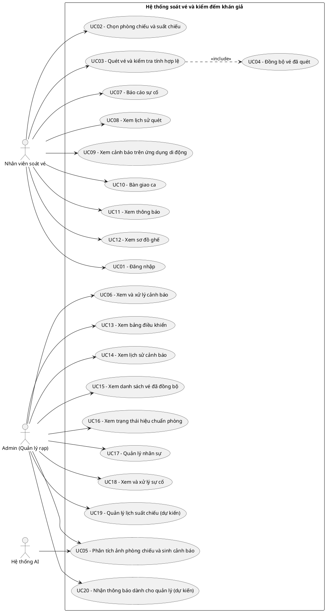

<!--
Bản v3 (làm lại từ v2). Commit hash khi kiểm chứng: e58f8ff (working tree có thay đổi chưa commit, xem mục G)
Ngày giờ kiểm chứng: 2026-10-10, 20:19–20:30 (giờ máy, UTC+7)
Máy kiểm chứng: AMD Ryzen 5 3500U (4 nhân / 8 luồng), RAM 13,9 GB, chạy CPU (không dùng GPU rời)
LƯU Ý: Chỉ phần A (từ "# PHÂN TÍCH YÊU CẦU" đến hết mục 2.6) được đưa vào Word. Các phần B–H là nội bộ.
-->

# PHÂN TÍCH YÊU CẦU

## 2.1. Khảo sát hiện trạng

Quy trình soát vé tại rạp chiếu phim hiện nay mang tính thủ công. Khán giả lấy vé giấy tại khu vực quầy, sau đó nhân viên soát vé kiểm tra lại vé một lần nữa tại cửa vào phòng chiếu trước khi cho khách vào rạp. Để kiểm đếm khán giả, nhân viên phải vào từng phòng chiếu đếm trực tiếp, rồi đối chiếu với số vé giấy đã được ghi nhận trên hệ thống (vé đã lấy được xem như khách đã vào rạp). Theo kinh nghiệm làm việc thực tế của tác giả tại rạp chiếu phim, quy trình này tồn tại nhiều rủi ro.

Hiện nay, việc soát vé và kiểm đếm khán giả còn gặp nhiều khó khăn như: một ca làm việc thường chỉ có một nhân viên soát vé phải đảm nhiệm đồng thời nhiều việc (kiểm tra phòng, soát vé, hướng dẫn khách ra về, dọn phòng sau suất chiếu); việc đếm khách bằng mắt thường trong phòng chiếu tối với số lượng ghế lớn dễ gây sai sót, đặc biệt khi khách rời chỗ tạm thời (đi vệ sinh, nghe điện thoại) đúng lúc nhân viên kiểm đếm; và một số khách cố tình gian lận như chuyển từ suất chiếu này sang suất chiếu khác để xem liên tục, hoặc lẻn vào phòng chiếu khi nhân viên vắng mặt, gây khó khăn cho việc quản lý minh bạch. Do đó, việc xây dựng hệ thống soát vé và kiểm đếm khán giả rạp chiếu phim ứng dụng thị giác máy tính trên ảnh hồng ngoại là cần thiết.

## 2.2. Yêu cầu chức năng

### 2.2.1. Chức năng của Admin (Quản lý rạp, sử dụng Web Admin)

- Xem bảng điều khiển thống kê số cảnh báo đang chờ xử lý theo loại (khách lậu, vắng mặt, vượt tải), tự động làm mới định kỳ.
- Tải ảnh phòng chiếu lên để chạy nhận diện thủ công và sinh cảnh báo.
- Xem danh sách cảnh báo đang chờ xử lý và đánh dấu đã xử lý.
- Xem lịch sử cảnh báo toàn hệ thống, lọc theo phòng, loại cảnh báo và trạng thái.
- Xem danh sách vé đã đồng bộ theo phòng chiếu và suất chiếu, tìm kiếm theo mã vé hoặc ghế.
- Xem trạng thái hiệu chuẩn (bản đồ ghế, ảnh hiệu chuẩn camera) của từng phòng chiếu.
- Xem và xử lý các sự cố do nhân viên báo cáo, có số sự cố đang chờ hiển thị trên thanh điều hướng.
- Quản lý tài khoản nhân viên (thêm, sửa, xóa).
- Quản lý lịch suất chiếu (dự kiến, chưa triển khai).
- Nhận thông báo dành cho quản lý về cảnh báo và sự cố (dự kiến, chưa triển khai; phạm vi chi tiết CẦN BỔ SUNG).

### 2.2.2. Chức năng của Nhân viên soát vé (sử dụng ứng dụng di động)

- Đăng nhập vào ứng dụng bằng tên đăng nhập và mật khẩu do quản lý cấp.
- Chọn phòng chiếu và suất chiếu cần soát vé.
- Quét mã QR trên vé và kiểm tra tính hợp lệ (đúng định dạng, đúng phòng, đúng suất, chưa quét trước đó).
- Lưu thông tin vé đã quét trên thiết bị và đồng bộ lên máy chủ.
- Xem lịch sử các vé đã quét theo phòng và suất chiếu.
- Xem sơ đồ ghế của phòng chiếu theo suất.
- Xem cảnh báo do hệ thống sinh ra và đánh dấu đã xử lý.
- Báo cáo sự cố (ghế hỏng, lỗi thiết bị, vệ sinh/cơ sở vật chất, khác).
- Xem danh sách sự cố đang chờ và đã khắc phục trong ca để bàn giao ca.
- Xem thông báo gồm cảnh báo và sự cố mới.

### 2.2.3. Chức năng của Hệ thống AI

- Tiếp nhận ảnh phòng chiếu được trích từ video hồng ngoại của camera giám sát và nhận diện vị trí đầu người trong ảnh.
- Ánh xạ vị trí đầu người nhận diện được sang mã ghế dựa trên bản đồ ghế của phòng chiếu.
- Đối chiếu tập ghế có người với tập ghế của các vé đã soát để sinh cảnh báo khách lậu (ghế có người nhưng không có vé) và vắng mặt (có vé nhưng ghế trống).
- Sinh cảnh báo vượt sức chứa khi số ghế có người vượt tổng số ghế của phòng.

## 2.3. Yêu cầu phi chức năng

| Loại yêu cầu | Mô tả |
| :--- | :--- |
| Hiệu năng | Đã đo: gọi API phân tích ảnh 10 lần với ảnh JPEG 1920x1080, thời gian phản hồi trung bình 2,76 giây, lớn nhất 3,41 giây, nhỏ nhất 2,19 giây (máy AMD Ryzen 5 3500U, RAM 13,9 GB, chạy CPU, mô hình YOLOv8n tinh chỉnh thử nghiệm best_v1.pt). Ảnh dùng để đo là ảnh mẫu có người phóng lên 1920x1080, chưa phải ảnh từ camera rạp. Chưa kiểm tra số người dùng đồng thời. |
| Bảo mật | Hiện trạng: mật khẩu nhân viên được lưu dạng văn bản thuần (chưa băm); API chưa yêu cầu xác thực (không dùng token) nên mọi máy khách gọi được các API quản lý, kể cả danh sách nhân viên; Web Admin chưa có đăng nhập; CORS cho phép mọi nguồn. Chưa có kiểm tra quyền theo vai trò ở máy chủ. Mục tiêu: băm mật khẩu, bổ sung xác thực và phân quyền ở giai đoạn sau. |
| Khả dụng | Ứng dụng di động lưu vé đã quét trên thiết bị (Hive) và gửi lên máy chủ ngay sau mỗi lần quét thành công; nếu gửi thất bại, vé được giữ lại và gửi lại ở lần quét tiếp theo. Chưa có nơi triển khai cố định (máy chủ đang chạy trên máy phát triển). CẦN ĐO độ sẵn sàng. Chưa kiểm tra giao diện Web Admin trên màn hình nhỏ. |
| Khả năng mở rộng | Hệ thống gồm ba thành phần tách biệt (ứng dụng di động Flutter, Web Admin React, máy chủ AI FastAPI) giao tiếp qua REST API. Danh mục loại sự cố và danh mục ca làm việc được máy chủ cung cấp qua API. Cơ sở dữ liệu SQLite hạn chế khi nhiều máy khách ghi đồng thời. Mỗi phòng chiếu cần một tệp bản đồ ghế riêng. |
| Độ chính xác nhận diện | Đã đo (tập kiểm tra 26 ảnh COCO128, 10 epoch, ảnh 320 px, epoch cuối): precision 0,333; recall 0,135; mAP@0.5 0,129; mAP@0.5:0.95 0,067. Chưa đo trên ảnh rạp hoặc ảnh hồng ngoại. Mục tiêu: mAP@0.5 khoảng 80–90% và sai số đếm ±1–2 người mỗi phòng. |
| Hoạt động ngoại tuyến | Ứng dụng di động vẫn quét và lưu vé khi mất kết nối; phát hiện vé trùng dựa trên lịch sử lưu trên chính thiết bị (không đối chiếu giữa các thiết bị). Các chức năng cần máy chủ (đăng nhập, danh sách phòng, cảnh báo, sự cố) không dùng được khi mất kết nối. |

Bảng 2.1. Yêu cầu phi chức năng

## 2.4. Product Backlog

| ID | User Story | Priority | Points | Sprint | Status |
| :--- | :--- | :--- | :--- | :--- | :--- |
| US01 | Là nhân viên soát vé, tôi muốn đăng nhập vào ứng dụng để bắt đầu ca làm việc | Must | 2 | 1 | Done |
| US02 | Là nhân viên soát vé, tôi muốn chọn phòng chiếu và suất chiếu để soát đúng suất | Must | 2 | 1 | In Progress |
| US03 | Là nhân viên soát vé, tôi muốn quét mã QR và biết ngay vé có hợp lệ hay không để cho khách vào đúng phòng | Must | 5 | 1 | In Progress |
| US04 | Là nhân viên soát vé, tôi muốn vé đã quét được lưu và gửi lên máy chủ để hệ thống có dữ liệu đối chiếu | Must | 3 | 1 | Done |
| US06 | Là hệ thống AI, tôi muốn nhận diện đầu người trong ảnh phòng chiếu để biết có người ngồi hay không | Must | 8 | 2 | In Progress |
| US07 | Là hệ thống AI, tôi muốn ánh xạ đầu người sang mã ghế để biết ghế nào có người | Must | 8 | 2 | In Progress |
| US08 | Là hệ thống AI, tôi muốn đối chiếu ghế có người với vé đã soát để sinh cảnh báo khách lậu và vắng mặt | Must | 8 | 2 | In Progress |
| US10 | Là admin, tôi muốn xem và đánh dấu đã xử lý các cảnh báo đang chờ để theo dõi và xử lý kịp thời | Must | 3 | 1 | Done |
| US11 | Là nhân viên soát vé, tôi muốn báo cáo sự cố để quản lý nắm được tình trạng phòng chiếu | Must | 2 | 1 | Done |
| ... | [Thêm các User Story khác - xem Phụ lục A] | ... | ... | ... | ... |

Bảng 2.2. Product Backlog (trích)

## 2.5. Use Case Diagram

[Chèn Hình 2.1 tại đây]

Hình 2.1. Use Case Diagram tổng quan hệ thống

## 2.6. Đặc tả Use Case

*(Ghi chú khi dán vào Word: bỏ dòng tiêu đề rỗng "| | |" ở đầu mỗi bảng.)*

### 2.6.1. Use Case: Đăng nhập

| | |
| :--- | :--- |
| Tên Use Case | UC01 - Đăng nhập |
| Actor | Nhân viên soát vé |
| Mô tả | Cho phép nhân viên đăng nhập vào ứng dụng di động bằng tài khoản do quản lý cấp |
| Tiền điều kiện | Nhân viên đã được quản lý tạo tài khoản; thiết bị kết nối được tới máy chủ |
| Luồng chính | 1. Nhân viên mở ứng dụng và nhập mã nhân viên/tên đăng nhập và mật khẩu 2. Ứng dụng gửi thông tin đến máy chủ 3. Máy chủ đối chiếu với danh sách nhân viên và trả về họ tên, vai trò, ca làm việc 4. Ứng dụng chuyển sang màn hình chính |
| Luồng ngoại lệ | 3a. Sai tên đăng nhập hoặc mật khẩu: máy chủ từ chối; ứng dụng hiển thị thông báo "Lỗi đăng nhập" và giữ nguyên màn hình đăng nhập 3b. Không kết nối được máy chủ: ứng dụng hiển thị thông báo "Lỗi đăng nhập" |
| Hậu điều kiện | Ứng dụng lưu thông tin nhân viên đang đăng nhập (đến khi đăng xuất) và hiển thị màn hình chính |

Bảng 2.3. Đặc tả Use Case Đăng nhập

### 2.6.2. Use Case: Chọn phòng chiếu và suất chiếu

| | |
| :--- | :--- |
| Tên Use Case | UC02 - Chọn phòng chiếu và suất chiếu |
| Actor | Nhân viên soát vé |
| Mô tả | Cho phép nhân viên chọn phòng và suất chiếu sẽ soát vé trong ca |
| Tiền điều kiện | Nhân viên đã đăng nhập (UC01) |
| Luồng chính | 1. Nhân viên mở màn hình chọn phòng chiếu; ứng dụng tải danh sách phòng từ máy chủ 2. Nhân viên chọn một phòng và xác nhận 3. Nhân viên mở màn hình chọn suất chiếu và chọn suất 4. Ứng dụng ghi nhận phòng và suất đã chọn để dùng cho màn hình quét vé |
| Luồng ngoại lệ | 1a. Không tải được danh sách phòng (mất kết nối): danh sách trống 3a. Máy chủ chưa có danh sách suất chiếu: ứng dụng chỉ hiển thị một suất mẫu cố định |
| Hậu điều kiện | Phòng và suất đã chọn được dùng làm bối cảnh cho UC03 |

Bảng 2.4. Đặc tả Use Case Chọn phòng chiếu và suất chiếu

### 2.6.3. Use Case: Quét vé và kiểm tra tính hợp lệ

| | |
| :--- | :--- |
| Tên Use Case | UC03 - Quét vé và kiểm tra tính hợp lệ |
| Actor | Nhân viên soát vé |
| Mô tả | Nhân viên quét mã QR trên vé để kiểm tra vé có hợp lệ với phòng và suất đang soát |
| Tiền điều kiện | Nhân viên đã đăng nhập; đã có phòng và suất đang soát |
| Luồng chính | 1. Nhân viên hướng camera điện thoại vào mã QR trên vé 2. Ứng dụng đọc nội dung mã (mã vé, phòng, suất, ghế) 3. Ứng dụng kiểm tra đủ thông tin, đúng phòng, đúng suất và vé chưa quét 4. Ứng dụng ghi vé vào lịch sử quét và danh sách chờ đồng bộ 5. Ứng dụng kích hoạt đồng bộ (UC04) và cập nhật bộ đếm vé đã soát |
| Luồng ngoại lệ | 2a. Mã QR không đúng định dạng: hiển thị "MÃ KHÔNG HỢP LỆ" 3a. Thiếu thông tin vé: hiển thị "MÃ KHÔNG HỢP LỆ" 3b. Sai phòng: hiển thị "VÉ SAI PHÒNG" 3c. Sai suất: hiển thị "VÉ SAI SUẤT" 3d. Vé đã quét trước đó trên thiết bị: hiển thị "VÉ ĐÃ QUÉT" kèm thời điểm quét |
| Hậu điều kiện | Vé hợp lệ được lưu trong lịch sử quét và danh sách chờ đồng bộ; vé không hợp lệ không được lưu |

Bảng 2.5. Đặc tả Use Case Quét vé và kiểm tra tính hợp lệ

### 2.6.4. Use Case: Đồng bộ vé đã quét

| | |
| :--- | :--- |
| Tên Use Case | UC04 - Đồng bộ vé đã quét |
| Actor | Nhân viên soát vé |
| Mô tả | Ứng dụng gửi các vé đã quét lên máy chủ để làm dữ liệu đối chiếu với kết quả nhận diện |
| Tiền điều kiện | Có vé đang chờ đồng bộ trên thiết bị |
| Luồng chính | 1. Sau mỗi lần quét thành công, ứng dụng lấy các vé đang chờ và nhóm theo (phòng, suất) 2. Ứng dụng gửi từng nhóm lên máy chủ 3. Máy chủ chuẩn hóa mã ghế, lưu vé và trả về thành công 4. Ứng dụng xóa các vé đã gửi thành công khỏi danh sách chờ; lịch sử quét vẫn được giữ lại |
| Luồng ngoại lệ | 2a. Mất kết nối hoặc máy chủ trả lỗi: các vé của nhóm đó vẫn nằm trong danh sách chờ và được gửi lại ở lần quét thành công tiếp theo |
| Hậu điều kiện | Vé đã gửi thành công có trong dữ liệu máy chủ theo (phòng, suất) và không còn trong danh sách chờ trên thiết bị |

Bảng 2.6. Đặc tả Use Case Đồng bộ vé đã quét

### 2.6.5. Use Case: Phân tích ảnh phòng chiếu và sinh cảnh báo

| | |
| :--- | :--- |
| Tên Use Case | UC05 - Phân tích ảnh phòng chiếu và sinh cảnh báo |
| Actor | Admin (tải ảnh), Hệ thống AI |
| Mô tả | Nhận diện vị trí đầu người trong ảnh phòng chiếu, ánh xạ sang mã ghế và đối chiếu với vé đã soát để sinh cảnh báo |
| Tiền điều kiện | Phòng chiếu đã có bản đồ ghế; đã có ảnh phòng chiếu trích từ video của camera; vé của suất đã được đồng bộ |
| Luồng chính | 1. Admin chọn phòng, chọn ảnh ở mục "Kiểm tra thủ công" trên Web Admin và chạy nhận diện 2. Web Admin gửi ảnh, mã phòng và mã suất đến máy chủ 3. Hệ thống AI nhận diện đầu người và lấy tọa độ tâm của từng đầu người 4. Hệ thống ánh xạ tọa độ sang mã ghế theo bản đồ ghế, được tập ghế có người 5. Hệ thống đối chiếu với tập ghế của vé đã soát, xác định khách lậu, vắng mặt và kiểm tra vượt sức chứa 6. Hệ thống lưu các cảnh báo mới (bỏ qua cảnh báo trùng chưa xử lý) và trả kết quả cho Web Admin |
| Luồng ngoại lệ | 3a. Phòng chưa có bản đồ ghế: máy chủ trả lỗi "Chưa có bản đồ ghế cho phòng" 1a. Admin chưa chọn ảnh: Web Admin yêu cầu chọn ảnh 2a. Máy chủ không phản hồi: Web Admin hiển thị lỗi AI |
| Hậu điều kiện | Chỉ các cảnh báo (khách lậu, vắng mặt, vượt tải) được lưu vào cơ sở dữ liệu; số ghế có người và ghế trống không được lưu riêng, chỉ có trong kết quả trả về |

Bảng 2.7. Đặc tả Use Case Phân tích ảnh phòng chiếu và sinh cảnh báo

### 2.6.6. Use Case: Xem và xử lý cảnh báo

| | |
| :--- | :--- |
| Tên Use Case | UC06 - Xem và xử lý cảnh báo |
| Actor | Admin |
| Mô tả | Admin xem các cảnh báo đang chờ trên Bảng điều khiển và đánh dấu đã xử lý |
| Tiền điều kiện | Có thể truy cập Web Admin (hiện chưa yêu cầu đăng nhập) |
| Luồng chính | 1. Admin mở "Bảng điều khiển" 2. Web Admin tải danh sách cảnh báo đang chờ và tự làm mới định kỳ 3. Admin xem loại cảnh báo (khách lậu, vắng mặt, vượt tải), phòng, suất, ghế 4. Admin nhấn "Đánh dấu đã xử lý" ở một cảnh báo 5. Máy chủ cập nhật trạng thái; cảnh báo biến mất khỏi danh sách chờ |
| Luồng ngoại lệ | 2a. Không tải được cảnh báo: danh sách giữ nguyên dữ liệu cũ 4a. Cập nhật thất bại: hiển thị thông báo "Không thể giải quyết" |
| Hậu điều kiện | Cảnh báo được đánh dấu đã xử lý trong cơ sở dữ liệu |

Bảng 2.8. Đặc tả Use Case Xem và xử lý cảnh báo

### 2.6.7. Use Case: Báo cáo sự cố

| | |
| :--- | :--- |
| Tên Use Case | UC07 - Báo cáo sự cố |
| Actor | Nhân viên soát vé |
| Mô tả | Nhân viên báo cáo sự cố tại phòng chiếu (ghế hỏng, lỗi thiết bị, vệ sinh/cơ sở vật chất, khác) lên hệ thống |
| Tiền điều kiện | Nhân viên đã đăng nhập |
| Luồng chính | 1. Nhân viên mở màn hình báo sự cố (có thể từ sơ đồ ghế khi báo ghế hỏng) 2. Nhân viên chọn loại sự cố, mức độ, nhập tiêu đề, mô tả và ghế liên quan (nếu có) 3. Ứng dụng gửi báo cáo kèm thông tin người báo đến máy chủ 4. Máy chủ kiểm tra loại sự cố, định dạng suất và mã ghế, xác định ca của người báo, lưu sự cố với trạng thái chờ xử lý 5. Ứng dụng thông báo gửi thành công |
| Luồng ngoại lệ | 4a. Loại sự cố không hợp lệ: máy chủ từ chối với thông báo "Loại sự cố không hợp lệ" 4b. Mã ghế sai định dạng: máy chủ từ chối với thông báo "Mã ghế không hợp lệ" 4c. Định dạng suất sai: máy chủ từ chối 3a. Mất kết nối: ứng dụng hiển thị thông báo lỗi kết nối máy chủ |
| Hậu điều kiện | Sự cố được lưu với trạng thái chờ xử lý, hiển thị cho nhân viên (bàn giao ca) và cho Admin |

Bảng 2.9. Đặc tả Use Case Báo cáo sự cố

---

# PHẦN NỘI BỘ (KHÔNG ĐƯA VÀO WORD)

## A. Phụ lục A: Product Backlog đầy đủ

Points và Sprint: đã được phân bổ thành 3 Sprint, mốc 2-5-8 điểm. Định nghĩa Status dùng trong bảng này ở mục D.

| ID | User Story | Priority | Points | Sprint | Status |
| :--- | :--- | :--- | :--- | :--- | :--- |
| US01 | Là nhân viên soát vé, tôi muốn đăng nhập vào ứng dụng để bắt đầu ca làm việc | Must | 2 | 1 | Done |
| US02 | Là nhân viên soát vé, tôi muốn chọn phòng chiếu và suất chiếu để soát đúng suất | Must | 2 | 1 | In Progress |
| US03 | Là nhân viên soát vé, tôi muốn quét mã QR và biết ngay vé có hợp lệ hay không để cho khách vào đúng phòng | Must | 5 | 1 | In Progress |
| US04 | Là nhân viên soát vé, tôi muốn vé đã quét được lưu và gửi lên máy chủ để hệ thống có dữ liệu đối chiếu | Must | 3 | 1 | Done |
| US05 | Là admin, tôi muốn tải ảnh phòng chiếu lên để chạy nhận diện thủ công và nhận cảnh báo | Must | 3 | 2 | In Progress |
| US06 | Là hệ thống AI, tôi muốn nhận diện đầu người trong ảnh phòng chiếu để biết có người ngồi hay không | Must | 8 | 2 | In Progress |
| US07 | Là hệ thống AI, tôi muốn ánh xạ đầu người sang mã ghế để biết ghế nào có người | Must | 8 | 2 | In Progress |
| US08 | Là hệ thống AI, tôi muốn đối chiếu ghế có người với vé đã soát để sinh cảnh báo khách lậu và vắng mặt | Must | 8 | 2 | In Progress |
| US09 | Là hệ thống AI, tôi muốn sinh cảnh báo vượt sức chứa để quản lý biết phòng quá tải | Should | 3 | 2 | In Progress |
| US10 | Là admin, tôi muốn xem và đánh dấu đã xử lý các cảnh báo đang chờ để theo dõi và xử lý kịp thời | Must | 3 | 1 | Done |
| US11 | Là nhân viên soát vé, tôi muốn báo cáo sự cố để quản lý nắm được tình trạng phòng chiếu | Must | 2 | 1 | Done |
| US12 | Là nhân viên soát vé, tôi muốn xem lịch sử các vé đã quét để kiểm tra lại số vé đã soát | Should | 2 | 1 | In Progress |
| US13 | Là nhân viên soát vé, tôi muốn xem cảnh báo và đánh dấu đã xử lý để xử lý các trường hợp bất thường | Should | 2 | 1 | Done |
| US14 | Là nhân viên soát vé, tôi muốn xem sự cố đang chờ và đã khắc phục trong ca để bàn giao ca | Should | 2 | 1 | Done |
| US15 | Là nhân viên soát vé, tôi muốn xem thông báo cảnh báo và sự cố mới để nắm tình hình kịp thời | Could | 2 | 1 | Done |
| US16 | Là nhân viên soát vé, tôi muốn xem sơ đồ ghế của phòng chiếu để biết ghế đã soát và ghế báo hỏng | Could | 5 | 1 | In Progress |
| US17 | Là admin, tôi muốn xem bảng điều khiển thống kê cảnh báo để nắm tình hình tổng quan | Must | 5 | 1 | Done |
| US18 | Là admin, tôi muốn xem lịch sử cảnh báo có bộ lọc để tra cứu các sự việc đã xảy ra | Should | 3 | 1 | In Progress |
| US19 | Là admin, tôi muốn xem danh sách vé đã đồng bộ theo phòng và suất để đối chiếu số vé đã soát | Must | 2 | 1 | Done |
| US20 | Là admin, tôi muốn xem trạng thái hiệu chuẩn của phòng chiếu để biết phòng nào sẵn sàng chạy nhận diện | Should | 5 | 2 | In Progress |
| US21 | Là admin, tôi muốn thêm, sửa, xóa tài khoản nhân viên để quản lý nhân sự | Must | 2 | 1 | Done |
| US22 | Là admin, tôi muốn xem và xử lý sự cố do nhân viên báo để khắc phục kịp thời | Should | 3 | 1 | In Progress |
| US23 | Là admin, tôi muốn quản lý lịch suất chiếu của các phòng để hệ thống có danh sách suất thật | Should | 5 | 3 | To Do |
| US24 | Là quản lý rạp, tôi muốn nhận thông báo về cảnh báo và sự cố để xử lý kịp thời | Should | 3 | 3 | To Do |

---

## B. Mã PlantUML Hình 2.1

Xuất hình PNG độ phân giải cao: (1) dán mã vào https://www.planttext.com hoặc PlantUML Server, chọn xuất PNG; hoặc (2) chạy cục bộ `java -jar plantuml.jar -tpng -Sdpi=300 usecase.puml` (cần Java và Graphviz); sau đó chèn ảnh vào vị trí "[Chèn Hình 2.1 tại đây]" trong Word. Tệp `docs/usecase_diagram.png` hiện có kích thước 0 byte, chưa phải hình thật.

Ghi chú: UC03 → UC04 là quan hệ include có thật (ứng dụng gọi đồng bộ ngay sau khi quét thành công, `scanner_screen.dart:135`). UC04 không gắn actor trực tiếp vì nó được kích hoạt tự động từ UC03. Không vẽ quan hệ extend/kế thừa vì chưa có trong hệ thống.

---

## C. Bảng kiểm chứng

Quy ước: mỗi khẳng định → bằng chứng. Nhãn: ĐÃ CHẠY THẬT (output lệnh trong lượt này) / ĐÃ ĐỌC CODE (chưa chạy) / DỮ LIỆU GIẢ / KHÔNG TỒN TẠI.

### C.1. Khẳng định trong nội dung Word

| Khẳng định | Nhãn | Bằng chứng |
| :--- | :--- | :--- |
| Login đúng trả thông tin nhân viên; sai trả lỗi | ĐÃ CHẠY THẬT | `POST /api/v1/login` tài khoản test tạm: đúng → `HTTP 200 {"status":"success","user":{"id":6,"name":"NV Test","role":"staff","shift":"ca_sang","shift_label":"Ca sáng"}}`; sai → `HTTP 401 {"error":"Tài khoản hoặc mật khẩu không chính xác"}` |
| Ứng dụng báo "Lỗi đăng nhập" khi thất bại | ĐÃ ĐỌC CODE | `cs_login_screen.dart:128-130` (SnackBar "Lỗi đăng nhập"); `api_client.dart:27-30` trả false khi lỗi/401. Ô nhập ghi "Mã nhân viên / Username" (`cs_login_screen.dart:82`) |
| Phòng chọn từ API thật | ĐÃ CHẠY THẬT + ĐỌC CODE | `GET /api/v1/rooms` → `{"room_id":"seats_config_room1","total_seats":1,"is_calibrated":false,...}`; `cs_rooms_screen.dart:29` gọi `ApiClient.fetchRooms()` |
| Suất chiếu chỉ là 1 suất mẫu cố định | DỮ LIỆU GIẢ | `cs_showtimes_screen.dart:16-21`: `mockShowtime = {'id':'2026-09-25T19:30','movie_name':'Suất chiếu mẫu'}`; `home_screen.dart:31-34` mặc định `room1` / `2026-09-25T19:30`. Backend không có bảng showtimes (xem C.3) |
| 5 nhánh kiểm tra khi quét | ĐÃ ĐỌC CODE | `scanner_screen.dart:68` (parse JSON), `:70-81` (thiếu trường → "MÃ KHÔNG HỢP LỆ"), `:83-93` ("VÉ SAI PHÒNG"), `:95-105` ("VÉ SAI SUẤT"), `:112-123` ("VÉ ĐÃ QUÉT"), `:152-156` (lỗi parse → "LỖI ĐỊNH DẠNG" / "MÃ KHÔNG HỢP LỆ"). Chưa chạy trên thiết bị |
| Việc kiểm tra không đối chiếu danh sách vé bán ra | ĐÃ ĐỌC CODE | Logic chỉ dựa vào nội dung QR và lịch sử Hive cục bộ (`HiveService.findScanRecord`, `scanner_screen.dart:112`); không gọi máy chủ khi quét |
| Đồng bộ chỉ kích hoạt sau khi quét thành công | ĐÃ ĐỌC CODE | `ApiClient.syncTicketsToServer` chỉ có một chỗ gọi: `scanner_screen.dart:135` (grep `syncTicketsToServer` trong `mobile_app`). Không có timer/kết nối nền |
| Đồng bộ nhóm theo (phòng, suất); xóa vé chờ sau khi 200; giữ lịch sử | ĐÃ ĐỌC CODE | `api_client.dart:50-80` (nhóm), `:93-97` (200 → thêm vào danh sách đã gửi), `:108-110` → `HiveService.clearTicketsAfterSync`; lịch sử nằm ở box riêng `scan_history_box` (`hive_service.dart:51,64-66`) |
| Máy chủ nhận và lưu vé | ĐÃ CHẠY THẬT | `POST /api/v1/sync_tickets` → `HTTP 200 {"status":"success","message":"Đã lưu 2 vé cho phòng room1, suất 2099-01-01T00:00"}`; `GET /api/v1/tickets` trả 2 vé, ghế chuẩn hóa `A01`, `A02` |
| Phân tích ảnh chạy được; hiệu năng 10 lần | ĐÃ CHẠY THẬT | `POST /api/v1/analyze` ×10, ảnh 1920x1080: 2,802 / 3,414 / 2,236 / 3,223 / 3,157 / 2,185 / 2,709 / 2,566 / 2,531 / 2,726 s; trung bình 2,755 s, lớn nhất 3,414 s, nhỏ nhất 2,185 s. Cấu hình máy: AMD Ryzen 5 3500U, 4 nhân/8 luồng, RAM 13,9 GB, CPU. Ảnh = ảnh COCO val `000000000544` (nhãn có 13 người, gốc 640x427) phóng lên 1920x1080 — KHÔNG phải ảnh rạp |
| Mô hình hiện không đáng tin | ĐÃ CHẠY THẬT | Cùng ảnh thử có 13 người (nhãn), `total_detected_people = 0` với ngưỡng `conf=0.4` (`main.py:91`). Phản hồi: `{"total_seats":1,"total_detected_people":0,"tap_A_from_app":["A01","A02"],"tap_B_from_camera":[]},"alerts":{"illegal_occupants":[],"missing_guests":["A01","A02"],"over_capacity":false}` |
| Mô hình đang load là best_v1.pt | ĐÃ ĐỌC CODE | `main.py:353-354` |
| best_v1.pt là bản huấn luyện thử (placeholder) | ĐÃ ĐỌC CODE + ĐÃ CHẠY | `train_v1.py`: model nền `yolov8n.pt`, `epochs=10`, `imgsz=320`, `batch=4`, `device='cpu'`, tên "Bản V1 Placeholder"; `runs/detect/head_detect_v1-2/args.yaml` xác nhận; dữ liệu `dataset.yaml` trỏ `datasets/images` (102 ảnh train, 26 ảnh val, nhãn 100/26 tệp; tên COCO, `names: {0: head}`); `coco128.zip` có trong thư mục |
| Chỉ số đã đo | ĐÃ ĐỌC | `runs/detect/head_detect_v1-2/results.csv` dòng epoch 10: precision 0,33317; recall 0,13514; mAP50 0,12914; mAP50-95 0,06705 (tập val 26 ảnh COCO, không phải ảnh rạp) |
| Bản đồ ghế phòng 1 là cấu hình giả | DỮ LIỆU GIẢ | `seats_configs/seats_config_room1.json` = `{"A1": [[0,0],[100,0],[100,100],[0,100]]}` (1 ghế, ô 100x100 px); thư mục `calibration_images` rỗng; `/api/v1/rooms` báo `is_calibrated:false` |
| Ánh xạ đầu người → ghế bằng tọa độ tâm khung | ĐÃ ĐỌC CODE | `main.py:94-95` (tâm khung), `seat_mapper.py:52-65` (`pointPolygonTest`) |
| Cảnh báo khách lậu / vắng mặt sinh và lưu | ĐÃ CHẠY THẬT | Sau `analyze`: `GET /api/v1/alerts` có `missing_guest` ghế A01, A02 (suất test) |
| Cảnh báo vượt sức chứa gần như không thể kích hoạt | ĐÃ ĐỌC CODE | `seat_mapper.py:75`: `over_capacity = len(set_B) > total_seats`, trong đó `set_B` là tập mã ghế (tập con của các ghế trong bản đồ) nên luôn ≤ tổng ghế. Số người nhận diện (`total_detected_people`) không được dùng để so sánh. Chưa có test chạy |
| Cảnh báo chỉ lưu theo ghế, không lưu số ghế có người/trống | ĐÃ ĐỌC CODE + SCHEMA | Bảng `alerts(id, room_id, show_id, alert_type, seat_id, timestamp, resolved)`; `main.py:100-105` |
| Bỏ qua cảnh báo trùng chưa xử lý | ĐÃ ĐỌC CODE | `database.py` hàm `save_alerts` (kiểm tra tồn tại trước khi chèn) |
| Đánh dấu đã xử lý cảnh báo | ĐÃ CHẠY THẬT | `POST /api/v1/resolve_alert/7` → `HTTP 200`; `GET /alerts/history?room_id=room1` → cảnh báo id 7 `resolved:1`, id 8 `resolved:0`. `Dashboard.jsx:76-83` gọi đúng endpoint |
| Bảng điều khiển: số cảnh báo theo loại, làm mới 5 giây | ĐÃ ĐỌC CODE | `Dashboard.jsx:58-62` (`setInterval(getAlerts, 5000)`), `:85-88` (đếm theo `alert_type`); chỉ phản ánh cảnh báo đang chờ, không phải thống kê trong ngày hay đối chiếu |
| Tải ảnh thủ công trên Web | ĐÃ ĐỌC CODE | `Dashboard.jsx:114-134`: chọn phòng (`room1`, `room2` cố định), chọn ảnh, gọi `analyzeRoom`; mã suất cố định trong state `'2026-10-05T19:30'` (`:8`), không có ô nhập suất |
| Sự cố: tạo, xem, xử lý | ĐÃ CHẠY THẬT | `POST /api/v1/incidents` → `HTTP 200 {"id":15,"shift_label":"Ca sáng",...}`; `GET /incidents/15` → `status:"open"`; xử lý bằng payload của mobile `{resolver_id, resolver_name}` → `HTTP 200`; `GET /incident_categories` trả 4 loại |
| Sự cố: kiểm tra đầu vào | ĐÃ ĐỌC CODE | `main.py:271-284` ("Loại sự cố không hợp lệ", định dạng `show_id`, "Mã ghế ... không hợp lệ") |
| Quản lý nhân sự | ĐÃ CHẠY THẬT | `POST /employees` → 200; `PUT /employees/7` → 200; `POST` trùng username → `HTTP 400 {"error":"UNIQUE constraint failed: employees.username"}`; `DELETE` → 200. `Employees.jsx` gọi 4 hàm tương ứng |
| Mật khẩu lưu văn bản thuần | ĐÃ ĐỌC CODE + ĐÃ CHẠY | `main.py:230` so sánh `password=?` trực tiếp; `GET /api/v1/employees` (không có token) trả trường `password` ở dạng thuần cho mọi nhân viên (không ghi lại giá trị trong tài liệu) |
| API không xác thực; CORS mở | ĐÃ CHẠY THẬT | Các lệnh gọi trên đều không gửi token vẫn thành công; `OPTIONS /api/v1/alerts` với `Origin: http://evil.example` → `HTTP 200`, `access-control-allow-origin: http://evil.example`; `main.py:35-41` (`allow_origins=['*']`) |
| Web Admin không có đăng nhập | ĐÃ ĐỌC CODE | `App.jsx`: không có trang đăng nhập; thư mục `web_admin/src/pages` gồm Alerts, Dashboard, Employees, Incidents, Rooms, Settings, Tickets. `Incidents.jsx:79` hỏi tên người xử lý bằng hộp thoại "Hệ thống chưa có đăng nhập" |
| Danh mục loại sự cố, ca từ backend | ĐÃ CHẠY THẬT | `GET /incident_categories`, `GET /shifts` trả dữ liệu từ `main.py:23-33` |
| Chưa có nơi triển khai cố định | ĐÃ ĐỌC CODE | `cineSightApi.js:4` (`http://localhost:8000`), `api_client.dart:12` (địa chỉ tunnel cấu hình cứng; không ghi lại URL trong tài liệu) |
| Hoạt động ngoại tuyến: vé trùng chỉ dựa trên thiết bị | ĐÃ ĐỌC CODE | `scanner_screen.dart:112` + `hive_service.dart:70-74` |
| Xem lịch sử quét | ĐÃ ĐỌC CODE | `cs_scan_history_screen.dart:29` (`HiveService.getScanHistory`); file có tạo đối tượng `CSMockMovie` chỉ để truyền phòng/suất cho giao diện |
| Xem cảnh báo / xử lý trên mobile | ĐÃ ĐỌC CODE + ĐÃ CHẠY | `cs_warning_screen.dart:34` (`fetchAlerts`), `cs_warning_detail_screen.dart:43` (`resolveAlert`); endpoint đã chạy thật ở dòng trên. Nút "Bỏ qua tất cả" chỉ hiện SnackBar (`home_screen.dart:164-166`) nên không đưa vào chức năng |
| Báo sự cố, bàn giao ca, thông báo trên mobile gọi API thật | ĐÃ ĐỌC CODE | `cs_add_incident_screen.dart:72` (`createIncident`), `cs_handover_screen.dart:27,181` (`getIncidents`, `resolveIncident`), `cs_notification_screen.dart:82-83` (`fetchAlerts`, `getIncidents`); `grep Mock\|mock_data` không có trong các màn này (ngoại trừ showtimes và wrapper ở scan history) |
| "Bàn giao ca" là danh sách sự cố, không có bản ghi bàn giao | ĐÃ ĐỌC CODE | `cs_handover_screen.dart:38-39,60-99` (chỉ nhóm sự cố chờ/đã khắc phục); không có API lưu bản ghi bàn giao |
| Sơ đồ ghế | ĐÃ ĐỌC CODE | `cs_seat_map_screen.dart:37,45` (đọc vé và sự cố thật); `:68` "Tạm tính" cho tỉ lệ lấp đầy; dòng `:134-136` truyền danh sách cảnh báo/ghế hỏng rỗng |
| Admin xem danh sách vé | ĐÃ CHẠY THẬT + ĐỌC CODE | `GET /api/v1/tickets` đã chạy; `Tickets.jsx:19`. Phòng (`room1`, `room2`) và suất (3 giá trị) là danh sách cố định trong giao diện (`:63-72`) |

### C.2. Căn cứ Status từng User Story

Quy ước Status: **Done** = endpoint tương ứng đã chạy thật trong lượt này với dữ liệu test, đã đọc code giao diện/ứng dụng gọi đúng endpoint và payload, và không có thành phần giả. **In Progress** = có giao diện/logic nhưng có dữ liệu giả, lỗi đã xác nhận hoặc chưa kiểm chứng đủ. **To Do** = chưa có. Lưu ý: giao diện Web và ứng dụng di động chưa được chạy trên trình duyệt/thiết bị trong lượt này.

| ID | Status | Căn cứ |
| :--- | :--- | :--- |
| US01 | Done | Login đúng/sai đã chạy (C.1) |
| US02 | In Progress | Phòng thật nhưng `room_id` trả về là `seats_config_room1` (xem phát hiện F1); suất là dữ liệu giả cố định |
| US03 | In Progress | Logic đọc code đủ 5 nhánh, chưa chạy trên thiết bị; chưa đối chiếu với danh sách vé thật; rủi ro sai phòng khi chọn phòng từ danh sách (F1) |
| US04 | Done | `sync_tickets` + `tickets` đã chạy thật; logic nhóm/xóa đã đọc code |
| US05 | In Progress | Gọi `analyze` được nhưng mã suất cố định, phòng cố định; phụ thuộc chất lượng AI |
| US06 | In Progress | Mô hình thử nghiệm, mAP@0.5 = 0,129 trên COCO128; không phát hiện người trên ảnh thử |
| US07 | In Progress | Bản đồ ghế giả (1 ghế), `calibration_images` rỗng |
| US08 | In Progress | Chạy được và lưu cảnh báo, nhưng dựa trên bản đồ ghế giả và nhận diện chưa tin cậy |
| US09 | In Progress | Code có nhưng điều kiện `len(set_B) > total_seats` không thể xảy ra (F4) |
| US10 | Done | `resolve_alert` + lịch sử xác nhận `resolved:1` đã chạy |
| US11 | Done | `POST /incidents` + `GET /incidents/{id}` đã chạy; màn hình mobile gọi API thật |
| US12 | In Progress | Chỉ đọc code (dữ liệu cục bộ Hive), chưa chạy |
| US13 | Done | Endpoint đã chạy; màn hình gọi API thật |
| US14 | Done | `GET /incidents` + resolve bằng payload mobile đã chạy |
| US15 | Done | Hai endpoint nguồn đã chạy; màn hình gọi API thật |
| US16 | In Progress | Ghế báo hỏng không hiển thị do sai kiểu dữ liệu (F5); phần trăm lấp đầy là "tạm tính" |
| US17 | Done | Đếm theo `alert_type` từ `/alerts` đã chạy; xem lưu ý chỉ là cảnh báo đang chờ |
| US18 | In Progress | Trang gửi `room_id=ALL&alert_type=ALL` làm danh sách rỗng (F2); nút "Xử lý ngay" chưa có hành động |
| US19 | Done | `GET /tickets` đã chạy; `Tickets.jsx` gọi đúng |
| US20 | In Progress | `GET /rooms` đã chạy nhưng cho thấy `room_id` là `seats_config_room1`, ảnh hiệu chuẩn không có |
| US21 | Done | POST/PUT/DELETE đã chạy thật với tài khoản test |
| US22 | In Progress | Xem được; nút xử lý của Web gửi `{resolver}` bị máy chủ từ chối `HTTP 422` (F3) |
| US23 | To Do | Backend không có bảng suất chiếu / API suất chiếu |
| US24 | To Do | Chưa có cơ chế thông báo cho quản lý ngoài trang xem sự cố (phạm vi CẦN BỔ SUNG) |

### C.3. Kiểm tra backend về suất chiếu

Schema `cinesight.db` hiện có các bảng `tickets`, `alerts`, `configs`, `employees`, `incidents` (đã chạy `SELECT sql FROM sqlite_master`). Không có bảng suất chiếu. Không có endpoint suất chiếu trong `main.py`.

### C.4. Dữ liệu đã dùng để kiểm chứng và việc dọn dẹp

- Sao lưu `cinesight.db` ra `C:\Users\Dell KIM ANH\.gemini\antigravity\scratch\bk\cinesight_20261010_2020.db` (ngoài thư mục dự án) trước khi chạy.
- Dữ liệu test: phòng `room1`, suất `2099-01-01T00:00`, vé `ZZTEST-1/2`, sự cố "ZZTEST su co", nhân viên `zz_test_tmp` và `zz_test_crud`. Đã xóa; kiểm tra lại: tickets 8, alerts 2, incidents 2, employees 4 (bằng số lượng trước khi chạy), không còn cảnh báo suất `2099-01-01T00:00`.
- Còn lại 2 cảnh báo (id 5, 6; phòng `room1`, suất `2026-09-25T19:30`, `missing_guest` ghế A01, A02, thời điểm 19:38 hôm nay). Hai cảnh báo này phát sinh từ lần chạy `analyze` thử ở lượt làm việc trước của tôi, không phải do lượt này. Chưa xóa, chờ bạn quyết định.
- Bộ đếm tự tăng của SQLite (id sự cố, id nhân viên, id cảnh báo) đã tăng do dữ liệu test.
- Đã xóa tệp `dummy.jpg` do tôi tạo ở lượt trước (còn sót ở thư mục gốc dự án).

---

## D. Truy vết: chức năng (2.2) ↔ User Story (2.4/PL A) ↔ Use Case (2.5/2.6)

| Chức năng ở 2.2 | User Story | Use Case |
| :--- | :--- | :--- |
| 2.2.1 Xem bảng điều khiển | US17 | UC13 |
| 2.2.1 Tải ảnh chạy nhận diện thủ công | US05 | UC05 |
| 2.2.1 Xem/đánh dấu cảnh báo đang chờ | US10 | UC06 |
| 2.2.1 Xem lịch sử cảnh báo | US18 | UC14 |
| 2.2.1 Xem danh sách vé | US19 | UC15 |
| 2.2.1 Xem trạng thái hiệu chuẩn | US20 | UC16 |
| 2.2.1 Xem và xử lý sự cố | US22 | UC18 |
| 2.2.1 Quản lý tài khoản nhân viên | US21 | UC17 |
| 2.2.1 Quản lý lịch suất chiếu (dự kiến) | US23 | UC19 |
| 2.2.1 Nhận thông báo cho quản lý (dự kiến) | US24 | UC20 |
| 2.2.2 Đăng nhập | US01 | UC01 |
| 2.2.2 Chọn phòng, suất | US02 | UC02 |
| 2.2.2 Quét vé, kiểm tra hợp lệ | US03 | UC03 |
| 2.2.2 Lưu và đồng bộ vé | US04 | UC04 |
| 2.2.2 Xem lịch sử quét | US12 | UC08 |
| 2.2.2 Xem sơ đồ ghế | US16 | UC12 |
| 2.2.2 Xem cảnh báo và xử lý | US13 | UC09 |
| 2.2.2 Báo sự cố | US11 | UC07 |
| 2.2.2 Xem sự cố để bàn giao ca | US14 | UC10 |
| 2.2.2 Xem thông báo | US15 | UC11 |
| 2.2.3 Nhận diện đầu người | US06 | UC05 |
| 2.2.3 Ánh xạ ghế | US07 | UC05 |
| 2.2.3 Đối chiếu, sinh cảnh báo | US08 | UC05 |
| 2.2.3 Cảnh báo vượt sức chứa | US09 | UC05 |

Đã kiểm tra: mỗi UC được đặc tả (UC01–UC07) có ít nhất một US (UC01: US01; UC02: US02; UC03: US03; UC04: US04; UC05: US05–US09; UC06: US10; UC07: US11); mỗi US thuộc ít nhất một chức năng ở 2.2. Thuật ngữ thống nhất: "vé đã soát/vé đã quét", "ghế có người", "cảnh báo".

---

## E. Bảng thay đổi v2 → v3 (đối chiếu các lỗi của v2)

| Mục | Sửa | Lý do |
| :--- | :--- | :--- |
| Tệp | Bản v2 trong `docs/` là bản có lỗi; `CHAPTER2_CONTENT.md` không có trên đĩa khi kiểm tra nên tạo lại từ đầu thành bản v3 này. Không sửa v1, v2 | Tránh ghi đè nhầm; tôi không giải thích được vì sao tệp v3 ghi ở lượt trước không còn |
| 2.1 | Viết lại chỉ từ ghi chú của bạn; bỏ câu "ảnh camera thường chụp trước giờ chiếu" và "ngăn chặn thất thoát"; không nêu tên rạp, không nêu số liệu | v2 tự suy diễn; câu cuối dùng đúng "ảnh hồng ngoại" theo đề tài |
| 2.2.1 | Bỏ "Quản lý suất chiếu" khỏi chức năng đã có (chuyển thành "dự kiến" gắn nhãn); bỏ "Quản lý phòng chiếu (CRUD)" thành "Xem trạng thái hiệu chuẩn"; thêm cảnh báo vượt tải, lịch sử cảnh báo, hiệu chuẩn, sự cố | Web chỉ xem trạng thái phòng; không có API suất chiếu |
| 2.2.2 | Đồng bộ mô tả đúng cơ chế: gửi sau mỗi lần quét, giữ lại và gửi lại ở lần quét sau (v2 viết "tự động khi có kết nối mạng"); thêm sơ đồ ghế, lịch sử quét, thông báo | `syncTicketsToServer` chỉ được gọi tại `scanner_screen.dart:135` |
| 2.2.3 | Actor "Hệ thống AI" (không còn "Camera tự động"); ghi nguồn ảnh là ảnh trích từ video hồng ngoại theo mô tả của bạn | Hiện Admin tải ảnh thủ công; camera tự động chưa có |
| 2.3 Hiệu năng | v2 ghi 2,46 giây với tệp 6 MB không phải ảnh thật (5 lần). v3: 10 lần, ảnh JPEG 1920x1080 có người, 2,76 s trung bình / 3,41 s lớn nhất, kèm cấu hình máy, nêu rõ ảnh chưa phải ảnh rạp | Đo lại theo yêu cầu |
| 2.3 Bảo mật | Bổ sung: không xác thực API, Web chưa đăng nhập, CORS mở, API trả mật khẩu | Báo đúng hiện trạng |
| 2.3 Khả năng mở rộng | Bỏ câu về quản lý kho và lịch suất chiếu; thay bằng kiến trúc 3 thành phần, danh mục từ backend, giới hạn SQLite | Có bằng chứng |
| 2.3 | Thêm hàng "Độ chính xác nhận diện" (số đã đo + mục tiêu) và "Hoạt động ngoại tuyến" | Theo khuôn mẫu đã yêu cầu |
| 2.4 | Bỏ cột Sprint "Tháng 10/2026…" tự gán; Points và Sprint để "—"; Status theo bằng chứng (US02, US03, US06–US08 là In Progress; US07 v2 ghi Done là sai) | Bạn chưa cung cấp sprint/points |
| 2.5 | Giữ vị trí hình; không chèn ảnh; tệp `usecase_diagram.png` 0 byte | Hình chưa tồn tại |
| 2.6 | Thêm tiêu đề "### 2.6.x. Use Case: <tên>"; hàng đầu "Tên Use Case \| UCxx - <tên>"; đủ 7 hàng; caption "Bảng 2.x" đặt SAU bảng | Đúng khuôn mẫu |
| UC01 | Định danh là mã nhân viên/tên đăng nhập; thông báo lỗi trên app là "Lỗi đăng nhập" (v2 trích thông báo máy chủ, không hiển thị trên app) | `cs_login_screen.dart:128-130` |
| UC03 | Có nhánh "mã QR không đúng định dạng" và 5 nhánh thật | `scanner_screen.dart` |
| UC04 | Bỏ "trạng thái đã đồng bộ"; thay bằng "xóa vé chờ, giữ lịch sử" | `clearTicketsAfterSync` |
| UC05 | Admin tải ảnh ở "Kiểm tra thủ công"; "đầu người" thay cho "khuôn mặt"; thêm vượt sức chứa; hậu điều kiện chỉ ghi cảnh báo được lưu | `Dashboard.jsx`, `main.py` |
| UC06 | Ghi đúng trang là "Bảng điều khiển" (trang "Cảnh báo" chỉ xem lịch sử, nút xử lý chưa hoạt động); bỏ "(resolved = 1)" | `Dashboard.jsx:76-83`, `Alerts.jsx:160` |
| PlantUML | ID trùng UC01–UC20; có UC chọn phòng/suất, lịch sử quét; tách "xem cảnh báo" và "bàn giao ca"; chỉ có quan hệ include thật (UC03→UC04); hệ thống AI gắn UC05 | Theo yêu cầu |
| Backlog | Thêm các story còn thiếu (nhân sự, bảng điều khiển, lịch sử quét, thông báo, sơ đồ ghế…), lịch suất chiếu và thông báo quản lý ở To Do | Phạm vi bạn xác nhận; quản lý kho không đưa vào |

---

## F. Các phát hiện sai khác giữa giao diện và hệ thống (chưa sửa, chỉ báo)

| Mã | Phát hiện | Bằng chứng |
| :--- | :--- | :--- |
| F1 | `GET /rooms` trả `room_id` là `seats_config_room1` (lấy theo tên tệp). Màn hình chọn phòng của mobile gán `roomId` bằng giá trị này; màn hình quét so khớp với trường `room` trong QR (ví dụ `room1`) nên có khả năng báo "VÉ SAI PHÒNG" sau khi chọn phòng bằng danh sách. Chưa chạy trên thiết bị | `main.py:142`, `seat_mapper.py:39`, `home_screen.dart:96`, `scanner_screen.dart:83` |

| F2 | Trang Cảnh báo gửi `room_id=ALL&alert_type=ALL&status=ALL`; máy chủ chỉ coi `all` (chữ thường) là "tất cả", nên trang mặc định hiển thị rỗng | Output đã chạy: `history giong web (ALL)` → `{"alerts":[]}`; `database.py` (`room_id != "all"`) |

| F3 | Nút "Đánh dấu đã xử lý" trên trang Thông báo (Web) gửi `{resolver}`; máy chủ yêu cầu `resolver_id`, `resolver_name` → `HTTP 422` | Output đã chạy: `resolve payload cua WEB` → 422 `Field required` |

| F4 | `over_capacity = len(set_B) > total_seats` với `set_B` là tập ghế nên không thể vượt tổng ghế | `seat_mapper.py:75` |

| F5 | Sơ đồ ghế mobile kiểm tra `inc['seat_ids'] is List`, nhưng API trả `seat_ids` là chuỗi JSON (`"[\"A01\"]"`) nên ghế báo hỏng không được đánh dấu | Output đã chạy: `GET incident` → `"seat_ids":"[\"A01\"]"`; `cs_seat_map_screen.dart:49` |

| F6 | Trang Cài đặt lưu `capacity_threshold` nhưng việc phân tích ảnh không dùng giá trị này | grep `capacity_threshold`: chỉ `database.py:74` và `get_configs`; `main.py` không đọc khi `analyze` |

| F7 | Trang Cảnh báo (Web): nút "Xử lý ngay" không có hành động; có đoạn mã `else if (a.alert_type === 'damaged_seat')` đặt nhầm trong khối `catch` (`Alerts.jsx:24-30`), nếu gặp lỗi sẽ phát sinh lỗi tham chiếu | `Alerts.jsx:24-30,160` |

| F8 | Màn hình đăng nhập mobile in sẵn dòng gợi ý tài khoản mẫu; "Quên mật khẩu" không có hành động; "Đổi mật khẩu" mở màn hình ngoại tuyến thay vì đổi mật khẩu | `cs_login_screen.dart:143-147,135-139`; `home_screen.dart:179-182` |

| F9 | Web không gửi trường ca (`shift`) khi thêm/sửa nhân viên nên tài khoản tạo từ Web không có ca | `cineSightApi.js:70-83`; `Employees.jsx` không có `shift` |

---

## G. Danh sách "Cần bổ sung / Cần bạn quyết định"

1. [ĐÃ XONG] Tên chính thức: "Xây dựng hệ thống soát vé và kiểm đếm khán giả rạp chiếu phim ứng dụng thị giác máy tính trên ảnh hồng ngoại".
2. [ĐÃ XONG] Nêu tên rạp: Không cần. Không đưa câu "video truyền tay nhau cách gian lận" vào báo cáo.
3. [ĐÃ XONG] Points và Sprint đã được phân bổ thành 3 Sprint theo đề xuất của tác giả.
4. [CẦN BỔ SUNG] Ảnh phòng chiếu thật (trích từ video hồng ngoại) và số lượng, độ phân giải; dự án hiện không có ảnh nào như vậy (dữ liệu huấn luyện là COCO128). Cần để đo lại hiệu năng, độ chính xác (mAP@0.5, sai số đếm) và hiệu chuẩn bản đồ ghế thật.
5. [CẦN BỔ SUNG] Phạm vi "thông báo cho leader" (US24/UC20): thông báo đẩy, kênh nào, loại thông tin nào.
6. [CẦN BỔ SUNG] Nơi triển khai và độ sẵn sàng (uptime) nếu muốn nêu trong 2.3; khả năng hiển thị Web trên màn hình nhỏ chưa kiểm tra.
7. [ĐÃ XONG] Quyết định giữ lại hai dòng "(dự kiến)" ở 2.2.1 (lịch suất chiếu, thông báo cho quản lý) làm hướng phát triển.
8. [ĐÃ XONG] Hai cảnh báo test (id 5, 6) đã được xóa khỏi database.
9. [QUYẾT ĐỊNH] Có đưa các lỗi F1–F9 vào danh sách việc cần sửa không (chưa sửa code theo yêu cầu).
10. [GHI NHẬN] "Admin" trong tài liệu là quản lý rạp (theo bạn); hệ thống chưa có vai trò Leader riêng, chưa có đăng nhập Web.

---

## H. Kết quả checklist

| Mục | Kết quả |
| :--- | :--- |
| Tiêu đề đúng khuôn (có dấu chấm sau số), chú thích đặt SAU bảng/hình, đánh số Bảng 2.1–2.9, Hình 2.1 | ĐẠT |
| Mỗi UC bảng 7 hàng đúng thứ tự (Tên Use Case, Actor, Mô tả, Tiền điều kiện, Luồng chính, Luồng ngoại lệ, Hậu điều kiện) | ĐẠT (UC01–UC07) |
| Không còn giá trị mẫu chưa kiểm chứng (bcrypt, JWT, RBAC, 3 giây, 100 người dùng, 99%) | ĐẠT |
| Không có số ước chừng: hiệu năng là số đo 10 lần; Points/Sprint là "—"; mAP là số từ `results.csv` | ĐẠT |
| ID US duy nhất; Priority thuộc MoSCoW (Must/Should/Could); Status thuộc {Done, In Progress, To Do}; mỗi Done có bằng chứng ở C | ĐẠT |
| Mọi actor của UC có trong 2.2; mọi UC trong 2.6 có trong PlantUML (UC01–UC07 và UC08–UC20) | ĐẠT |
| Mỗi chức năng ở 2.2 có US và ngược lại; mỗi UC đặc tả có US | ĐẠT (mục D) |
| Không có token, mật khẩu, URL tunnel, dữ liệu nhạy cảm | ĐẠT: đã không ghi giá trị mật khẩu, URL tunnel, tên tài khoản thật; chỉ tài khoản test tạm (`zz_test_*`) được nhắc tên ở mục nội bộ C.4 |
| Giao diện Web/ứng dụng di động đã chạy trên trình duyệt/thiết bị | KHÔNG ĐẠT (chưa làm trong lượt này; Done dựa trên endpoint đã chạy + đọc code) |
| `flutter test` (mobile_app) | 3 đạt, 1 không đạt (xem mục J) |

### git status --short (thời điểm 20:19)

Commit `e58f8ff`. Working tree có 90 dòng thay đổi chưa commit, gồm sửa/xóa/thêm trong `ai_service`, `mobile_app`, `web_admin`; thư mục `docs/` chưa theo dõi. Chi tiết đầy đủ chạy lại bằng `git status --short` (đã chạy ở bước kiểm chứng).

---

## I. Lệnh dùng để kiểm chứng (chạy lại khi cập nhật chương)

- `git rev-parse --short HEAD` ; `git status --short`
- Sao lưu DB: `Copy-Item ai_service\cinesight.db <thư mục ngoài dự án>\cinesight_<ngày>.db`
- Schema: `python -c "import sqlite3; c=sqlite3.connect('ai_service/cinesight.db').cursor(); [print(r[0]) for r in c.execute(\"select sql from sqlite_master where type='table'\")]"`
- Chạy API: `scratch\e2e.py` (login, sync_tickets, tickets, analyze ×10, alerts, resolve, incidents, CORS, dọn dẹp) và `scratch\e2e2.py` (rooms, history, configs, shifts, CRUD nhân sự) bằng `python` (đặt `$env:PYTHONIOENCODING='utf-8'`)
- Tạo ảnh đo: `scratch\make_img.py` bằng `ai_service\venv\Scripts\python.exe` (cần `cv2`)
- Chỉ số huấn luyện: đọc dòng cuối `ai_service\runs\detect\head_detect_v1-2\results.csv`
- Dữ liệu huấn luyện: đếm tệp trong `ai_service\datasets\images\{train,val}` và `labels`
- Nguồn đồng bộ: `Select-String -Path mobile_app\lib -Pattern syncTicketsToServer -Recurse`
- Cần chạy lại khi có: lịch suất chiếu (US23), băm mật khẩu và xác thực (mục Bảo mật), fine-tune mô hình/ảnh thật (US06–US08), sửa F1–F9.

---

## J. Kết quả `flutter test` (mobile_app, chạy 20:27–20:29)

Lệnh: `cd mobile_app; flutter test` (đã xem 40 dòng cuối của output). Kết quả: 3 test đạt, 1 test không đạt ("Some tests failed").

- ĐẠT: `race_condition_test.dart` (in "Test passed! remainingTickets: 1", ghi nhận lưu vé vào Hive và dọn 2 vé sau đồng bộ); `seat_and_scan_flow_test.dart` — "Lịch sử quét vé: Vé vẫn bị phát hiện ĐÃ QUÉT sau khi hộp chờ sync bị dọn" (hỗ trợ khẳng định ở UC04: xóa vé chờ nhưng giữ lịch sử); `widget_test.dart` — "App initializes smoke test".
- KHÔNG ĐẠT: `seat_and_scan_flow_test.dart` — "Báo ghế hư: Không còn ghế chọn sẵn; chọn ở Sơ đồ ghế hiện ở màn Báo ghế hư": không tìm thấy widget có chữ "F5" khi `tap()` (`seat_and_scan_flow_test.dart:27`). Chưa điều tra nguyên nhân; liên quan US16 (sơ đồ ghế) và UC07 (báo ghế hỏng từ sơ đồ ghế). Đây là một lý do để US16 ở In Progress.
- Các test này kiểm tra tầng lưu trữ Hive và giao diện cơ bản, chưa kiểm tra luồng quét mã QR bằng camera nên US03 giữ In Progress.