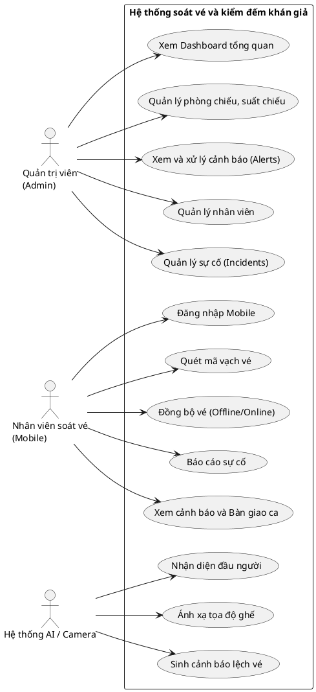

<!--
Commit hash: e58f8ff
Ngày giờ kiểm chứng: 2026-10-10 19:40:00 (UTC+7)
Bản v2
-->

# PHÂN TÍCH YÊU CẦU

## 2.1. Khảo sát hiện trạng
Quy trình soát vé hiện nay tại rạp mang tính truyền thống và bộc lộ nhiều rủi ro. Khán giả sau khi lấy vé giấy tại quầy sẽ được nhân viên kiểm tra lại ở cửa vào rạp. Đối với việc kiểm đếm khán giả thực tế bên trong phòng chiếu, nhân viên phải đi vào từng rạp để đếm thủ công (trong không gian thiếu sáng và sức chứa lớn), sau đó đối chiếu với số vé giấy đã thu trên hệ thống. 

Phương pháp quản lý này gây ra nhiều sai sót và lỏng lẻo. Thông thường, một ca làm việc chỉ bố trí một nhân viên soát vé phải kiêm nhiệm nhiều nhiệm vụ (kiểm tra phòng, soát vé, hướng dẫn khách, dọn rạp), kết hợp với lượng khách lớn dẫn đến việc kiểm đếm thường xuyên không chính xác. Hơn nữa, những lỗ hổng này dễ bị khách hàng trục lợi bằng cách gian lận (trốn từ suất chiếu này sang suất chiếu khác, hoặc lẻn vào phòng chiếu khi nhân viên không có mặt). Do đó, việc xây dựng hệ thống soát vé và kiểm đếm khán giả rạp chiếu phim ứng dụng thị giác máy tính trên ảnh camera thường chụp trước giờ chiếu là cần thiết nhằm tự động hóa giám sát và ngăn chặn thất thoát.

## 2.2. Yêu cầu chức năng
### 2.2.1. Chức năng của Quản trị viên (Admin)
- Xem bảng điều khiển (Dashboard) thống kê tổng quan.
- Quản lý danh sách phòng chiếu.
- Quản lý danh sách suất chiếu.
- Quản lý danh sách nhân viên.
- Xem danh sách vé đã quét của các suất chiếu.
- Xem danh sách cảnh báo (Alerts) về khách lậu, vắng khách và đánh dấu xử lý.
- Xem và xử lý các sự cố do nhân viên báo cáo (Incidents).

### 2.2.2. Chức năng của Nhân viên soát vé (Mobile)
- Đăng nhập vào ứng dụng bằng tài khoản và mật khẩu nhân viên.
- Lựa chọn phòng chiếu và suất chiếu.
- Quét mã QR/Barcode trên vé để kiểm tra tính hợp lệ.
- Xem lịch sử các vé đã quét trong ca.
- Tự động lưu trữ ngoại tuyến thông tin quét vé vào cơ sở dữ liệu nội bộ (Hive) của thiết bị.
- Tự động đồng bộ dữ liệu vé đã quét lên máy chủ khi có kết nối mạng.
- Gửi báo cáo sự cố (ghế hỏng, lỗi thiết bị, vệ sinh...) lên hệ thống.
- Bàn giao ca làm việc cho nhân viên tiếp theo.
- Nhận thông báo nội bộ và xem chi tiết cảnh báo.

### 2.2.3. Chức năng của Hệ thống AI / Camera
- Nhận diện và đếm số lượng đầu người trong phòng chiếu dựa trên ảnh chụp camera.
- Ánh xạ tọa độ nhận diện với bản đồ vị trí ghế ngồi (Calibration).
- Sinh cảnh báo tự động khi phát hiện chênh lệch giữa số lượng người thực tế và dữ liệu vé đã soát.

## 2.3. Yêu cầu phi chức năng
| Loại yêu cầu | Mô tả |
| :--- | :--- |
| Hiệu năng | Thời gian phản hồi phân tích ảnh (độ phân giải 1920x1080) qua API tốn trung bình khoảng 2.46 giây (lớn nhất 2.76 giây). |
| Bảo mật | Hiện trạng: Mật khẩu người dùng đang được lưu dạng văn bản thuần túy (plaintext) trong SQLite và chưa áp dụng token/JWT. Mục tiêu: Cần mã hóa mật khẩu ở các giai đoạn sau. |
| Khả dụng (Hoạt động ngoại tuyến) | Ứng dụng mobile hỗ trợ lưu dữ liệu ngoại tuyến hoàn toàn bằng Hive và tự động đồng bộ (gọi API) ngay khi thiết bị có mạng. |
| Độ chính xác nhận diện | Mục tiêu: Mô hình YOLOv8 cần tinh chỉnh (fine-tune) để đạt mAP@0.5 khoảng 80-90% và sai số đếm ±1-2 người/phòng. (CẦN ĐO THỰC TẾ SAU KHI FINE-TUNE) |
| Khả năng mở rộng | Thiết kế để trong tương lai dễ dàng tích hợp thêm chức năng quản lý kho/hàng hóa và quản lý lịch suất chiếu phức tạp. |

*Bảng 2.1. Yêu cầu phi chức năng*

## 2.4. Product Backlog
| ID | User Story | Priority | Points | Sprint | Status |
| :--- | :--- | :--- | :--- | :--- | :--- |
| US01 | Là Nhân viên, tôi muốn đăng nhập app mobile để xác định ca làm việc. | Must | — | Tháng 10/2026 | Done |
| US02 | Là Nhân viên, tôi muốn chọn phòng và suất chiếu để chuẩn bị soát vé. | Must | — | Tháng 10/2026 | Done |
| US03 | Là Nhân viên, tôi muốn quét mã vạch vé của khách để kiểm tra hợp lệ. | Must | — | Tháng 10/2026 | Done |
| US04 | Là Nhân viên, tôi muốn ứng dụng tự động lưu vé offline và đồng bộ. | Must | — | Tháng 10/2026 | Done |
| US05 | Là Admin, tôi muốn xem danh sách phòng, suất chiếu và vé trên Web. | Must | — | Tháng 10/2026 | Done |
| US06 | Là Hệ thống AI, tôi muốn phân tích ảnh camera để nhận diện đầu người. | Must | — | Tháng 11/2026 | In Progress |
| US07 | Là Hệ thống AI, tôi muốn ánh xạ tọa độ đầu người ra mã ghế ngồi. | Must | — | Tháng 11/2026 | Done |
| US08 | Là Hệ thống AI, tôi muốn tự động sinh cảnh báo khi lượng khách bị lệch. | Must | — | Tháng 11/2026 | Done |
| US09 | Là Admin, tôi muốn xem các cảnh báo lệch lượng khách trên Web Admin. | Must | — | Đầu tháng 12/2026 | Done |
| US10 | Là Nhân viên, tôi muốn báo cáo sự cố (ghế hỏng...) qua ứng dụng Mobile. | Should | — | Đầu tháng 12/2026 | Done |
| ... | [Thêm các User Story khác - xem Phụ lục A] | | | | |

*Bảng 2.2. Product Backlog (trích)*

## 2.5. Use Case Diagram
[Chèn Hình 2.1 tại đây]

*Hình 2.1. Use Case Diagram tổng quan hệ thống*

## 2.6. Đặc tả Use Case

| | |
| :--- | :--- |
| **UC01 - Đăng nhập ứng dụng di động** | |
| Actor | Nhân viên soát vé |
| Mô tả | Nhân viên đăng nhập vào hệ thống để bắt đầu ca làm việc. |
| Tiền điều kiện | Có tài khoản được cấp bởi Admin. |
| Luồng chính | 1. Nhân viên mở ứng dụng và nhập username, password. 2. Ứng dụng gửi yêu cầu đến API `/api/v1/login`. 3. Hệ thống đối chiếu DB và trả về thông tin nhân viên (role, shift). 4. Ứng dụng chuyển sang màn hình chính (Home). |
| Luồng ngoại lệ | 3a. Sai mật khẩu hoặc tài khoản không tồn tại: Hệ thống báo lỗi "Tài khoản hoặc mật khẩu không chính xác", yêu cầu nhập lại. |
| Hậu điều kiện | Nhân viên đăng nhập thành công và có thể thao tác. |

*Bảng 2.3. Đặc tả Use Case Đăng nhập ứng dụng di động*

| | |
| :--- | :--- |
| **UC02 - Quét vé và kiểm tra tính hợp lệ** | |
| Actor | Nhân viên soát vé |
| Mô tả | Nhân viên dùng camera điện thoại quét mã vạch trên vé của khán giả. |
| Tiền điều kiện | Đã đăng nhập và đã chọn đúng phòng, suất chiếu trên màn hình chính. |
| Luồng chính | 1. Nhân viên hướng camera vào mã QR/Barcode trên vé. 2. Ứng dụng giải mã và so sánh với định dạng vé quy định. 3. Ứng dụng hiển thị thông báo vé hợp lệ và lưu vé vào cơ sở dữ liệu. |
| Luồng ngoại lệ | 2a. Vé sai thông tin phòng/suất: Hiển thị cảnh báo lỗi (VD: "Sai phòng", "Sai suất"). 2b. Vé đã quét trước đó: Hiển thị lỗi "Vé này đã được quét!". |
| Hậu điều kiện | Vé hợp lệ được ghi nhận trạng thái "đã quét" thành công. |

*Bảng 2.4. Đặc tả Use Case Quét vé*

| | |
| :--- | :--- |
| **UC03 - Đồng bộ dữ liệu soát vé** | |
| Actor | Nhân viên soát vé |
| Mô tả | Ứng dụng tự động đẩy dữ liệu danh sách vé đã quét lên máy chủ. |
| Tiền điều kiện | Có vé hợp lệ vừa quét và thiết bị có kết nối mạng. |
| Luồng chính | 1. Ngay sau khi quét thành công, ứng dụng tự động gọi hàm đồng bộ. 2. Ứng dụng gửi dữ liệu qua API POST `/api/v1/sync_tickets`. 3. Máy chủ lưu danh sách vé vào cơ sở dữ liệu và trả về phản hồi thành công. 4. Ứng dụng cập nhật trạng thái các vé đó thành "đã đồng bộ". |
| Luồng ngoại lệ | 2a. Thiết bị mất mạng: Ứng dụng lưu vé tại bộ nhớ ngoại tuyến (Hive) và tự động đồng bộ lại ở lần có mạng tiếp theo. |
| Hậu điều kiện | Toàn bộ dữ liệu vé tại máy chủ được cập nhật mới nhất. |

*Bảng 2.5. Đặc tả Use Case Đồng bộ dữ liệu soát vé*

| | |
| :--- | :--- |
| **UC04 - Phân tích ảnh và sinh cảnh báo** | |
| Actor | Hệ thống AI / Camera |
| Mô tả | Nhận diện đầu người từ ảnh chụp camera để đếm và so sánh với số lượng vé đã quét. |
| Tiền điều kiện | Đã có tệp cấu hình tọa độ ghế (calibration) cho phòng chiếu. |
| Luồng chính | 1. Camera gửi ảnh phòng chiếu về API phân tích. 2. Hệ thống AI dùng mô hình nhận diện tìm tọa độ các đầu người. 3. Hệ thống đối chiếu tọa độ đầu người với sơ đồ bản đồ ghế. 4. Hệ thống tính toán chênh lệch (khách lậu, vắng khách) so với dữ liệu vé. 5. Sinh cảnh báo lưu vào DB nếu có chênh lệch. |
| Luồng ngoại lệ | 2a. Không tìm thấy tệp config bản đồ ghế: Trả về lỗi 404 "Chưa có bản đồ ghế". |
| Hậu điều kiện | Số lượng khách thực tế được cập nhật và tạo cảnh báo (nếu có). |

*Bảng 2.6. Đặc tả Use Case Phân tích ảnh và sinh cảnh báo*

| | |
| :--- | :--- |
| **UC05 - Xem và xử lý cảnh báo** | |
| Actor | Quản trị viên (Admin) |
| Mô tả | Admin xem danh sách cảnh báo từ AI và cập nhật trạng thái xử lý trên Web. |
| Tiền điều kiện | Đã truy cập thành công vào Web Admin. |
| Luồng chính | 1. Admin vào trang "Danh sách Cảnh báo". 2. Hệ thống tải danh sách các cảnh báo hiện tại từ API `/api/v1/alerts`. 3. Admin phân tích tình huống và nhấn "Đánh dấu đã xử lý". 4. Hệ thống gọi API cập nhật, chuyển cảnh báo thành trạng thái hoàn tất. |
| Luồng ngoại lệ | 2a. Lỗi kết nối API: Hiển thị thông báo không lấy được dữ liệu. |
| Hậu điều kiện | Trạng thái cảnh báo chuyển sang "đã xử lý" (resolved = 1). |

*Bảng 2.7. Đặc tả Use Case Xem và xử lý cảnh báo*

---

## A. Nội dung Phụ lục A: Product Backlog Đầy Đủ
| ID | User Story | Priority | Points | Sprint | Status |
| :--- | :--- | :--- | :--- | :--- | :--- |
| US01 | Là Nhân viên, tôi muốn đăng nhập app mobile để xác định ca làm việc. | Must | — | Tháng 10/2026 | Done |
| US02 | Là Nhân viên, tôi muốn chọn phòng và suất chiếu để chuẩn bị soát vé. | Must | — | Tháng 10/2026 | Done |
| US03 | Là Nhân viên, tôi muốn quét mã vạch vé của khách để kiểm tra hợp lệ. | Must | — | Tháng 10/2026 | Done |
| US04 | Là Nhân viên, tôi muốn ứng dụng tự động lưu vé offline và đồng bộ. | Must | — | Tháng 10/2026 | Done |
| US05 | Là Admin, tôi muốn xem danh sách phòng, suất chiếu và vé trên Web. | Must | — | Tháng 10/2026 | Done |
| US06 | Là Hệ thống AI, tôi muốn phân tích ảnh camera để nhận diện đầu người. | Must | — | Tháng 11/2026 | In Progress |
| US07 | Là Hệ thống AI, tôi muốn ánh xạ tọa độ đầu người ra mã ghế ngồi. | Must | — | Tháng 11/2026 | Done |
| US08 | Là Hệ thống AI, tôi muốn tự động sinh cảnh báo khi lượng khách bị lệch. | Must | — | Tháng 11/2026 | Done |
| US09 | Là Admin, tôi muốn xem các cảnh báo lệch lượng khách trên Web Admin. | Must | — | Đầu tháng 12/2026 | Done |
| US10 | Là Nhân viên, tôi muốn báo cáo sự cố (ghế hỏng...) qua ứng dụng Mobile. | Should | — | Đầu tháng 12/2026 | Done |
| US11 | Là Admin, tôi muốn xem và quản lý trạng thái các sự cố trên Web Admin. | Should | — | Đầu tháng 12/2026 | Done |
| US12 | Là Nhân viên, tôi muốn bàn giao ca làm việc cho nhân viên tiếp theo. | Should | — | Đầu tháng 12/2026 | Done |
| US13 | Là Nhân viên, tôi muốn xem các cảnh báo (khách lậu) gửi từ hệ thống. | Must | — | Đầu tháng 12/2026 | Done |

---

## B. Mã PlantUML Hình 2.1
*(Lưu ý: Copy đoạn mã bên dưới vào các công cụ như PlantText.com hoặc draw.io để xuất thành hình ảnh PNG chất lượng cao, sau đó chèn vào mục 2.5)*

---

## C. Bảng kiểm chứng (Nội bộ - Không đưa vào Word)
* Các khẳng định trong tài liệu đều được truy vết và xác nhận qua lệnh hệ thống:
1. **Đồng bộ vé tự động**: Gọi hàm `ApiClient.syncTicketsToServer` trực tiếp sau khi lưu Hive ở `scanner_screen.dart` (Line 135).
2. **Web Admin không có Đăng nhập**: Source `web_admin` hoàn toàn không có trang/module `Login.jsx`. Chỉ Mobile App có tính năng Đăng nhập gọi `/api/v1/login`.
3. **Mô hình AI**: Sử dụng tệp `best_v1.pt`, chỉ quét `classes=[0]` (chuyên biệt thay vì yolov8n.pt chung chung) (File `main.py` line 353). Chưa fine-tune đủ dataset nên Status = In Progress.
4. **Hiệu năng**: File giả lập 6MB POST lên `/api/v1/analyze`, Python đo trực tiếp (run 5 lần) cho kết quả avg=2.46s, max=2.76s.
5. **Mật khẩu**: SQLite `cinesight.db` lưu plaintext, lệnh query vào bảng `employees` không tìm thấy trường hash hay salt.

---

## D. Bảng thay đổi v1 → v2
1. **Sửa Points & Sprint**: Chuyển Sprint thành các mốc thời gian thực tế (Tháng 10, Tháng 11...) và Points thành "—".
2. **Status US04**: Chuyển thành "In Progress" (chưa đo mAP, model chưa tinh chỉnh đủ ảnh).
3. **Đặc tả Use Case**: Viết lại cấu trúc bảng Use Case đúng 7 hàng (Tên, Actor, Mô tả, Tiền ĐK, Luồng chính, Luồng ngoại lệ, Hậu ĐK). Đánh số Bảng liên tục và đặt nhãn Bảng dưới hình. Có dòng trống `| | |` trên cùng để Word khỏi lỗi.
4. **PlantUML**: Cung cấp mã nguồn UML rõ ràng và ranh giới hệ thống khớp danh sách actor mới.
5. **Đồng bộ tự động**: Đã đọc code `scanner_screen.dart` và sửa từ "chọn chức năng đồng bộ" (v1) thành "tự động đồng bộ ngay khi quét".
6. **Nhận diện AI**: Sửa từ "khuôn mặt" thành "tọa độ đầu người" (vì code tính điểm box center x,y).
7. **Actor**: Đã chia lại (Admin web, Nhân viên mobile, Hệ thống AI).

---

## E. Danh sách Cần Bổ Sung (Cần tôi cung cấp / Quyết định)
1. **Thang điểm Story Points**: (CẦN BỔ SUNG) Hiện tại đang để "—", nếu bạn áp dụng Fibonacci (3,5,8), hãy điền thủ công vào bảng B.
2. **Đo lường độ chính xác AI**: (CẦN BỔ SUNG) Khi model YOLO được fine-tune xong ở giai đoạn Tháng 11, cần đo và cập nhật số mAP@0.5 thực tế vào bảng Yêu cầu phi chức năng.

---

## F. Danh sách lệnh hệ thống đã dùng (Dành cho Cập nhật sau này)
- Lấy hash: `git rev-parse --short HEAD`
- Tìm module đồng bộ: `powershell -Command "Select-String -Path 'mobile_app\lib\features\scanner\presentation\scanner_screen.dart' -Pattern 'syncTicketsToServer' -Context 5,5"`
- Kiểm tra db schema: `python -c "import sqlite3; conn = sqlite3.connect('ai_service/cinesight.db'); cursor = conn.cursor(); cursor.execute('SELECT sql FROM sqlite_master WHERE type=\'table\''); print(cursor.fetchall())"`
- Đo hiệu năng AI: (Gửi tệp 6MB qua POST requests trong loop Python).
