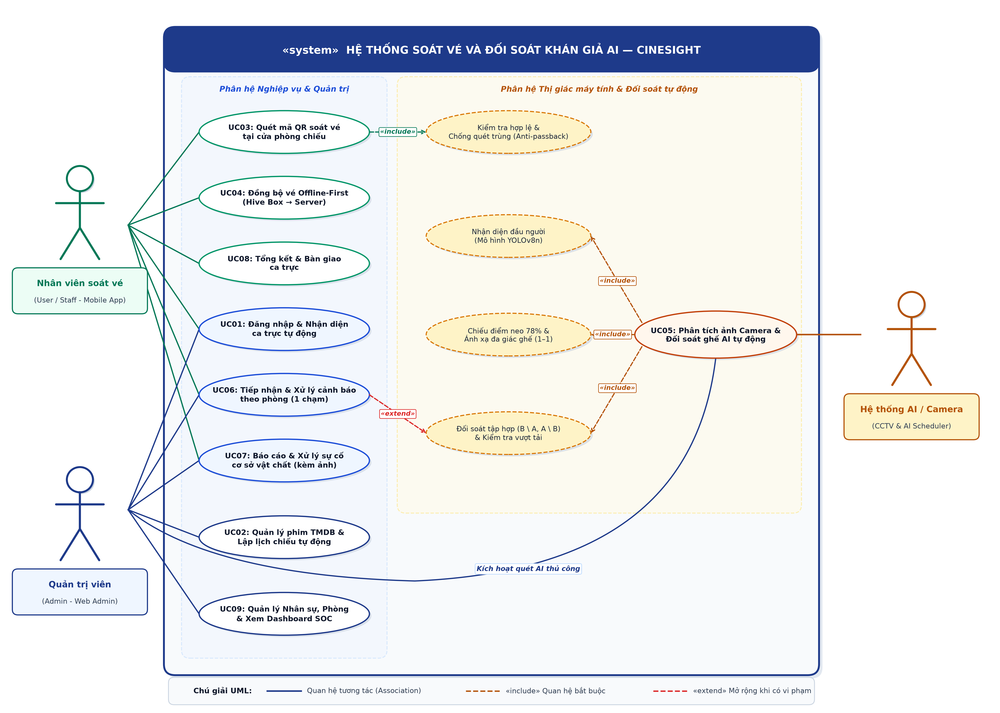

# CHƯƠNG 2: PHÂN TÍCH YÊU CẦU

## 2.1. Khảo sát hiện trạng

Hiện nay, quy trình soát vé và kiểm soát khán giả tại các cụm rạp chiếu phim phần lớn vẫn thực hiện theo phương thức bán thủ công truyền thống: khán giả nhận vé in nhiệt tại quầy hoặc xuất trình mã vé điện tử trên điện thoại, sau đó nhân viên kiểm soát tại cửa phòng chiếu sẽ kiểm tra bằng mắt thường hoặc dùng máy quét mã vạch độc lập để cho khách vào phòng. Đối với việc kiểm đếm số lượng khán giả thực tế bên trong phòng chiếu, nhân viên phải trực tiếp đi vào từng rạp (thường trong điều kiện phòng chiếu tối, phim đã bắt đầu chiếu) để đếm thủ công, sau đó ghi chép và đối chiếu lại với số vé bán ra trên hệ thống quản lý rạp (POS).

Hiện nay, việc kiểm soát vé và đối soát lượng khán giả thực tế trong phòng chiếu theo phương thức thủ công còn gặp nhiều khó khăn như:
1. **Thất thoát doanh thu và hiện tượng gian lận ("xem phim chui"):** Khán giả sau khi vào rạp có thể tự ý di chuyển từ các vị trí ghế thường lên các vị trí ghế VIP/Sweetbox trống, hoặc cố tình ở lại phòng chiếu sau khi kết thúc suất chiếu để xem tiếp các suất chiếu sau mà không mua vé.
2. **Khó khăn trong việc kiểm đếm trong điều kiện thiếu sáng:** Phòng chiếu phim có diện tích rộng, bố trí dạng bậc thang dốc và ánh sáng tắt tối khi phim bắt đầu chiếu. Việc nhân viên đi lại đếm từng người gây bất tiện, làm gián đoạn trải nghiệm của khán giả khác và tỷ lệ sai sót số lượng là rất cao.
3. **Quá tải áp lực lên nhân viên vận hành:** Một nhân viên tại cụm rạp thường phải kiêm nhiệm nhiều đầu việc cùng lúc (soát vé tại cửa rạp, hướng dẫn chỗ ngồi, kiểm tra vệ sinh, giám sát an ninh phòng chiếu). Khi lượng khách đông vào các khung giờ cao điểm hoặc dịp lễ Tết, việc kiểm soát vé tại cửa dễ xảy ra tình trạng sót vé, quét trùng hoặc không kịp phát hiện vé sai suất/sai phòng.
4. **Thiếu sự liên thông dữ liệu thời gian thực giữa camera và hệ thống vé:** Các cụm rạp hiện nay đều đã trang bị hệ thống camera an ninh (CCTV) trong phòng chiếu, tuy nhiên camera chỉ đóng vai trò ghi hình thụ động (lưu trữ video để xem lại khi có sự cố). Chưa có cơ chế tự động hóa kết nối giữa luồng hình ảnh camera với cơ sở dữ liệu vé đã soát để phát hiện ngay lập tức các trường hợp bất thường.

Do đó, việc xây dựng hệ thống **"CineSight - Hệ thống soát vé và kiểm đếm khán giả rạp chiếu phim ứng dụng thị giác máy tính trên ảnh camera phòng chiếu"** là cần thiết nhằm tự động hóa toàn diện khâu đối soát, tối ưu hóa năng suất vận hành của nhân viên và ngăn chặn triệt để thất thoát doanh thu cho rạp.

---

## 2.2. Yêu cầu chức năng

Dựa trên kiến trúc và phạm vi thực tế của hệ thống CineSight, các yêu cầu chức năng được phân rã chi tiết theo từng tác nhân (Actor) tham gia vào hệ thống như sau:

### 2.2.1. Chức năng của Admin (Quản trị viên - Web Admin)
- **Quản lý người dùng (CRUD Nhân sự & Ca trực tự động):**
  - Thêm mới tài khoản nhân sự (mã nhân viên, họ và tên, tên đăng nhập, mật khẩu, vai trò `Quản lý` hoặc `Soát vé`). Hệ thống kiểm soát phân quyền nghiêm ngặt (RBAC): chặn tài khoản nhân viên soát vé đăng nhập vào cổng Web Admin (`403 Forbidden`).
  - Theo dõi trạng thái hoạt động trực tuyến (`Đang trực` / `Ngoại tuyến`) và **ca làm việc tự động (Dynamic Shift)** theo thời điểm đăng nhập thực tế trong ngày: khi nhân sự chưa đăng nhập hiển thị `"Chưa có"`; khi đăng nhập hệ thống tự động nhận diện ca trực (*Nhân viên:* Ca sáng `07:30–13:00`, Ca chiều `13:00–16:00`, Ca tối `16:00–23:00`; *Quản lý:* Ca sáng `07:30–16:00`, Ca tối `16:30–24:00`).
  - Chỉnh sửa thông tin nhân sự, đặt lại mật khẩu và xóa tài khoản. Hỗ trợ cơ chế **Khóa mềm (`is_active = 0`)** đối với nhân viên đã phát sinh lịch sử biên bản sự cố nhằm bảo toàn toàn vẹn khóa ngoại (3NF).
- **Quản lý danh mục phim (Movies - Đồng bộ TMDB):**
  - Quản lý danh mục phim chiếu rạp (tên phim, thời lượng phút, thể loại, phân loại độ tuổi `P/K/T13/T16/T18`, ảnh áp phích, điểm đánh giá).
  - Hỗ trợ đồng bộ dữ liệu phim thực tế từ cơ sở dữ liệu điện ảnh quốc tế TMDB (`tmdb_sync`) hoặc thêm/sửa/xóa phim thủ công.
- **Quản lý phòng chiếu và suất chiếu (Rooms & Showtimes):**
  - Xem danh sách 4 phòng chiếu trong cụm rạp kèm cấu hình ma trận ghế 2D: **Phòng 1, 2, 4 (136 ghế - 12 hàng A..L)** và **Phòng 3 VIP/Sweetbox (132 ghế - 10 hàng A..J)**.
  - Tạo mới, chỉnh sửa suất chiếu thủ công hoặc kích hoạt **Trình lập lịch chiếu tự động chống chồng lấn khung giờ** (tự động phân bổ các bộ phim đang chiếu vào 4 phòng chiếu theo thời lượng phim + 15 phút dọn vệ sinh).
- **Quản lý danh sách vé (Tickets):**
  - Tra cứu, lọc danh sách toàn bộ các vé đã được soát hợp lệ tại cổng theo từng phòng chiếu và suất chiếu cụ thể (mã vé, số ghế, hạng ghế `Standard/VIP/Sweetbox`, thời điểm soát).
- **Giám sát và kích hoạt phân tích AI:**
  - Tải ảnh chụp khung hình (snapshot) từ camera CCTV phòng chiếu lên hệ thống hoặc chọn luồng camera để kích hoạt tiến trình AI phân tích đối soát tức thời.
  - Theo dõi nhật ký kiểm toán suy luận AI (`ai_inference_logs`) của cả chế độ quét thủ công và chế độ **tự động quét định kỳ 3 mốc thời gian mỗi suất chiếu** (Đầu giờ, Giữa giờ, Cuối giờ).
- **Xem báo cáo, thống kê (Dashboard SOC):**
  - Theo dõi các chỉ số vận hành tổng quan theo thời gian thực: tổng số vé đã quét trong ngày, tỷ lệ lấp đầy ghế (Occupancy Rate), số lượng cảnh báo vi phạm an ninh chưa xử lý và trạng thái trực tuyến của từng phòng chiếu.
- **Quản lý cảnh báo vi phạm (Alerts):**
  - Tiếp nhận danh sách cảnh báo chênh lệch vé do AI gửi về, được **gom nhóm trực quan theo từng Phòng chiếu** kèm 3 chỉ số đối soát (*Vé đã quét, Trong rạp, Ghế vi phạm*).
  - Xem chi tiết danh sách mã ghế vi phạm ($B \setminus A$, $A \setminus B$, vượt tải) kèm ảnh bằng chứng khoanh vùng của AI.
  - Hỗ trợ đánh dấu xử lý từng cảnh báo đơn lẻ hoặc nhấn nút **"Xử lý toàn bộ phòng (1 chạm)"** sau khi nhân viên hiện trường đã kiểm tra xong.
- **Quản lý sự cố rạp chiếu (Incidents):**
  - Tiếp nhận các báo cáo sự cố cơ sở vật chất (`seat_damage` - ghế hỏng, `equipment` - thiết bị, `facility` - vệ sinh/hạ tầng, `other` - khác) kèm ảnh chụp hiện trường do nhân viên gửi từ ứng dụng di động.
  - Cập nhật trạng thái xử lý sự cố từ `"Đang mở / Chờ xử lý"` (`open`) sang `"Đã khắc phục"` (`resolved`).

### 2.2.2. Chức năng của User (Nhân viên soát vé - Mobile App)
- **Đăng nhập, nhận diện ca trực tự động và quản lý phiên:**
  - Đăng nhập vào ứng dụng di động bằng tài khoản nhân viên (`username/password`) đã được cấp.
  - Hệ thống tự động ghi nhận giờ đăng nhập để xác định ca trực hiện tại (Ca sáng `07:30–13:00`, Ca chiều `13:00–16:00`, Ca tối `16:00–23:00`) mà không cần gán cứng từ trước.
- **Lựa chọn phòng chiếu và suất chiếu linh hoạt:**
  - Linh hoạt lựa chọn bất kỳ phòng chiếu và suất chiếu nào đang hoặc sắp diễn ra để mở cửa đón khách và thực hiện soát vé.
- **Quét mã QR soát vé (Scanner):**
  - Kích hoạt camera điện thoại quét mã QR trên vé của khán giả; kiểm tra tính hợp lệ tức thì (đúng định dạng, đúng phòng chiếu, đúng suất chiếu).
  - Thực hiện cơ chế **chống quét trùng vé (Anti-passback)**: từ chối ngay lập tức các mã vé đã được quét trước đó để ngăn chặn hành vi quay vòng vé.
- **Lưu trữ ngoại tuyến và đồng bộ dữ liệu (Offline-First):**
  - Tự động lưu trữ cục bộ toàn bộ dữ liệu vé đã quét vào cơ sở dữ liệu nội bộ trên thiết bị (`Hive Box`), đảm bảo quét vé mượt mà ngay cả khi mất kết nối mạng.
  - Tự động đồng bộ (`Auto-sync`) danh sách vé hợp lệ lên máy chủ trung tâm ngay khi thiết bị có kết nối mạng Internet.
- **Xem lịch sử soát vé và sơ đồ ghế 2D:**
  - Tra cứu danh sách các vé đã quét trong ca trực và xem trực quan sơ đồ ghế 2D của từng phòng chiếu (136 ghế hoặc 132 ghế) để hướng dẫn vị trí ngồi cho khách.
- **Tiếp nhận và xử lý nhanh cảnh báo an ninh theo phòng:**
  - Nhận thông báo chuông/rung tức thời và xem thẻ cảnh báo gom nhóm theo phòng chiếu khi AI phát hiện ghế có người ngồi nhưng chưa soát vé ($B \setminus A$).
  - Hỗ trợ nút **"Xử lý toàn bộ phòng (1 chạm)"** ngay trên ứng dụng di động sau khi đã kiểm tra và nhắc nhở khách tại phòng chiếu.
- **Báo cáo sự cố phòng chiếu kèm hình ảnh:**
  - Tạo phiếu báo cáo sự cố cơ sở vật chất (chọn phòng, danh mục sự cố, vị trí ghế, mô tả chi tiết và **đính kèm ảnh chụp thực tế từ camera/thư viện**).
  - Các sự cố đã được xử lý sẽ **tự động ẩn sau 1 giờ** hoặc cho phép nhân viên **xóa/ẩn ngay lập tức** khỏi danh sách để giao diện luôn gọn gàng.
- **Bàn giao ca trực (Shift Handover):**
  - Thực hiện tổng kết số lượng vé đã soát, số lượng cảnh báo/sự cố phát sinh trong ca và xác nhận bàn giao ca làm việc.

### 2.2.3. Chức năng của Hệ thống AI / Camera (System Actor)
- **Tiếp nhận dữ liệu hình ảnh & Lập lịch quét tự động:**
  - Tiếp nhận ảnh chụp snapshot độ phân giải cao từ camera góc cao (High-Angle CCTV) của phòng chiếu theo 2 cơ chế: kích hoạt thủ công hoặc **tự động quét định kỳ 3 mốc thời gian mỗi suất chiếu** (Đầu giờ chiếu, Giữa giờ chiếu, Cuối giờ chiếu).
- **Nhận diện đầu người (Head Detection):**
  - Ứng dụng mô hình học sâu **YOLOv8n** đã được huấn luyện chuyên biệt trên tập dữ liệu thực tế phòng chiếu (`imgsz=800, conf=0.28, iou=0.45`) để phát hiện chính xác khung bao đầu người ($x_1, y_1, x_2, y_2$) trong điều kiện thiếu sáng/hồng ngoại, kết hợp **Bộ lọc khử trùng khoảng cách phối cảnh (Perspective Distance Suppression)**.
- **Chiếu điểm neo phối cảnh 78% và Ánh xạ đa giác ghế (Point-in-Polygon):**
  - Thay vì lấy tâm hình học 50% dễ bị lệch thị sai ở các hàng ghế dốc, hệ thống tính **điểm neo phối cảnh tại 78% chiều cao khung bao** ($x_{anchor} = \frac{x_1+x_2}{2}, y_{anchor} = y_1 + 0.78(y_2 - y_1)$).
  - Áp dụng thuật toán dò đa giác 3 bước (`cv2.pointPolygonTest`) kết hợp bù dung sai viền $\le 8\text{px}$ và **ràng buộc vật lý 1–1** (mỗi ghế tối đa 1 khán giả, không tràn sang ghế kế bên) trên ma trận **136 ghế** (Phòng 1, 2, 4) hoặc **132 ghế** (Phòng 3).
- **Tự động đối soát logic tập hợp (Set Difference) & Sinh cảnh báo:**
  - Xác định tập hợp ghế có người ngồi thực tế ($B$) và đối chiếu với tập hợp ghế đã soát vé hợp lệ tại cổng ($A$):
    - Phát hiện **Ghế có người ngồi nhưng chưa soát vé (Khách lậu / Ngồi sai ghế):** $B \setminus A$.
    - Phát hiện **Ghế đã soát vé nhưng thực tế trống (Khách vắng mặt):** $A \setminus B$.
    - Phát hiện **Cảnh báo vượt tải phòng chiếu (Over-capacity)** khi $|B| > |A|$.
  - Tự động lưu nhật ký kiểm toán vào bảng `ai_inference_logs`, sinh cảnh báo vào bảng `alerts` và phát tín hiệu đồng bộ tức thời tới Web Admin và Mobile App.

---

## 2.3. Yêu cầu phi chức năng

| Loại yêu cầu | Mô tả |
| :--- | :--- |
| **Hiệu năng** | - Thời gian suy luận (Inference time) của mô hình YOLOv8n đạt ~15–25ms trên GPU và < 300ms trên CPU. - Thời gian phản hồi API phân tích toàn trình `/api/v1/analyze` (nhận ảnh, chạy AI, chiếu điểm neo 78%, ánh xạ 136/132 đa giác ghế, đối soát tập hợp và lưu DB) đạt trung bình **< 1.5 giây** (nhanh hơn ngưỡng tiêu chuẩn < 3 giây). - Tốc độ giải mã và kiểm tra vé QR cục bộ trên Mobile App đạt **< 100ms**; máy chủ hỗ trợ xử lý đồng thời **50–100 thiết bị** đồng bộ cùng lúc. |
| **Bảo mật** | - Mật khẩu người dùng được băm một chiều theo chuẩn **`PBKDF2-HMAC-SHA256` (100.000 vòng lặp kèm Salt ngẫu nhiên)**. - Xác thực phiên làm việc bằng chữ ký số **`HMAC-SHA256 Bearer Token`** và kiểm soát truy cập theo vai trò **RBAC** (`Quản lý` vs `Soát vé`, chặn nhân viên truy cập Web Admin với mã `403 Forbidden`). - Ràng buộc khóa ngoại nghiêm ngặt (`PRAGMA foreign_keys = ON`), khóa mềm nhân sự (`is_active = 0`) và chống quay vòng vé (**Anti-passback**). |
| **Khả dụng** | - Đạt độ khả dụng **Uptime 99%** nhờ kiến trúc **Offline-First** trên Mobile App (lưu trữ cô lập trong `Hive Box` khi mất mạng và tự động đồng bộ khi có mạng) kết hợp cơ chế **`SQLite WAL (Write-Ahead Logging)`** chống khóa bảng khi đọc/ghi đồng thời. - Giao diện Web Admin (React + TailwindCSS) tương thích đa màn hình (Desktop/Tablet); ứng dụng Flutter hoạt động mượt mà trên thiết bị Android thực tế. |
| **Độ chính xác** | - Mô hình YOLOv8n nhận diện đầu người trong môi trường ánh sáng rạp chiếu đạt độ chính xác **mAP@0.5 > 88%**, F1-Score đạt **0.955**. - Thuật toán chiếu điểm neo phối cảnh 78% kết hợp dò đa giác `pointPolygonTest` và ràng buộc 1–1 đảm bảo ánh xạ chính xác vị trí ghế, loại bỏ hiện tượng nhảy ghế dây chuyền. |
| **Khả năng mở rộng** | - Kiến trúc phân tầng module hóa độc lập (FastAPI AI Service, React Web Admin, Flutter Mobile App), dễ dàng mở rộng thêm tính năng mới. - Hỗ trợ mở rộng số lượng phòng chiếu linh hoạt chỉ bằng cách nạp tệp cấu hình tọa độ đa giác `seats_config_roomX.json` mà không cần sửa đổi mã nguồn thuật toán. |

*Bảng 2.1. Yêu cầu phi chức năng*

---

## 2.4. Product Backlog

Danh sách các User Stories của hệ thống CineSight được sắp xếp theo độ ưu tiên (MoSCoW) và phân bổ theo các Sprint phát triển:

| ID | User Story | Priority | Points | Sprint | Status |
| :---: | :--- | :---: | :---: | :---: | :---: |
| **US01** | Là nhân viên/quản lý, tôi muốn đăng nhập vào hệ thống và được tự động nhận diện ca làm việc theo khung giờ đăng nhập thực tế. | Must | 3 | 1 | Done |
| **US02** | Là nhân viên, tôi muốn chọn phòng chiếu và suất chiếu linh hoạt trên ứng dụng di động để bắt đầu soát vé tại cửa phòng. | Must | 2 | 1 | Done |
| **US03** | Là nhân viên, tôi muốn quét mã QR trên vé để kiểm tra tính hợp lệ (đúng phòng, đúng suất chiếu) và chống quét trùng vé (Anti-passback). | Must | 5 | 1 | Done |
| **US04** | Là nhân viên, tôi muốn ứng dụng lưu vé ngoại tuyến vào Hive Box khi mất mạng và tự động đồng bộ lên máy chủ khi có mạng trở lại. | Must | 5 | 1 | Done |
| **US05** | Là quản trị viên, tôi muốn quản lý người dùng (CRUD nhân sự), theo dõi trạng thái trực tuyến/ca trực động và khóa mềm tài khoản khi cần. | Must | 5 | 2 | Done |
| **US06** | Là quản trị viên, tôi muốn quản lý danh mục phim đồng bộ từ TMDB và sử dụng trình lập lịch chiếu tự động chống chồng lấn khung giờ. | Must | 5 | 2 | Done |
| **US07** | Là quản trị viên, tôi muốn xem sơ đồ ghế 2D của 4 phòng chiếu (136 ghế Phòng 1, 2, 4 và 132 ghế Phòng 3) và xem thống kê trên Dashboard SOC. | Must | 3 | 2 | Done |
| **US08** | Là hệ thống AI, tôi muốn nhận diện đầu người bằng YOLOv8n và ánh xạ điểm neo phối cảnh 78% vào đa giác ghế theo ràng buộc 1–1. | Must | 8 | 3 | Done |
| **US09** | Là hệ thống AI, tôi muốn tự động quét định kỳ 3 mốc mỗi suất chiếu (hoặc theo yêu cầu) và đối soát tập hợp ($B \setminus A$, $A \setminus B$) để sinh cảnh báo. | Must | 8 | 3 | Done |
| **US10** | Là quản trị viên/nhân viên, tôi muốn xem cảnh báo gom nhóm theo từng phòng chiếu và xử lý nhanh toàn bộ phòng chỉ với 1 chạm. | Must | 5 | 4 | Done |
| **US11** | Là nhân viên, tôi muốn gửi báo cáo sự cố phòng chiếu kèm ảnh chụp thực tế và tự động ẩn/xóa nhanh các sự cố sau khi đã khắc phục. | Should | 3 | 4 | Done |
| **US12** | Là nhân viên, tôi muốn thực hiện tổng kết số vé đã quét, số sự cố trong ca và xác nhận bàn giao ca trực trên ứng dụng di động. | Should | 2 | 4 | Done |

*Bảng 2.2. Product Backlog (trích)*

---

## 2.5. Use Case Diagram

Hệ thống CineSight bao gồm 3 tác nhân (Actor) chính tương tác với các chức năng nghiệp vụ:
1. **Admin (Quản trị viên - Web Admin):** Quản lý nhân sự, đồng bộ phim TMDB, lập lịch chiếu, giám sát Dashboard SOC, kích hoạt AI và điều phối xử lý cảnh báo/sự cố.
2. **User (Nhân viên soát vé - Mobile App):** Đăng nhập nhận ca tự động, quét mã QR soát vé tại cửa rạp, đồng bộ vé Offline-First, xử lý cảnh báo tại phòng chiếu, báo cáo sự cố kèm ảnh và bàn giao ca.
3. **Hệ thống AI / Camera (System Actor):** Tự động thu thập khung hình CCTV (3 mốc/suất hoặc theo yêu cầu), thực thi mô hình YOLOv8n, ánh xạ tọa độ đa giác ghế và đối soát tập hợp với dữ liệu vé điện tử.

*Hình 2.1. Use Case Diagram tổng quan hệ thống*

---

## 2.6. Đặc tả Use Case

### 2.6.1. Use Case: Đăng nhập
| Tên Use Case | UC01 - Đăng nhập và nhận diện ca trực tự động |
| :--- | :--- |
| **Actor** | User (Nhân viên soát vé), Admin (Quản trị viên) |
| **Mô tả** | Cho phép người dùng đăng nhập vào hệ thống (Mobile App hoặc Web Admin), kiểm tra phân quyền RBAC và tự động xác định ca làm việc dựa trên thời điểm đăng nhập thực tế. |
| **Tiền điều kiện** | Người dùng đã được cấp tài khoản hợp lệ và trạng thái tài khoản đang hoạt động (`is_active = 1`). |
| **Luồng chính** | 1. Người dùng nhập `username` và `password` trên giao diện đăng nhập. 2. Hệ thống gửi yêu cầu xác thực tới API `POST /api/v1/login` (hoặc `/api/v1/auth/login`). 3. Máy chủ kiểm tra thông tin trong bảng `employees` và đối chiếu mật khẩu băm `PBKDF2-HMAC-SHA256`. 4. Hệ thống lấy thời gian thực tế lúc đăng nhập để tự động gán ca trực (`get_dynamic_shift`): Nhân viên (07:30–13:00 Ca sáng, 13:00–16:00 Ca chiều, 16:00–23:00 Ca tối); Quản lý (07:30–16:00 Ca sáng, 16:30–24:00 Ca tối). 5. Máy chủ cập nhật trạng thái trực tuyến (`last_seen_at`), cấp `Bearer Token` và trả về thông tin phiên làm việc. 6. Đăng nhập thành công, chuyển hướng người dùng vào màn hình chính. |
| **Luồng ngoại lệ** | 2a. Để trống thông tin $\rightarrow$ Hiển thị cảnh báo *"Vui lòng nhập đầy đủ tên đăng nhập và mật khẩu"*. 3a. Sai tài khoản/mật khẩu hoặc tài khoản đã bị khóa mềm (`is_active = 0`) $\rightarrow$ Trả về lỗi `401 Unauthorized` và hiển thị thông báo lỗi. 3b. Tài khoản vai trò `Soát vé` đăng nhập vào cổng Web Admin $\rightarrow$ Trả về lỗi `403 Forbidden` và chặn truy cập. |
| **Hậu điều kiện** | Người dùng được chuyển đến trang chủ, trạng thái trên hệ thống chuyển từ *"Chưa có"* sang ca trực thực tế tương ứng và bật cờ *"Đang trực"*. |

*Bảng 2.3. Đặc tả Use Case Đăng nhập*

### 2.6.2. Use Case: Quản lý phim và lập lịch chiếu
| Tên Use Case | UC02 - Quản lý phim TMDB và lập lịch chiếu tự động |
| :--- | :--- |
| **Actor** | Admin (Quản trị viên) |
| **Mô tả** | Cho phép Quản trị viên đồng bộ danh mục phim từ TMDB và tạo lịch chiếu thủ công hoặc tự động xếp lịch chiếu chống chồng lấn cho 4 phòng chiếu. |
| **Tiền điều kiện** | Quản trị viên đã đăng nhập thành công vào cổng Web Admin với quyền `Quản lý`. |
| **Luồng chính** | 1. Quản trị viên mở trang **Quản lý Phim** hoặc **Lịch chiếu** trên Web Admin. 2. Quản trị viên thêm phim mới hoặc chạy đồng bộ dữ liệu phim từ gói snapshot TMDB vào bảng `movies`. 3. Quản trị viên chọn tạo suất chiếu mới (`POST /api/v1/showtimes`) hoặc kích hoạt trình lập lịch chiếu tự động (`POST /api/v1/showtimes/generate`). 4. Hệ thống kiểm tra thời lượng từng bộ phim, cộng thêm 15 phút nghỉ dọn vệ sinh giữa hai suất liên tiếp và kiểm tra chống trùng giờ trên cùng một phòng chiếu (`room_id`). 5. Hệ thống lưu danh sách suất chiếu hợp lệ vào bảng `showtimes` và hiển thị lên lưới lịch chiếu. |
| **Luồng ngoại lệ** | 4a. Khung giờ suất chiếu mới bị giao cắt với một suất chiếu đã tồn tại trong cùng phòng $\rightarrow$ Hệ thống từ chối và hiển thị lỗi *"Xung đột khung giờ chiếu tại phòng đã chọn"*. |
| **Hậu điều kiện** | Danh mục phim và lịch chiếu của 4 phòng chiếu được cập nhật đồng bộ cho cả Web Admin và Mobile App. |

*Bảng 2.4. Đặc tả Use Case Quản lý phim và lập lịch chiếu*

### 2.6.3. Use Case: Quét mã QR soát vé
| Tên Use Case | UC03 - Quét mã QR soát vé tại cửa phòng chiếu |
| :--- | :--- |
| **Actor** | User (Nhân viên soát vé) |
| **Mô tả** | Nhân viên sử dụng camera trên ứng dụng di động để quét mã QR trên vé của khách, kiểm tra tính hợp lệ và ngăn chặn vé quét trùng (Anti-passback). |
| **Tiền điều kiện** | Nhân viên đã đăng nhập ứng dụng di động và chọn Phòng chiếu, Suất chiếu cần kiểm soát. |
| **Luồng chính** | 1. Nhân viên mở màn hình **Quét vé (Scanner)** và hướng camera vào mã QR của khách. 2. Ứng dụng giải mã tức thì chuỗi thông tin vé (Mã vé, Phòng chiếu, Suất chiếu, Mã ghế, Hạng ghế). 3. Ứng dụng kiểm tra đối chiếu đúng Phòng chiếu và đúng Suất chiếu đang chọn. 4. Ứng dụng kiểm tra trong bộ nhớ cục bộ (`Hive Box`) và dữ liệu đồng bộ để xác nhận mã vé chưa từng được quét trước đó. 5. Ứng dụng phát âm thanh xác nhận hợp lệ, hiển thị thẻ xanh *"VÉ HỢP LỆ"* kèm vị trí ghế và lưu bản ghi vé vào bộ nhớ thiết bị. |
| **Luồng ngoại lệ** | 2a. Mã QR sai cấu trúc định dạng $\rightarrow$ Hiển thị cảnh báo *"Mã vé không hợp lệ"*. 3a. Vé thuộc phòng khác hoặc suất chiếu khác $\rightarrow$ Hiển thị cảnh báo đỏ *"SAI PHÒNG CHIẾU / SAI SUẤT CHIẾU"*. 4a. Vé đã từng được quét (Anti-passback) $\rightarrow$ Phát âm báo động và hiển thị cảnh báo đỏ *"VÉ ĐÃ ĐƯỢC SỬ DỤNG TRƯỚC ĐÓ"*. |
| **Hậu điều kiện** | Vé hợp lệ được ghi nhận trạng thái đã soát (`scanned`) kèm thời gian quét và sẵn sàng đồng bộ lên máy chủ. |

*Bảng 2.5. Đặc tả Use Case Quét mã QR soát vé*

### 2.6.4. Use Case: Đồng bộ vé ngoại tuyến
| Tên Use Case | UC04 - Đồng bộ vé đã soát lên máy chủ (Offline-First Sync) |
| :--- | :--- |
| **Actor** | User (Nhân viên soát vé) / Hệ thống Mobile App |
| **Mô tả** | Tự động đẩy danh sách các vé đã quét lưu trong bộ nhớ ngoại tuyến (`Hive Box`) của điện thoại lên cơ sở dữ liệu máy chủ trung tâm. |
| **Tiền điều kiện** | Có bản ghi vé hợp lệ chưa đồng bộ (`isSynced = false`) trong `Hive Box` và thiết bị có kết nối mạng. |
| **Luồng chính** | 1. Sau khi quét vé thành công hoặc khi phát hiện mạng phục hồi, ứng dụng kích hoạt tiến trình đồng bộ ngầm. 2. Ứng dụng đóng gói danh sách vé chưa đồng bộ thành mảng JSON. 3. Ứng dụng gửi yêu cầu HTTP `POST /api/v1/tickets/sync` (hỗ trợ tương thích `/api/v1/sync_tickets`) lên máy chủ. 4. Máy chủ kiểm tra ràng buộc `UNIQUE(showtime_id, seat_label)` và cập nhật trạng thái vé vào bảng `tickets` (chế độ SQLite WAL). 5. Máy chủ trả về mã `200 OK`; ứng dụng cập nhật cờ `isSynced = true` trong `Hive Box`. |
| **Luồng ngoại lệ** | 3a. Mất kết nối mạng giữa chừng $\rightarrow$ Ứng dụng giữ nguyên vé trong hàng đợi `Hive Box` (`isSynced = false`) và tự động thử lại ở chu kỳ tiếp theo mà không làm gián đoạn việc quét vé. |
| **Hậu điều kiện** | Cơ sở dữ liệu máy chủ cập nhật đầy đủ tập hợp ghế đã soát vé hợp lệ ($A$) theo thời gian thực. |

*Bảng 2.6. Đặc tả Use Case Đồng bộ vé ngoại tuyến*

### 2.6.5. Use Case: Phân tích ảnh camera và đối soát ghế AI
| Tên Use Case | UC05 - Phân tích ảnh camera và đối soát ghế AI tự động |
| :--- | :--- |
| **Actor** | Hệ thống AI / Camera, Admin (Quản trị viên) |
| **Mô tả** | Nhận diện khán giả trong phòng chiếu bằng mô hình YOLOv8n, chiếu điểm neo phối cảnh 78% vào ma trận đa giác ghế (136 hoặc 132 ghế) và đối soát tập hợp với dữ liệu vé đã soát. |
| **Tiền điều kiện** | Phòng chiếu đã có tệp cấu hình đa giác ghế (`seats_config_roomX.json`) và suất chiếu đang diễn ra. |
| **Luồng chính** | 1. Hệ thống tự động kích hoạt ở **3 mốc thời gian mỗi suất chiếu** (Đầu giờ, Giữa giờ, Cuối giờ) hoặc Quản trị viên nhấn nút *"Chạy AI"* gửi ảnh tới API `POST /api/v1/analyze`. 2. Mô hình `YOLOv8n` nhận diện các khung bao đầu người và lọc khử trùng khoảng cách phối cảnh. 3. Hệ thống tính **điểm neo phối cảnh tại 78% chiều cao khung bao** ($y_{anchor} = y_1 + 0.78(y_2 - y_1)$) và thực hiện dò đa giác 3 bước (`cv2.pointPolygonTest` + dung sai viền $\le 8\text{px}$) với ràng buộc 1–1 để xác định tập ghế có người ngồi thực tế ($B$). 4. Hệ thống truy vấn bảng `tickets` lấy tập ghế đã soát vé hợp lệ ($A$) của suất chiếu. 5. Thực hiện phép trừ tập hợp: phát hiện ghế có người ngồi nhưng không có vé ($B \setminus A$), ghế đã soát vé nhưng trống ($A \setminus B$) và kiểm tra vượt tải ($|B| > |A|$). 6. Ghi nhận kết quả vào bảng `ai_inference_logs`, tạo cảnh báo vào bảng `alerts` và trả về ảnh trực quan hóa kèm danh sách mã ghế vi phạm. |
| **Luồng ngoại lệ** | 1a. Thiếu tệp cấu hình đa giác ghế của phòng chiếu $\rightarrow$ Trả về mã lỗi `404 Not Found`. 2a. Ảnh camera bị che khuất hoặc hỏng luồng hình ảnh $\rightarrow$ Ghi nhận cảnh báo chất lượng ảnh vào nhật ký hệ thống. |
| **Hậu điều kiện** | Kết quả suy luận AI, ảnh khoanh vùng bằng chứng và danh sách ghế vi phạm được lưu trữ và phát tới Web Admin / Mobile App. |

*Bảng 2.7. Đặc tả Use Case Phân tích ảnh camera và đối soát ghế AI*

### 2.6.6. Use Case: Tiếp nhận và xử lý cảnh báo vi phạm
| Tên Use Case | UC06 - Tiếp nhận và xử lý cảnh báo vi phạm theo phòng |
| :--- | :--- |
| **Actor** | Admin (Quản trị viên), User (Nhân viên soát vé) |
| **Mô tả** | Hiển thị cảnh báo vi phạm gom nhóm theo từng phòng chiếu và cho phép nhân viên/quản lý xác nhận xử lý từng ghế hoặc xử lý toàn bộ phòng chỉ với 1 chạm. |
| **Tiền điều kiện** | Hệ thống AI đã thực thi UC05 và phát hiện có sự chênh lệch ghế vi phạm (`resolved = 0`). |
| **Luồng chính** | 1. Web Admin và Mobile App nhận cảnh báo mới, hiển thị thẻ cảnh báo gom nhóm theo Phòng chiếu kèm 3 chỉ số (*Vé đã quét, Trong rạp, Ghế vi phạm*). 2. Nhân viên xem danh sách mã ghế vi phạm cụ thể (ví dụ: `E05, E06`) và ảnh khoanh vùng AI. 3. Nhân viên trực tiếp kiểm tra tại vị trí ghế trong rạp, nhắc nhở khách ngồi đúng số ghế trên vé hoặc yêu cầu mua vé bổ sung. 4. Nhân viên hoặc Quản trị viên nhấn nút **"Xử lý toàn bộ phòng (1 chạm)"** (`POST /api/v1/alerts/resolve-room`) hoặc xử lý từng cảnh báo (`PUT /api/v1/alerts/{alert_id}/resolve`). 5. Máy chủ cập nhật trạng thái `resolved = 1` và làm mới bộ đếm an ninh trên Dashboard SOC. |
| **Luồng ngoại lệ** | 4a. Lỗi mất kết nối mạng khi gửi xác nhận $\rightarrow$ Ứng dụng hiển thị thông báo lỗi và cho phép bấm thử lại. |
| **Hậu điều kiện** | Toàn bộ cảnh báo vi phạm của phòng chiếu được chuyển sang trạng thái *"Đã xử lý"*, đồng bộ tức thời trên cả Web và Mobile. |

*Bảng 2.8. Đặc tả Use Case Tiếp nhận và xử lý cảnh báo vi phạm*

### 2.6.7. Use Case: Báo cáo và xử lý sự cố phòng chiếu
| Tên Use Case | UC07 - Báo cáo và xử lý sự cố cơ sở vật chất |
| :--- | :--- |
| **Actor** | User (Nhân viên soát vé), Admin (Quản trị viên) |
| **Mô tả** | Nhân viên gửi báo cáo hư hỏng cơ sở vật chất kèm hình ảnh thực tế từ ứng dụng di động; Quản trị viên điều phối khắc phục và hệ thống tự động dọn dẹp các sự cố cũ đã xử lý. |
| **Tiền điều kiện** | Nhân viên đã đăng nhập Mobile App; Quản trị viên đăng nhập Web Admin. |
| **Luồng chính** | 1. Nhân viên phát hiện sự cố trong phòng chiếu (ghế gãy, thiết bị lỗi, vệ sinh) và mở mục **Báo cáo sự cố** trên Mobile App. 2. Nhân viên chọn phòng chiếu, phân loại (`seat_damage`, `equipment`, `facility`, `other`), nhập mã ghế, mô tả chi tiết và chụp/đính kèm ảnh hiện trường. 3. Ứng dụng gửi dữ liệu tới API `POST /api/v1/incidents`; máy chủ lưu vào bảng `incidents` với trạng thái `status = 'open'` (*Đang mở / Chờ xử lý*). 4. Quản trị viên xem chi tiết báo cáo và ảnh đính kèm trên Web Admin, điều phối kỹ thuật khắc phục và nhấn xác nhận hoàn tất (`PUT /api/v1/incidents/{id}/resolve`). 5. Máy chủ chuyển trạng thái sang `status = 'resolved'` (*Đã khắc phục*). 6. Trên ứng dụng di động, các sự cố đã xử lý sẽ **tự động ẩn sau 1 tiếng** hoặc nhân viên có thể nhấn nút xóa/ẩn ngay lập tức. |
| **Luồng ngoại lệ** | 2a. Chưa nhập mô tả hoặc chưa chọn phòng chiếu $\rightarrow$ Ứng dụng nhắc nhở điền đầy đủ thông tin bắt buộc. 3a. Tệp ảnh đính kèm không đúng định dạng $\rightarrow$ Hệ thống thông báo chỉ chấp nhận định dạng ảnh hợp lệ (`JPG/PNG`). |
| **Hậu điều kiện** | Sự cố cơ sở vật chất được ghi nhận, lưu vết đầy đủ kèm hình ảnh và theo dõi đến khi khắc phục hoàn tất. |

*Bảng 2.9. Đặc tả Use Case Báo cáo và xử lý sự cố phòng chiếu*
