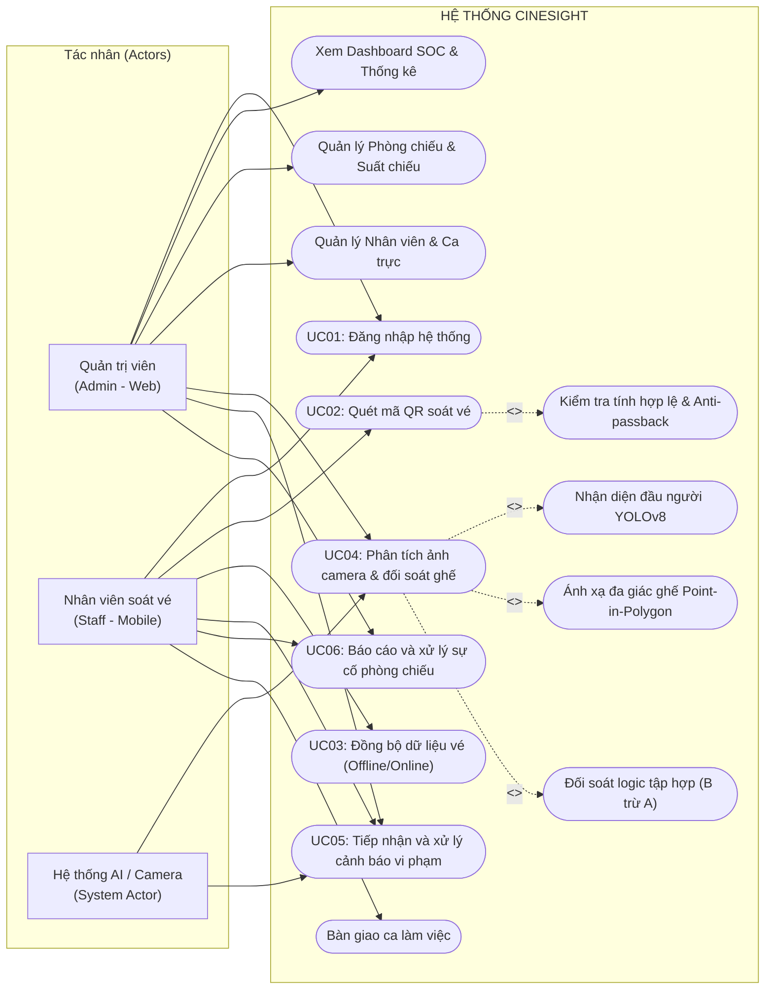
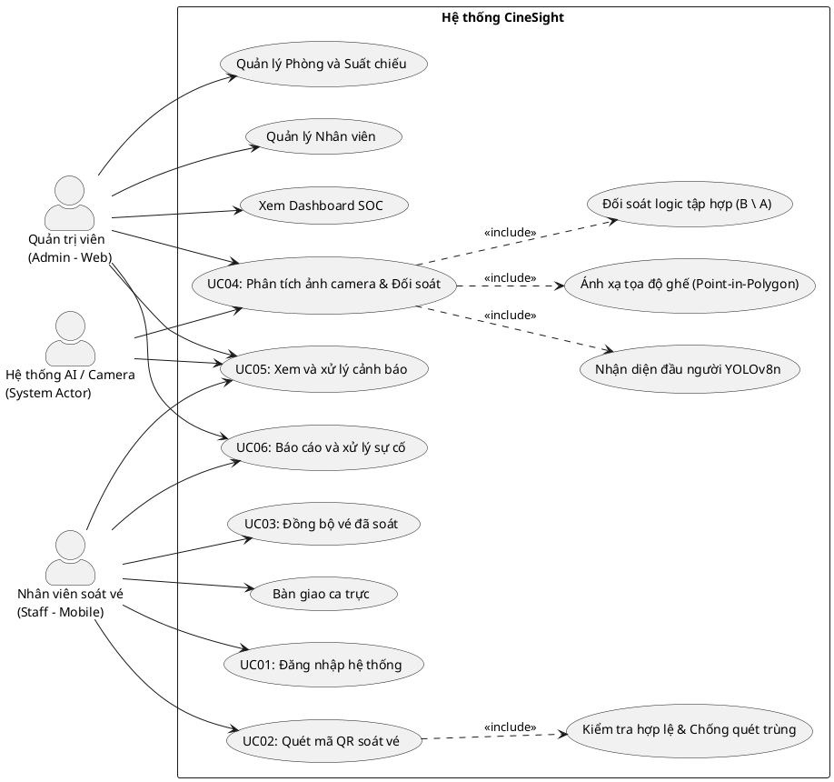

# CHƯƠNG 2: PHÂN TÍCH YÊU CẦU

## 2.1. Khảo sát hiện trạng

Hiện nay, quy trình soát vé và kiểm soát khán giả tại các cụm rạp chiếu phim phần lớn vẫn thực hiện theo phương thức bán thủ công truyền thống: khán giả nhận vé in nhiệt tại quầy hoặc xuất trình mã vé điện tử trên điện thoại, sau đó nhân viên kiểm soát tại cửa phòng chiếu sẽ kiểm tra bằng mắt thường hoặc dùng máy quét mã vạch độc lập để cho khách vào phòng. Đối với việc kiểm đếm số lượng khán giả thực tế bên trong phòng chiếu, nhân viên phải trực tiếp đi vào từng rạp (thường trong điều kiện phòng chiếu tối, phim đã bắt đầu chiếu) để đếm thủ công, sau đó ghi chép và đối chiếu lại với số vé bán ra trên hệ thống quản lý rạp (POS).

Quy trình quản lý thủ công này bộc lộ nhiều khó khăn và rủi ro nghiêm trọng:
1. **Thất thoát doanh thu và hiện tượng gian lận ("xem phim chui"):** Khán giả sau khi vào rạp có thể tự ý di chuyển từ các vị trí ghế thường lên các vị trí ghế VIP trống, hoặc cố tình ở lại phòng chiếu sau khi kết thúc suất chiếu để xem tiếp các suất chiếu sau mà không mua vé.
2. **Khó khăn trong việc kiểm đếm trong điều kiện thiếu sáng:** Phòng chiếu phim có diện tích rộng, bố trí dạng bậc thang dốc và ánh sáng tắt tối khi phim bắt đầu chiếu. Việc nhân viên đi lại đếm từng người gây bất tiện, làm gián đoạn trải nghiệm của khán giả khác và tỷ lệ sai sót số lượng là rất cao.
3. **Quá tải áp lực lên nhân viên vận hành:** Một nhân viên tại cụm rạp thường phải kiêm nhiệm nhiều đầu việc cùng lúc (soát vé tại cửa rạp, hướng dẫn chỗ ngồi, kiểm tra vệ sinh, giám sát an ninh phòng chiếu). Khi lượng khách đông vào các khung giờ cao điểm hoặc dịp lễ Tết, việc kiểm soát vé tại cửa dễ xảy ra tình trạng sót vé, quét trùng hoặc không kịp phát hiện vé sai suất/sai phòng.
4. **Thiếu sự liên thông dữ liệu thời gian thực giữa camera và hệ thống vé:** Các cụm rạp hiện nay đều đã trang bị hệ thống camera an ninh (CCTV) trong phòng chiếu, tuy nhiên camera chỉ đóng vai trò ghi hình thụ động (lưu trữ video để xem lại khi có sự cố). Chưa có cơ chế tự động hóa kết nối giữa luồng hình ảnh camera với cơ sở dữ liệu vé đã soát để phát hiện ngay lập tức các trường hợp bất thường.

Do đó, việc nghiên cứu và xây dựng hệ thống **"CineSight - Hệ thống soát vé và kiểm đếm khán giả rạp chiếu phim ứng dụng thị giác máy tính trên ảnh camera phòng chiếu"** là hoàn toàn cấp thiết, nhằm tự động hóa toàn diện khâu đối soát, tối ưu hóa năng suất vận hành của nhân viên và ngăn chặn triệt để thất thoát doanh thu cho rạp.

---

## 2.2. Yêu cầu chức năng

Dựa trên kiến trúc và phạm vi thực tế của hệ thống CineSight, các yêu cầu chức năng được phân rã chi tiết theo từng tác nhân (Actor) tham gia vào hệ thống như sau:

### 2.2.1. Chức năng của Quản trị viên (Admin - Web Admin)
- **Quản lý người dùng (CRUD Nhân viên):**
  - Thêm mới tài khoản nhân viên soát vé (họ và tên, tên đăng nhập, mật khẩu, số điện thoại, vai trò).
  - Phân công ca làm việc (Ca sáng, Ca chiều, Ca tối) và gán phòng chiếu phụ trách cho từng nhân viên.
  - Chỉnh sửa thông tin cá nhân, cập nhật ca trực hoặc xóa tài khoản nhân viên.
- **Quản lý phòng chiếu (Rooms):**
  - Xem danh sách toàn bộ các phòng chiếu trong cụm rạp kèm theo các thông số cấu hình: tổng số ghế, số hàng, số cột, trạng thái sẵn sàng.
  - Xem sơ đồ ghế 2D trực quan tương ứng với ma trận cấu hình của từng phòng chiếu.
- **Quản lý suất chiếu (Showtimes):**
  - Xem danh mục lịch chiếu phim theo từng ngày và theo từng phòng chiếu.
  - Tạo mới suất chiếu: chọn phim, chọn phòng chiếu, thiết lập thời gian bắt đầu và thời gian kết thúc.
- **Quản lý danh sách vé (Tickets):**
  - Tra cứu và xem danh sách toàn bộ các vé đã được soát hợp lệ tại cổng theo từng phòng chiếu và suất chiếu cụ thể (mã vé, số ghế, loại ghế, thời điểm soát, nhân viên thực hiện).
- **Giám sát và kích hoạt phân tích AI:**
  - Tải ảnh chụp khung hình (snapshot) từ camera CCTV phòng chiếu lên hệ thống.
  - Kích hoạt tiến trình AI phân tích tự động: chạy mô hình nhận diện đầu người, ánh xạ tọa độ vào sơ đồ ghế và thực hiện đối soát tự động với danh sách vé đã quét.
- **Xem báo cáo, thống kê (Dashboard SOC):**
  - Theo dõi các chỉ số vận hành tổng quan theo thời gian thực: tổng số vé đã quét trong ngày, tỷ lệ lấp đầy ghế (Occupancy Rate), tổng số cảnh báo vi phạm an ninh chưa xử lý.
  - Quan sát trạng thái hoạt động tức thời của các phòng chiếu.
- **Quản lý cảnh báo vi phạm (Alerts):**
  - Tiếp nhận danh sách các cảnh báo chênh lệch vé do AI tự động gửi về, phân loại theo các nhóm: Khách lậu / Ngồi sai ghế không vé ($B \setminus A$), Khách vắng mặt ($A \setminus B$), và Cảnh báo vượt tải phòng chiếu (Over-capacity).
  - Xem chi tiết danh sách mã ghế vi phạm kèm ảnh bằng chứng phân tích.
  - Thực hiện thao tác "Đánh dấu đã xử lý" sau khi nhân viên rạp đã xử lý xong tại hiện trường.
- **Quản lý sự cố rạp chiếu (Incidents):**
  - Tiếp nhận các báo cáo sự cố cơ sở vật chất (ghế hỏng/gãy, lỗi điều hòa, rác bẩn) do nhân viên gửi từ ứng dụng di động.
  - Cập nhật trạng thái xử lý sự cố (Đang chờ xử lý $\rightarrow$ Đã khắc phục).

### 2.2.2. Chức năng của Nhân viên soát vé (User / Staff - Mobile App)
- **Đăng nhập và quản lý phiên làm việc:**
  - Đăng nhập vào ứng dụng bằng tài khoản nhân viên (username/password) đã được hệ thống cấp.
  - Xem thông tin ca trực hiện tại và danh sách phòng chiếu được phân công phụ trách.
- **Lựa chọn phòng chiếu và suất chiếu:**
  - Lựa chọn phòng chiếu và suất chiếu sắp diễn ra để chuẩn bị quy trình mở cửa đón khách và soát vé.
- **Quét mã QR soát vé (Scanner):**
  - Kích hoạt camera điện thoại để quét mã vạch / mã QR trên vé của khán giả.
  - Kiểm tra tính hợp lệ của vé ngay tức thì: kiểm tra định dạng vé, đối chiếu đúng phòng chiếu, đúng suất chiếu.
  - Thực hiện cơ chế chống quét trùng vé (Anti-passback): từ chối các mã vé đã được quét trước đó để ngăn chặn hành vi một vé sử dụng cho nhiều người.
- **Lưu trữ ngoại tuyến và đồng bộ dữ liệu (Offline-First):**
  - Tự động lưu trữ cục bộ toàn bộ dữ liệu vé đã quét vào cơ sở dữ liệu nội bộ trên thiết bị (Hive Box), đảm bảo ứng dụng hoạt động thông suốt ngay cả khi rạp bị mất kết nối mạng.
  - Tự động đồng bộ (Auto-sync) toàn bộ danh sách vé hợp lệ lên máy chủ trung tâm ngay khi thiết bị có kết nối mạng Internet.
- **Xem lịch sử soát vé:**
  - Xem danh sách chi tiết các vé đã quét thành công trong ca trực (mã vé, số ghế, giờ quét).
- **Xem sơ đồ ghế phòng chiếu:**
  - Xem trực quan sơ đồ ghế 2D của phòng chiếu để hỗ trợ hướng dẫn vị trí ngồi cho khán giả.
- **Tiếp nhận thông báo và cảnh báo an ninh:**
  - Nhận thông báo chuông/rung và xem chi tiết cảnh báo từ hệ thống AI khi phát hiện có người ngồi ghế không hợp lệ tại phòng chiếu mình đang phụ trách.
- **Báo cáo sự cố phòng chiếu:**
  - Tạo phiếu báo cáo sự cố cơ sở vật chất (chọn loại sự cố, nhập vị trí ghế hỏng, mô tả chi tiết) để chuyển về cho Quản trị viên xử lý.
- **Bàn giao ca trực (Shift Handover):**
  - Thực hiện thao tác tổng kết số lượng vé đã soát, số lượng sự cố phát sinh và bàn giao ca làm việc cho nhân viên ca tiếp theo.

### 2.2.3. Chức năng của Hệ thống AI / Camera (System Actor)
- **Tiếp nhận dữ liệu hình ảnh:** Tiếp nhận ảnh chụp snapshot độ phân giải cao (Full HD 1920x1080) từ camera an ninh góc cao (High-Angle CCTV) của phòng chiếu.
- **Nhận diện đầu người (Head Detection):** Ứng dụng mô hình mạng nơ-ron tích chập YOLOv8n chuyên biệt để phát hiện chính xác vị trí tâm đầu người của toàn bộ khán giả trong điều kiện phòng chiếu tối/ánh sáng hồng ngoại.
- **Ánh xạ tọa độ ghế (Point-in-Polygon):** Áp dụng thuật toán hình học tính toán (Ray Casting) để kiểm tra điểm tâm đầu người $(x, y)$ nằm bên trong vùng đa giác tọa độ của 136 vị trí ghế đã được hiệu chuẩn (Calibration Matrix).
- **Tự động đối soát logic tập hợp (Set Difference):**
  - Xác định tập hợp ghế có người ngồi thực tế ($B$).
  - Truy vấn tập hợp các vé đã được nhân viên soát hợp lệ tại cổng ($A$).
  - Tính toán chênh lệch:
    - Ghế có người ngồi chui không có vé: $B \setminus A$.
    - Ghế đã soát vé nhưng thực tế để trống: $A \setminus B$.
    - Cảnh báo vượt công suất tối đa của phòng chiếu.
- **Tự động sinh và lưu trữ cảnh báo:** Tự động tạo bản ghi cảnh báo vi phạm lưu vào cơ sở dữ liệu máy chủ và phát thông báo tức thời tới Web Admin và Mobile App.

---

## 2.3. Yêu cầu phi chức năng

| Loại yêu cầu | Mô tả chi tiết |
| :--- | :--- |
| **Hiệu năng (Performance)** | - Thời gian thực thi mô hình AI (Inference time) của YOLOv8n trên ảnh Full HD (1920x1080) đạt ~15-25ms trên GPU và < 300ms trên CPU. - Thời gian xử lý API toàn trình `/api/v1/analyze` (từ khi nhận ảnh, chạy AI, ánh xạ đa giác 136 ghế, đối soát DB và lưu cảnh báo) đạt trung bình < 1.5 giây. - Tốc độ giải mã và phản hồi quét vé QR trên ứng dụng Mobile đạt < 100ms (kiểm tra cục bộ tức thì). - Hệ thống máy chủ đáp ứng xử lý đồng thời 50-100 phiên đồng bộ vé từ các thiết bị di động mà không gây nghẽn hàng đợi. |
| **Bảo mật (Security)** | - Cơ sở dữ liệu SQLite quản lý tập trung với ràng buộc toàn vẹn khóa chính và khóa ngoại nghiêm ngặt giữa các bảng: nhân viên, phòng chiếu, suất chiếu, vé, cảnh báo và sự cố. - Áp dụng cơ chế chống gian lận soát vé (Anti-passback): mỗi mã vé là duy nhất cho từng suất chiếu và bị khóa ngay sau lần quét thành công đầu tiên. - Dữ liệu vé lưu tạm trên thiết bị di động được lưu trữ an toàn trong các hộp dữ liệu cô lập của Hive Box. |
| **Khả dụng (Availability & Offline-First)** | - Tính khả dụng cao với kiến trúc Offline-First: Ứng dụng di động tiếp tục cho phép nhân viên quét vé và kiểm tra vé bình thường ngay cả khi mất sóng Wi-Fi/4G; dữ liệu sẽ tự động đẩy lên máy chủ ngay khi có mạng trở lại. - Giao diện Web Admin tương thích chuẩn trên các trình duyệt máy tính phòng điều hành; ứng dụng di động hiển thị trực quan, mượt mà trên hệ điều hành Android. |
| **Độ chính xác (Accuracy)** | - Mô hình YOLOv8n nhận diện đầu người đạt độ chính xác phát hiện mAP@0.5 đạt trên 85% trong môi trường ánh sáng thực tế của phòng chiếu phim. - Thuật toán ánh xạ điểm trong đa giác (Ray Casting Point-in-Polygon) đảm bảo độ chính xác tuyệt đối (100%) về mặt toán học khi xác định tọa độ tâm rơi vào biên ghế. |
| **Khả năng mở rộng (Scalability)** | - Kiến trúc hệ thống phân tách độc lập giữa Tầng trí tuệ nhân tạo (FastAPI AI Service), Tầng điều hành quản trị (React Vite Web Admin), và Tầng nghiệp vụ hiện trường (Flutter Mobile App). - Dễ dàng mở rộng cấu hình sơ đồ ghế cho các phòng chiếu mới (Phòng 1, Phòng 2, Phòng 3...) thông qua việc nạp tệp tọa độ đa giác JSON độc lập mà không cần thay đổi logic mã nguồn cốt lõi. |

*Bảng 2.1. Yêu cầu phi chức năng của hệ thống CineSight*

---

## 2.4. Product Backlog

Danh sách các hạng mục yêu cầu (User Stories) của hệ thống CineSight được tổng hợp, phân loại theo mức độ ưu tiên (MoSCoW) và quản lý theo tiến độ các Sprint:

| ID | User Story | Priority | Points | Sprint | Status |
| :--- | :--- | :--- | :--- | :--- | :--- |
| **US01** | Là Nhân viên, tôi muốn đăng nhập vào ứng dụng mobile bằng tài khoản được cấp để xác định danh tính và ca làm việc. | Must | 3 | Sprint 1 | Done |
| **US02** | Là Nhân viên, tôi muốn chọn phòng chiếu và suất chiếu hiện tại để bắt đầu quy trình soát vé tại cửa phòng. | Must | 2 | Sprint 1 | Done |
| **US03** | Là Nhân viên, tôi muốn quét mã QR trên vé để kiểm tra tính hợp lệ (đúng phòng, đúng suất chiếu, chưa bị quét trùng). | Must | 5 | Sprint 1 | Done |
| **US04** | Là Nhân viên, tôi muốn ứng dụng tự động lưu trữ vé vào bộ nhớ nội bộ (Hive) khi mất mạng và tự động đồng bộ lên máy chủ khi có kết nối trở lại. | Must | 5 | Sprint 2 | Done |
| **US05** | Là Quản trị viên, tôi muốn xem bảng điều khiển (Dashboard) thống kê tổng quan số vé đã soát, tỷ lệ lấp đầy ghế và số lượng cảnh báo vi phạm. | Must | 3 | Sprint 2 | Done |
| **US06** | Là Quản trị viên, tôi muốn quản lý thông tin các phòng chiếu, xem sơ đồ ghế 2D và quản lý lịch các suất chiếu. | Must | 5 | Sprint 2 | Done |
| **US07** | Là Quản trị viên, tôi muốn quản lý thông tin nhân viên soát vé (CRUD) và phân chia ca trực, phòng phụ trách. | Must | 3 | Sprint 2 | Done |
| **US08** | Là Quản trị viên, tôi muốn tải ảnh camera phòng chiếu và bấm nút "Chạy AI" để kích hoạt phân tích đối soát trực tiếp từ Web Admin. | Must | 5 | Sprint 3 | Done |
| **US09** | Là Hệ thống AI, tôi muốn nhận diện vị trí đầu người trong phòng chiếu bằng mô hình YOLOv8n trên ảnh snapshot camera. | Must | 8 | Sprint 3 | Done |
| **US10** | Là Hệ thống AI, tôi muốn ánh xạ tọa độ đầu người vào ma trận đa giác ghế và tự động đối soát logic tập hợp với danh sách vé đã quét để phát hiện khách lậu, vắng khách. | Must | 8 | Sprint 3 | Done |
| **US11** | Là Quản trị viên, tôi muốn xem danh sách cảnh báo vi phạm chi tiết trên Web Admin và đánh dấu xác nhận đã xử lý. | Must | 3 | Sprint 4 | Done |
| **US12** | Là Nhân viên, tôi muốn nhận thông báo cảnh báo tức thời trên điện thoại khi phát hiện có khách ngồi sai ghế/ngồi không vé tại phòng chiếu mình phụ trách. | Must | 3 | Sprint 4 | Done |
| **US13** | Là Nhân viên, tôi muốn gửi báo cáo sự cố cơ sở vật chất (ghế hỏng, điều hòa, vệ sinh) kèm vị trí cụ thể lên hệ thống. | Should | 3 | Sprint 4 | Done |
| **US14** | Là Quản trị viên, tôi muốn theo dõi danh sách và cập nhật trạng thái khắc phục các sự cố rạp do nhân viên báo cáo. | Should | 2 | Sprint 4 | Done |
| **US15** | Là Nhân viên, tôi muốn thực hiện thao tác bàn giao ca làm việc để tổng kết số lượng vé và sự cố cho ca tiếp theo. | Should | 2 | Sprint 4 | Done |

*Bảng 2.2. Product Backlog hệ thống CineSight*

---

## 2.5. Use Case Diagram

Hệ thống bao gồm 3 tác nhân chính:
1. **Quản trị viên (Admin):** Tương tác thông qua ứng dụng Web Admin.
2. **Nhân viên soát vé (Staff / User):** Tương tác thông qua ứng dụng di động Flutter.
3. **Hệ thống AI / Camera (System Actor):** Thực hiện tiến trình phân tích thị giác máy tính và đối soát tự động trên máy chủ backend.

### Sơ đồ Use Case tổng quan (Mermaid Diagram)

*Hình 2.1. Use Case Diagram tổng quan hệ thống CineSight*

### Mã nguồn PlantUML (Dùng để xuất file ảnh chèn vào đồ án tốt nghiệp)

---

## 2.6. Đặc tả Use Case

Phần này mô tả chi tiết 6 Use Case cốt lõi nhất của hệ thống theo đúng cấu trúc chuẩn học thuật.

### 2.6.1. Use Case UC01: Đăng nhập hệ thống

| Thuộc tính | Nội dung mô tả |
| :--- | :--- |
| **Tên Use Case** | **UC01 - Đăng nhập hệ thống** |
| **Actor** | Nhân viên soát vé (Mobile App), Quản trị viên (Web Admin) |
| **Mô tả** | Xác thực danh tính của người dùng để cấp quyền truy cập vào các chức năng tương ứng của hệ thống. |
| **Tiền điều kiện** | Người dùng đã được cấp tài khoản hợp lệ trong cơ sở dữ liệu hệ thống. |
| **Luồng sự kiện chính** | 1. Người dùng mở ứng dụng và nhập Tên đăng nhập (username) và Mật khẩu (password). 2. Người dùng nhấn nút "Đăng nhập". 3. Ứng dụng gửi yêu cầu xác thực đến máy chủ qua API `POST /api/v1/login`. 4. Máy chủ kiểm tra thông tin trong bảng `employees`. 5. Máy chủ xác thực thành công và trả về thông tin nhân viên, vai trò (role), ca làm việc (shift) và phòng phụ trách. 6. Ứng dụng lưu phiên làm việc và chuyển hướng người dùng đến màn hình chính (Dashboard/Home). |
| **Luồng ngoại lệ** | **3a. Thiếu thông tin đầu vào:** Người dùng để trống tên đăng nhập hoặc mật khẩu $\rightarrow$ Ứng dụng hiển thị cảnh báo "Vui lòng nhập đầy đủ thông tin". **4a. Sai tài khoản hoặc mật khẩu:** Máy chủ kiểm tra không khớp $\rightarrow$ Trả về mã lỗi 401 Unauthorized $\rightarrow$ Ứng dụng hiển thị thông báo "Tài khoản hoặc mật khẩu không chính xác". **4b. Mất kết nối máy chủ:** Không thể kết nối tới backend $\rightarrow$ Ứng dụng hiển thị thông báo "Lỗi kết nối máy chủ, vui lòng kiểm tra mạng". |
| **Hậu điều kiện** | Người dùng đăng nhập thành công và truy cập đúng phân quyền của mình. |

*Bảng 2.3. Đặc tả Use Case Đăng nhập hệ thống*

---

### 2.6.2. Use Case UC02: Quét mã QR soát vé

| Thuộc tính | Nội dung mô tả |
| :--- | :--- |
| **Tên Use Case** | **UC02 - Quét mã QR soát vé** |
| **Actor** | Nhân viên soát vé |
| **Mô tả** | Nhân viên sử dụng camera trên ứng dụng di động để quét mã QR vé xem phim của khách tại cửa phòng chiếu, kiểm tra tính hợp lệ và ghi nhận trạng thái đã soát. |
| **Tiền điều kiện** | Nhân viên đã đăng nhập thành công và đã chọn đúng Phòng chiếu, Suất chiếu hiện tại trên ứng dụng. |
| **Luồng sự kiện chính** | 1. Nhân viên mở màn hình Quét vé (Scanner Screen). 2. Hướng camera thiết bị vào mã QR trên vé của khán giả. 3. Ứng dụng tự động nhận diện, trích xuất chuỗi mã hóa và phân tích thông tin vé (Mã vé, Phòng chiếu, Suất chiếu, Số ghế). 4. Ứng dụng kiểm tra tính hợp lệ: đối chiếu phòng chiếu và khung giờ suất chiếu đang chọn. 5. Ứng dụng kiểm tra trùng lặp trong cơ sở dữ liệu ngoại tuyến (Hive Box): xác nhận vé chưa từng được quét. 6. Ứng dụng phát âm thanh xác nhận thành công, hiển thị thông báo "VÉ HỢP LỆ" (màu xanh lá) kèm số ghế, đồng thời lưu bản ghi vé vào bộ nhớ thiết bị. |
| **Luồng ngoại lệ** | **3a. Mã QR không đúng định dạng:** Ứng dụng báo lỗi "Mã vé không hợp lệ". **4a. Vé sai phòng chiếu:** Phòng trên vé khác phòng đang chọn $\rightarrow$ Báo lỗi màu đỏ "SAI PHÒNG CHIẾU" kèm thông tin phòng đúng của vé. **4b. Vé sai suất chiếu:** Giờ chiếu trên vé không khớp với suất chiếu đang diễn ra $\rightarrow$ Báo lỗi "SAI SUẤT CHIẾU". **5a. Vé bị quét trùng (Anti-passback):** Mã vé đã tồn tại trong danh sách vé đã quét $\rightarrow$ Phát chuông cảnh báo vi phạm, hiện thông báo đỏ "CẢNH BÁO: VÉ ĐÃ ĐƯỢC QUÉT TRƯỚC ĐÓ". |
| **Hậu điều kiện** | Vé hợp lệ được ghi nhận trạng thái "Đã quét" trong hệ thống và sẵn sàng để đồng bộ lên máy chủ. |

*Bảng 2.4. Đặc tả Use Case Quét mã QR soát vé*

---

### 2.6.3. Use Case UC03: Đồng bộ vé đã soát lên máy chủ

| Thuộc tính | Nội dung mô tả |
| :--- | :--- |
| **Tên Use Case** | **UC03 - Đồng bộ vé đã soát lên máy chủ** |
| **Actor** | Nhân viên soát vé / Hệ thống Mobile App |
| **Mô tả** | Tự động đồng bộ các bản ghi vé đã quét hợp lệ từ bộ nhớ ngoại tuyến của ứng dụng di động lên cơ sở dữ liệu máy chủ trung tâm. |
| **Tiền điều kiện** | Có ít nhất một vé hợp lệ đã được quét lưu trong Hive Box và thiết bị có kết nối mạng Internet. |
| **Luồng sự kiện chính** | 1. Ngay sau khi quét thành công một vé (hoặc khi nhân viên bấm nút "Đồng bộ vé"), ứng dụng kích hoạt tiến trình đồng bộ ngầm. 2. Ứng dụng đóng gói danh sách vé chưa đồng bộ thành mảng JSON. 3. Ứng dụng gửi yêu cầu qua giao thức HTTP POST tới API `/api/v1/sync_tickets`. 4. Máy chủ nhận payload, kiểm tra ràng buộc và ghi các vé hợp lệ vào bảng `tickets` trong cơ sở dữ liệu SQLite. 5. Máy chủ trả về phản hồi mã 200 OK với thông báo đồng bộ thành công. 6. Ứng dụng di động cập nhật cờ `isSynced = true` cho các vé tương ứng trong bộ nhớ Hive. |
| **Luồng ngoại lệ** | **3a. Thiết bị mất kết nối mạng (Offline):** Ứng dụng ghi nhận trạng thái chờ đồng bộ (`isSynced = false`), lưu trữ an toàn trong Hive và tự động thử lại khi phát hiện kết nối mạng được phục hồi. **4a. Lỗi xung đột dữ liệu trên máy chủ:** Máy chủ từ chối bản ghi trùng lặp và trả về danh sách các vé đã ghi nhận. |
| **Hậu điều kiện** | Dữ liệu vé trên máy chủ trung tâm được cập nhật đầy đủ, tạo cơ sở dữ liệu cho bước đối soát AI. |

*Bảng 2.5. Đặc tả Use Case Đồng bộ vé đã soát lên máy chủ*

---

### 2.6.4. Use Case UC04: Phân tích ảnh camera và đối soát ghế tự động

| Thuộc tính | Nội dung mô tả |
| :--- | :--- |
| **Tên Use Case** | **UC04 - Phân tích ảnh camera và đối soát ghế tự động** |
| **Actor** | Hệ thống AI / Quản trị viên (Admin) |
| **Mô tả** | Phân tích ảnh chụp snapshot camera phòng chiếu bằng mô hình thị giác máy tính, xác định vị trí khán giả ngồi thực tế và đối soát logic tập hợp với danh sách vé đã soát tại cổng. |
| **Tiền điều kiện** | Suất chiếu đã bắt đầu (khoảng 10-15 phút sau giờ chiếu), phòng chiếu đã có tệp cấu hình tọa độ ghế đa giác (`seats_config_roomX.json`) và đã nhận dữ liệu vé đã đồng bộ. |
| **Luồng sự kiện chính** | 1. Quản trị viên chọn phòng chiếu trên Web Admin, tải ảnh chụp snapshot từ camera CCTV và nhấn nút "⚡ Chạy AI" (hoặc hệ thống định thời tự động kích hoạt). 2. Hệ thống gửi ảnh tới API `POST /api/v1/analyze` kèm theo `room_id` và `showtime_id`. 3. Mô hình YOLOv8n nhận diện toàn bộ các vị trí đầu người trong khung hình, trích xuất danh sách tọa độ tâm $(x, y)$. 4. Thuật toán Ray Casting đối chiếu từng tọa độ tâm với danh sách các đa giác ghế trong tệp cấu hình để xác định danh sách các ghế có người ngồi thực tế (**Tập B**). 5. Hệ thống truy vấn cơ sở dữ liệu SQLite lấy danh sách các ghế đã soát vé hợp lệ cho suất chiếu đó (**Tập A**). 6. Hệ thống thực hiện phép trừ đại số tập hợp:    - Xác định ghế ngồi không vé / khách lậu: $B \setminus A$.    - Xác định ghế đã soát vé nhưng không có người ngồi: $A \setminus B$. 7. Hệ thống tự động lưu bản ghi phân tích và sinh cảnh báo vào bảng `alerts`. 8. Trả về kết quả phân tích trực quan lên giao diện Web Admin. |
| **Luồng ngoại lệ** | **2a. Không tìm thấy tệp cấu hình đa giác ghế:** Máy chủ trả về mã lỗi 404 "Không tìm thấy cấu hình ghế cho phòng chiếu". **3a. Ảnh chụp bị mờ hoặc quá tối không nhận diện được:** Mô hình trả về 0 người $\rightarrow$ Hệ thống cảnh báo chất lượng ảnh camera không đạt yêu cầu. |
| **Hậu điều kiện** | Kết quả đối soát và các cảnh báo vi phạm được lưu trữ đầy đủ trong cơ sở dữ liệu hệ thống. |

*Bảng 2.6. Đặc tả Use Case Phân tích ảnh camera và đối soát ghế tự động*

---

### 2.6.5. Use Case UC05: Tiếp nhận và xử lý cảnh báo vi phạm

| Thuộc tính | Nội dung mô tả |
| :--- | :--- |
| **Tên Use Case** | **UC05 - Tiếp nhận và xử lý cảnh báo vi phạm** |
| **Actor** | Quản trị viên (Admin), Nhân viên soát vé (Staff) |
| **Mô tả** | Tiếp nhận các cảnh báo lệch lượng khách do hệ thống AI sinh ra, kiểm tra thực tế và cập nhật trạng thái xử lý vi phạm. |
| **Tiền điều kiện** | Hệ thống AI đã thực hiện xong tiến trình phân tích UC04 và ghi nhận có chênh lệch ghế vi phạm. |
| **Luồng sự kiện chính** | 1. Hệ thống phát tín hiệu cảnh báo: Web Admin hiển thị thẻ cảnh báo nổi bật trên Dashboard/Alerts; ứng dụng di động của nhân viên phụ trách phòng chiếu nhận thông báo âm thanh rung. 2. Quản trị viên hoặc Nhân viên mở xem chi tiết cảnh báo: phòng chiếu, suất chiếu, loại vi phạm (ngồi lậu $B \setminus A$, vắng khách $A \setminus B$), danh sách mã ghế cụ thể. 3. Nhân viên trực tiếp vào phòng chiếu kiểm tra vị trí ghế vi phạm được chỉ định. 4. Sau khi nhắc nhở khán giả về đúng ghế hoặc mời khách mua bổ sung vé, người dùng nhấn nút "Đánh dấu đã xử lý" trên Web Admin (gọi API `POST /api/v1/resolve_alert/{alert_id}`). 5. Máy chủ cập nhật trường `resolved = 1` trong cơ sở dữ liệu. 6. Giao diện chuyển trạng thái cảnh báo sang màu xanh "Đã xử lý". |
| **Luồng ngoại lệ** | **4a. Lỗi kết nối mạng khi xác nhận:** Không thể gọi API cập nhật $\rightarrow$ Hệ thống hiển thị thông báo lỗi "Cập nhật trạng thái thất bại, vui lòng thử lại". |
| **Hậu điều kiện** | Bản ghi cảnh báo được chuyển sang trạng thái đã xử lý hoàn tất, dữ liệu báo cáo SOC được cập nhật tức thời. |

*Bảng 2.7. Đặc tả Use Case Tiếp nhận và xử lý cảnh báo vi phạm*

---

### 2.6.6. Use Case UC06: Báo cáo và xử lý sự cố phòng chiếu

| Thuộc tính | Nội dung mô tả |
| :--- | :--- |
| **Tên Use Case** | **UC06 - Báo cáo và xử lý sự cố phòng chiếu** |
| **Actor** | Nhân viên soát vé (Báo cáo), Quản trị viên (Tiếp nhận & Xử lý) |
| **Mô tả** | Cho phép nhân viên gửi báo cáo về các hư hỏng cơ sở vật chất phát hiện trong phòng chiếu và quản trị viên quản lý tiến độ khắc phục. |
| **Tiền điều kiện** | Nhân viên đã đăng nhập vào ứng dụng di động; Quản trị viên đang truy cập trang Quản lý Sự cố trên Web Admin. |
| **Luồng sự kiện chính** | 1. Nhân viên phát hiện cơ sở vật chất gặp vấn đề (ghế gãy, rách đệm, lỗi điều hòa, rác bẩn). 2. Nhân viên vào mục "Báo cáo sự cố" trên Mobile App. 3. Chọn phòng chiếu, chọn danh mục sự cố (Ghế hỏng, Vệ sinh, Thiết bị), nhập số ghế cụ thể và ghi chú mô tả. 4. Nhân viên nhấn nút "Gửi báo cáo". 5. Ứng dụng gửi dữ liệu qua API `POST /api/v1/incidents` lên máy chủ. 6. Máy chủ lưu bản ghi sự cố vào bảng `incidents` với trạng thái ban đầu là "Chờ xử lý" (Pending). 7. Web Admin nhận thông tin sự cố mới, Quản trị viên điều phối bộ phận kỹ thuật khắc phục. 8. Sau khi khắc phục xong, Quản trị viên nhấn nút "Xác nhận đã khắc phục" (gọi API `POST /api/v1/incidents/{incident_id}/resolve`). 9. Hệ thống chuyển trạng thái sự cố sang "Đã khắc phục" (Resolved). |
| **Luồng ngoại lệ** | **4a. Thiếu trường thông tin bắt buộc:** Nhân viên chưa nhập vị trí hoặc mô tả $\rightarrow$ Ứng dụng nhắc nhở "Vui lòng nhập đầy đủ thông tin sự cố". **5a. Mất kết nối khi gửi:** Báo lỗi kết nối mạng và yêu cầu gửi lại khi có mạng. |
| **Hậu điều kiện** | Sự cố được ghi nhận và theo dõi xuyên suốt vòng đời từ khi phát hiện đến khi được khắc phục triệt để. |

*Bảng 2.8. Đặc tả Use Case Báo cáo và xử lý sự cố phòng chiếu*

