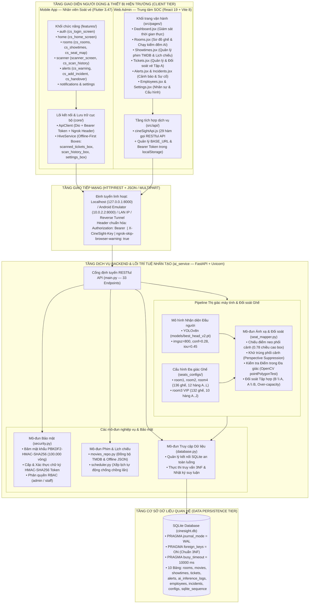
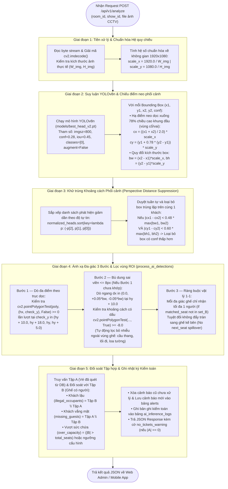
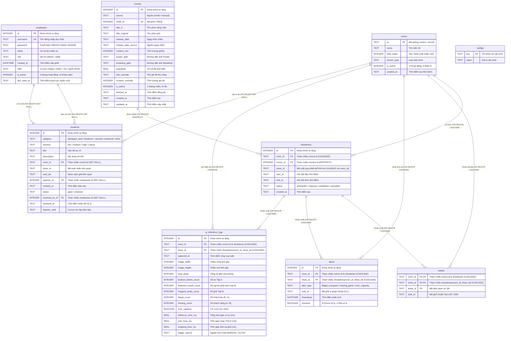
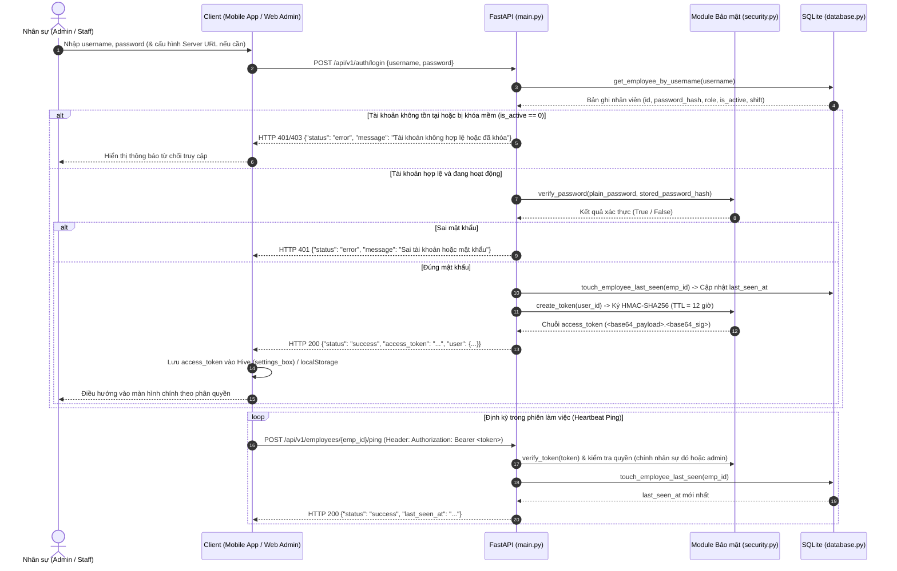
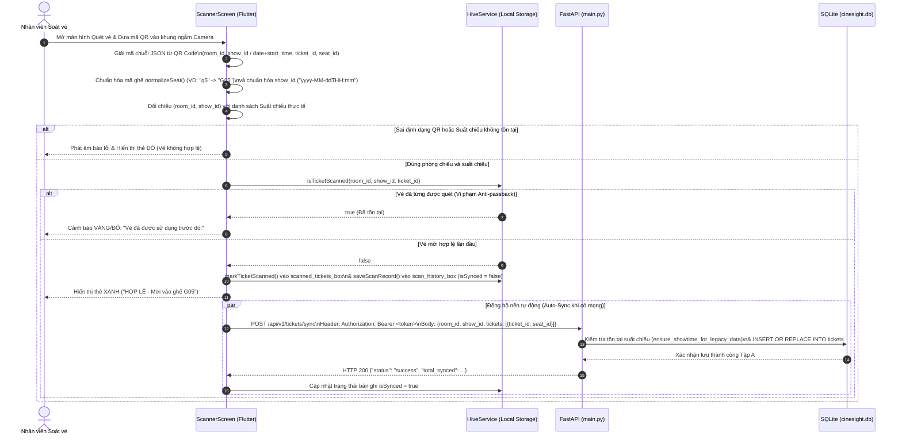
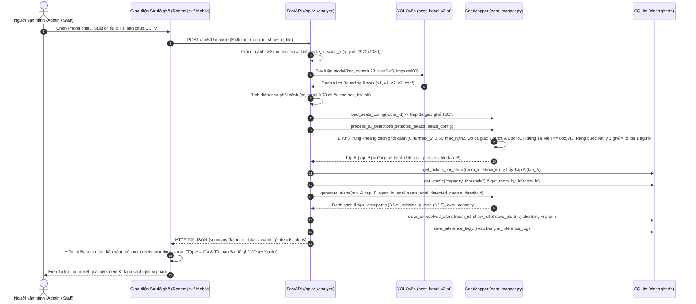
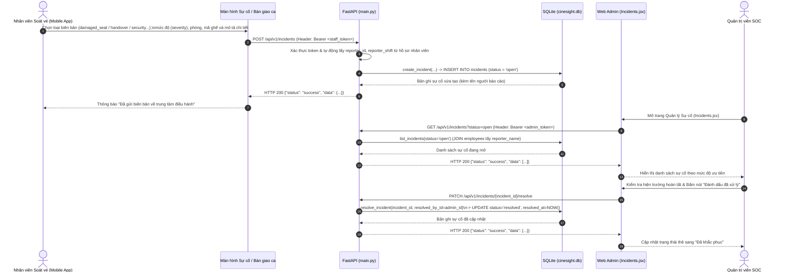

# CHƯƠNG 3: THIẾT KẾ HỆ THỐNG (SYSTEM DESIGN)

Tài liệu này đặc tả toàn diện thiết kế kiến trúc, thuật toán thị giác máy tính, cơ sở dữ liệu quan hệ chuẩn hóa 3NF, luồng tương tác tuần tự, giao diện lập trình ứng dụng (RESTful API) và cơ chế bảo mật – kiểm thử của hệ thống **CineSight** (đồng bộ 100% với trạng thái mã nguồn thực tế ngày `02/11/2026`).

---

## 3.1. Kiến trúc tổng thể hệ thống (System Architecture)

### 3.1.1. Sơ đồ kiến trúc phân tầng và triển khai

Hệ thống **CineSight** được thiết kế theo mô hình kiến trúc Phân tầng Khách – Chủ (Multi-tier Client–Server Architecture), kết hợp giữa **Tác vụ biên ngoại tuyến (Offline-First Edge Computing)** trên thiết bị di động của nhân viên soát vé, **Trung tâm chỉ huy vận hành (Security Operations Center – SOC)** trên nền tảng Web, và **Lõi dịch vụ Trí tuệ nhân tạo hợp nhất (`ai_service`)** vận hành trên nền tảng FastAPI.


*Hình 3.1. Sơ đồ kiến trúc phân tầng tổng thể của hệ thống CineSight*

### 3.1.2. Lý giải các quyết định thiết kế cốt lõi (Design Rationale)


1. **Kiến trúc Backend hợp nhất (`ai_service` Unified Backend):**
   - Thay vì tách rời một máy chủ Web API truyền thống và một máy chủ suy luận AI riêng biệt (vốn làm tăng độ trễ truyền ảnh qua mạng nội bộ và phát sinh bài toán đồng bộ trạng thái giữa hai dịch vụ), CineSight hợp nhất toàn bộ 33 RESTful API nghiệp vụ và pipeline suy luận thị giác máy tính vào một dịch vụ FastAPI duy nhất (`ai_service/main.py`).
   - Khi nhận yêu cầu `POST /api/v1/analyze`, khung hình CCTV được giải mã trực tiếp trên bộ nhớ RAM (`numpy.ndarray`), đưa qua mô hình YOLOv8n đã nạp sẵn (`warm-loaded model`), đối chiếu ngay với tập vé `Tập A` lấy từ SQLite cùng tiến trình và trả kết quả trong thời gian trung bình `< 300 ms`.

2. **Cơ chế phối hợp Offline-First trên Mobile (Hive) và Đọc/Ghi đồng thời không khóa trên Server (SQLite WAL):**
   - **Tại biên di động (`mobile_app`):** Khu vực cửa phòng chiếu thường xuyên chịu suy hao tín hiệu Wi-Fi/4G do kết cấu tường cách âm dày. Ứng dụng Flutter sử dụng cơ sở dữ liệu NoSQL nhúng **Hive** (`hive_service.dart`) với 3 hộp lưu trữ tách biệt (`scanned_tickets_box`, `scan_history_box`, `settings_box`). Khi nhân viên quét mã QR, vé được kiểm tra chống quét trùng (Anti-passback) và ghi nhận tức thì vào bộ nhớ cục bộ (`< 50 ms`), sau đó tự động đồng bộ nền (`POST /api/v1/tickets/sync`) lên máy chủ khi có mạng.
   - **Tại máy chủ trung tâm (`ai_service`):** Để xử lý đồng thời các luồng đồng bộ vé liên tục từ nhiều thiết bị di động cùng lúc với luồng ghi cảnh báo AI và truy vấn Dashboard từ Web Admin, hàm `get_db_connection()` trong `database.py` kích hoạt chế độ **Write-Ahead Logging (`PRAGMA journal_mode = WAL`)**, kết hợp `PRAGMA synchronous = NORMAL` và `PRAGMA busy_timeout = 10000`. Cơ chế WAL cho phép các tác vụ đọc (`SELECT`) và ghi (`INSERT/UPDATE`) diễn ra song song mà không khóa chéo bảng (`database is locked`).

3. **Chiến lược kết nối mạng linh hoạt (Adaptive Network Provisioning):**
   - Hệ thống hỗ trợ chuyển đổi linh hoạt địa chỉ máy chủ (`server_url` / `cinesight_api_url`) ngay trên giao diện đăng nhập và cài đặt của cả Mobile App lẫn Web Admin mà không cần biên dịch lại mã nguồn.
   - Trên Mobile App (`hive_service.dart`), giá trị mặc định được đặt là `http://10.0.2.2:8000` (tương thích tức thì với Android Emulator) và tích hợp bộ lọc tự động khôi phục về mặc định nếu phát hiện URL tunnel cũ không còn hiệu lực. Đồng thời, cả `api_client.dart` và `cineSightApi.js` đều tự động đính kèm header `'ngrok-skip-browser-warning': 'true'`, cho phép triển khai thử nghiệm hiện trường qua Reverse Tunnel hoặc mạng LAN nội bộ hoàn toàn trong suốt.

---

## 3.2. Thiết kế Pipeline Thị giác máy tính & Thuật toán Ánh xạ Ghế (`ai_service`)

Trái tim công nghệ của hệ thống CineSight là pipeline xử lý ảnh CCTV hồng ngoại góc cao và thuật toán ánh xạ tọa độ đầu khán giả vào đa giác ghế 2D. Quy trình này được hiện thực hóa xuyên suốt giữa `ai_service/main.py` và `ai_service/seat_mapper.py` qua 5 giai đoạn chặt chẽ.


*Hình 3.2. Sơ đồ luồng thuật toán nhận diện đầu người, ánh xạ ghế và đối soát tự động*

### 3.2.1. Giai đoạn 1 — Tiền xử lý và Chuẩn hóa hệ quy chiếu ($1920 \times 1080$)

Các bản đồ tọa độ đa giác ghế (`seats_configs/seats_config_room*.json`) được hiệu chuẩn trên hệ quy chiếu chuẩn Full HD ($1920 \times 1080$ pixels). Tuy nhiên, trong thực tế vận hành, ảnh gửi lên từ các nguồn khác nhau (snapshot trích xuất từ đầu ghi NVR, ảnh chụp lại qua ứng dụng di động hoặc ảnh nén qua mạng) có thể có độ phân giải bất kỳ $(W_{\text{img}}, H_{\text{img}})$.

Ngay khi nhận mảng byte ảnh, hệ thống giải mã bằng `cv2.imdecode(np_img, cv2.IMREAD_COLOR)`, kiểm tra tính hợp lệ của ma trận ảnh và tính cặp hệ số tỷ lệ chuẩn hóa:

$$\text{scale}_x = \frac{1920.0}{W_{\text{img}}}, \quad \text{scale}_y = \frac{1080.0}{H_{\text{img}}}$$

Mọi tọa độ phát hiện từ mô hình AI đều được nhân với $(\text{scale}_x, \text{scale}_y)$ trước khi đưa vào bộ ánh xạ hình học, đảm bảo tính bất biến theo độ phân giải ảnh đầu vào (Resolution Invariance).

### 3.2.2. Giai đoạn 2 — Suy luận nhận diện đầu người trên ảnh hồng ngoại (YOLOv8 Head Detection)

1. **Cấu hình tham số suy luận thực tế (`main.py`):**
   - Trọng số mô hình mặc định: `models/best_head_v2.pt` (kiến trúc YOLOv8n tinh chỉnh chuyên biệt trên tập dữ liệu camera hồng ngoại phòng chiếu rạp).
   - Độ phân giải suy luận: `MODEL_IMGSZ = 800` (giữ chi tiết các đầu người kích thước nhỏ khoảng $18 \times 18\text{ px}$ ở các hàng ghế đầu `A, B, C` xa camera).
   - Ngưỡng độ tự tin: `MODEL_CONF = 0.28` (cân bằng tối ưu giữa Precision và Recall, loại bỏ các nhiễu phản quang nhẹ trên thành ghế da).
   - Ngưỡng NMS nội bộ của YOLO: `iou = 0.45`, `classes = [0]` (lớp `head`), `augment = False`.

2. **Công thức Chiếu điểm neo phối cảnh (Perspective-Aware Anchor Projection):**
   - Do camera CCTV trong rạp chiếu phim được lắp đặt ở góc cao phía sau hoặc phía trước màn hình chiếu xuống theo góc nghiêng từ $25^\circ - 40^\circ$, nếu lấy tâm hình học chính giữa khung bao đầu người $(y_1 + 0.5 \times (y_2 - y_1))$, điểm neo của khách ngồi ở hàng ghế dưới (ví dụ hàng `H`) rất dễ bị vọt lên vùng đa giác của lưng ghế hàng phía trên (hàng `G`) do hiện tượng lệch thị sai phối cảnh (Perspective Parallax).
   - Để khắc phục triệt để, hệ thống dịch chuyển điểm neo dọc xuống vị trí **$78\%$ chiều cao khung bao** (tương ứng vùng cổ/vai tiếp giáp trực tiếp với đệm lưng ghế), đồng thời quy đổi chiều rộng và chiều cao khung bao về hệ quy chiếu chuẩn:

$$c_x = \left(\frac{x_1 + x_2}{2.0}\right) \times \text{scale}_x, \quad c_y = \left(y_1 + 0.78 \times (y_2 - y_1)\right) \times \text{scale}_y$$

$$b_w = (x_2 - x_1) \times \text{scale}_x, \quad b_h = (y_2 - y_1) \times \text{scale}_y$$

### 3.2.3. Giai đoạn 3 — Bộ lọc Khử trùng Khoảng cách Phối cảnh (Perspective Distance Suppression)

Trong thực tế xem phim, khán giả thường nghiêng đầu trò chuyện với người ngồi cạnh hoặc cúi đầu sử dụng điện thoại, khiến bộ phát hiện có thể sinh ra 2 khung bao lệch tâm nhẹ trên cùng một người (một khung bao phần tóc/đầu, một khung bao phần mặt/vai) vượt qua ngưỡng IoU chuẩn của YOLO.

Hàm `process_ai_detections` trong `seat_mapper.py` bổ sung tầng lọc **Perspective Distance Suppression** phụ thuộc kích thước khung bao theo phối cảnh:
1. Sắp xếp toàn bộ tập phát hiện `normalized_heads` giảm dần theo độ tự tin `conf`:
   ```python
   normalized_heads.sort(key=lambda p: (-p[2], p[1], p[0]))
   ```
2. Duyệt từng ứng viên `(cx1, cy1, conf1, bw1, bh1)` và so sánh với các điểm đã giữ lại `(cx2, cy2, conf2, bw2, bh2)`. Gọi $\max\_w = \max(b_{w1}, b_{w2})$ và $\max\_h = \max(b_{h1}, b_{h2})$. Hai phát hiện bị coi là nhận diện kép trên cùng một khách và phát hiện có `conf` thấp hơn sẽ bị loại bỏ nếu thỏa mãn đồng thời:

$$|c_{x1} - c_{x2}| < 0.48 \times \max(b_{w1}, b_{w2}) \quad \text{và} \quad |c_{y1} - c_{y2}| < 0.60 \times \max(b_{h1}, b_{h2})$$

*(Trường hợp tương thích ngược khi gọi từ unit test chỉ truyền tọa độ 2 chiều `(cx, cy)` với $b_w = b_h = 0$, bộ lọc áp dụng ngưỡng khoảng cách tuyệt đối $|c_{x1} - c_{x2}| < 12.0\text{ px}$ và $|c_{y1} - c_{y2}| < 12.0\text{ px}$).*

### 3.2.4. Giai đoạn 4 — Thuật toán Ánh xạ Đa giác 3 Bước và Lọc vùng ROI (`process_ai_detections`)

Sau khi khử trùng, mỗi điểm neo `(hx, hy, conf, bw, bh)` được ánh xạ vào bản đồ đa giác ghế `seats_config` thông qua thuật toán 3 bước:

1. **Bước 1 — Dò đa điểm theo trục dọc (Multi-offset Vertical Ray-Casting):**
   - Kiểm tra điểm neo có nằm lọt bên trong đa giác ghế hay không bằng hàm `cv2.pointPolygonTest(poly_np, (hx, check_y), False) >= 0` theo thứ tự ưu tiên độ lệch dọc:
     $$\text{check\_y} \in \{h_y + 10.0,\; h_y + 18.0,\; h_y,\; h_y + 5.0\}$$
   - Việc ưu tiên kiểm tra tại $h_y + 10.0$ và $h_y + 18.0$ giúp kéo điểm neo lọt hẳn vào lòng đệm ghế của đúng hàng ghế mà khách đang ngồi.

2. **Bước 2 — Bù dung sai viền $\le 8\text{ px}$ và Lọc vùng quan tâm (ROI Filter):**
   - Chỉ thực hiện khi Bước 1 chưa tìm được ghế khớp (ví dụ khách tựa đầu hẳn lên tay vịn sát biên đa giác).
   - Hệ thống dò 3 độ lệch ngang $\Delta x \in \{0.0,\; +0.05 \times b_w,\; -0.05 \times b_w\}$ tại tung độ $h_y + 10.0$ trên các ghế chưa có người ngồi, tính khoảng cách Euclid có dấu $d = \text{cv2.pointPolygonTest}(\text{poly\_np}, (h_x + \Delta x, h_y + 10.0), \text{True})$.
   - Chỉ chấp nhận ghế có khoảng cách lớn nhất thỏa mãn **$d \ge -8.0\text{ px}$** (nằm cách viền đa giác tối đa $8\text{ pixels}$).
   - **Tác dụng lọc ROI tự động:** Mọi khung nhận diện nhiễu nằm ở cầu thang, lối đi hai bên, loa treo tường hoặc phản quang màn hình đều có khoảng cách $d \ll -8.0\text{ px}$ nên bị loại bỏ hoàn toàn, không làm sai lệch chỉ số đếm.

3. **Bước 3 — Ràng buộc vật lý 1–1 (One-to-One Physical Seat Constraint):**
   - Mỗi đa giác ghế trong `seats_config` đại diện cho đúng 1 ghế vật lý duy nhất (`1 ghế = tối đa 1 người`).
   - Khi `matched_seat` hợp lệ và chưa tồn tại trong `set_B`, ghế đó được thêm vào `set_B`. Nếu `matched_seat` đã có trong `set_B`, phát hiện dư thừa bị hủy bỏ ngay lập tức, **tuyệt đối không đẩy tràn sang ghế bên cạnh (`next_seat`)**, triệt tiêu hoàn toàn lỗi báo giả ghế trống kế bên có người ngồi.

### 3.2.5. Giai đoạn 5 — Đối soát Tập hợp và Sinh Cảnh báo (`generate_alerts`)

Gọi $A$ (`tap_A`) là tập hợp mã ghế đã được soát vé hợp lệ từ bảng `tickets`, và $B$ (`tap_B`) là tập hợp mã ghế thực tế có người ngồi do thuật toán ở Giai đoạn 4 trả về. Tổng số khán giả hợp lệ trong phòng được đồng bộ thống nhất bằng lực lượng của tập $B$:

$$N_{\text{detected}} = |B|$$

Hệ thống thực hiện phép toán hiệu hai tập hợp (Set Difference):
- **Tập ghế khách ngồi không có vé / ngồi sai ghế (`illegal_occupants`):**
  $$I = B \setminus A = \{s \mid s \in B \text{ và } s \notin A\}$$
- **Tập ghế đã soát vé nhưng vắng khách (`missing_guests`):**
  $$M = A \setminus B = \{s \mid s \in A \text{ và } s \notin B\}$$
- **Cờ cảnh báo vượt sức chứa (`over_capacity`):**
  $$\text{over\_capacity} = \left(N_{\text{detected}} > N_{\text{total\_seats}}\right) \lor \left(\theta_{\text{cap}} > 0 \land |I| \ge \theta_{\text{cap}}\right)$$
  trong đó $N_{\text{total\_seats}}$ là tổng số ghế của phòng và $\theta_{\text{cap}}$ là ngưỡng `capacity_threshold` lưu trong bảng `configs`.
- **Cơ chế cảnh báo chưa đồng bộ vé (`no_tickets_warning`):** Nếu $|A| = 0$, API trả về cờ `no_tickets_warning = true` kèm thông điệp hướng dẫn vận hành để Web Admin hiển thị dải băng cảnh báo màu vàng, giúp người vận hành phân biệt rõ trường hợp *"chưa quét vé Tập A"* với trường hợp *"khách vắng mặt thật"*.

---

## 3.3. Thiết kế Cơ sở dữ liệu (Database Design — Chuẩn 3NF)

Cơ sở dữ liệu trung tâm `ai_service/cinesight.db` được thiết kế tuân thủ nghiêm ngặt **Dạng chuẩn thứ ba (Third Normal Form — 3NF)** trên hệ quản trị SQLite 3, bật ràng buộc khóa ngoại `PRAGMA foreign_keys = ON` trên mọi kết nối.

### 3.3.1. Sơ đồ Thực thể Liên kết (Entity-Relationship Diagram — ERD)


*Hình 3.3. Sơ đồ Thực thể Liên kết (ERD) chuẩn 3NF của cơ sở dữ liệu `cinesight.db`*

### 3.3.2. Từ điển dữ liệu chi tiết (Data Dictionary)

Hệ thống bao gồm **10 bảng** trong `cinesight.db` (9 bảng nghiệp vụ và 1 bảng hệ thống `sqlite_sequence` quản lý bộ đếm `AUTOINCREMENT`).

#### Bảng 3.1. Đặc tả bảng `rooms` (Danh mục Phòng chiếu — 4 bản ghi hiện hành)
| Tên cột | Kiểu dữ liệu | Khóa / Ràng buộc | Mặc định | Giải thích nghiệp vụ |
| :--- | :--- | :--- | :--- | :--- |
| `id` | `TEXT` | `PRIMARY KEY` | — | Mã định danh phòng chiếu (`room1`, `room2`, `room3`, `room4`). |
| `name` | `TEXT` | `NOT NULL` | — | Tên hiển thị của phòng chiếu (VD: *Phòng 01 - IMAX Laser*). |
| `total_seats` | `INTEGER` | `NOT NULL` | `136` | Tổng sức chứa ghế vật lý (`136` cho phòng 1, 2, 4; `132` cho phòng 3). |
| `screen_type` | `TEXT` | `NOT NULL` | `'2D Standard'` | Chuẩn công nghệ chiếu (`IMAX Laser`, `Dolby Atmos`, `4DX Sweetbox`, `2D Standard`). |
| `is_active` | `INTEGER` | `NOT NULL` | `1` | Trạng thái vận hành (`1`: Đang khai thác, `0`: Tạm ngưng/Bảo trì). |
| `created_at` | `TEXT` | `NOT NULL` | — | Thời điểm khởi tạo bản ghi (chuẩn ISO-8601). |

#### Bảng 3.2. Đặc tả bảng `movies` (Danh mục Phim điện ảnh — 25 bản ghi hiện hành)
| Tên cột | Kiểu dữ liệu | Khóa / Ràng buộc | Mặc định | Giải thích nghiệp vụ |
| :--- | :--- | :--- | :--- | :--- |
| `id` | `INTEGER` | `PRIMARY KEY AUTOINCREMENT` | — | Khóa chính nội bộ của phim. |
| `source` | `TEXT` | `NOT NULL` | — | Nguồn dữ liệu (`'tmdb'` hoặc `'manual'`). |
| `tmdb_id` | `INTEGER` | `UNIQUE` (Nullable) | `NULL` | Mã định danh phim trên hệ thống The Movie Database (TMDB). |
| `title_vi` | `TEXT` | `NOT NULL` | — | Tên phim phát hành tại Việt Nam. |
| `title_original` | `TEXT` | `NOT NULL` | — | Tên phim nguyên bản quốc tế. |
| `release_date` | `TEXT` | `NOT NULL` | — | Ngày khởi chiếu (`yyyy-MM-dd`). |
| `release_date_source` | `TEXT` | `NOT NULL` | — | Nguồn ngày khởi chiếu (`VN`, `PRIMARY`, `MANUAL`). |
| `runtime_min` | `INTEGER` | `NOT NULL` | — | Thời lượng phim gốc tính bằng phút (phục vụ tính giờ kết thúc suất chiếu). |
| `poster_path` | `TEXT` | Nullable | `NULL` | Đường dẫn tương đối ảnh Poster trên TMDB (ghép với `https://image.tmdb.org/t/p/w500`). |
| `backdrop_path` | `TEXT` | Nullable | `NULL` | Đường dẫn tương đối ảnh nền Backdrop trên TMDB. |
| `popularity` | `REAL` | Nullable | `0.0` | Điểm độ phổ biến từ TMDB (dùng để ưu tiên phân bổ suất chiếu giờ vàng). |
| `title_override` | `TEXT` | Nullable | `NULL` | Tên phim do Quản trị viên ghi đè thủ công (nếu có). |
| `runtime_override` | `INTEGER` | Nullable | `NULL` | Thời lượng phim do Quản trị viên hiệu chỉnh thủ công. |
| `is_active` | `INTEGER` | `NOT NULL` | `1` | Cờ cho phép đưa phim vào bộ lập lịch tự động (`1`: Có, `0`: Không). |
| `fetched_at` | `TEXT` | `NOT NULL` | — | Thời điểm đồng bộ dữ liệu gần nhất từ TMDB. |
| `created_at` | `TEXT` | `NOT NULL` | — | Thời điểm tạo bản ghi. |
| `updated_at` | `TEXT` | `NOT NULL` | — | Thời điểm cập nhật bản ghi gần nhất. |

#### Bảng 3.3. Đặc tả bảng `showtimes` (Lịch chiếu phim chuẩn 3NF — 423 bản ghi hiện hành)
| Tên cột | Kiểu dữ liệu | Khóa / Ràng buộc | Mặc định | Giải thích nghiệp vụ |
| :--- | :--- | :--- | :--- | :--- |
| `id` | `INTEGER` | `PRIMARY KEY AUTOINCREMENT` | — | Định danh duy nhất của suất chiếu. |
| `room_id` | `TEXT` | `NOT NULL`, `FK -> rooms(id) ON DELETE CASCADE` | — | Phòng chiếu diễn ra suất chiếu; hợp cùng `show_id` tạo khóa `UNIQUE(room_id, show_id)`. |
| `movie_id` | `INTEGER` | `NOT NULL`, `FK -> movies(id) ON DELETE RESTRICT` | — | Phim được chiếu (chặn xóa phim nếu đã có suất chiếu tham chiếu). |
| `show_id` | `TEXT` | `NOT NULL` | — | Mã khung giờ chuẩn hóa `yyyy-MM-ddTHH:mm` (VD: `2026-11-02T19:30`). |
| `start_at` | `TEXT` | `NOT NULL` | — | Thời điểm bắt đầu chiếu (`yyyy-MM-ddTHH:mm:ss`). |
| `end_at` | `TEXT` | `NOT NULL` | — | Thời điểm kết thúc chiếu (tính theo `runtime_min` của phim). |
| `status` | `TEXT` | `NOT NULL` | `'scheduled'` | Trạng thái suất chiếu (`scheduled`, `ongoing`, `completed`, `cancelled`). |
| `created_at` | `TEXT` | `NOT NULL` | — | Thời điểm khởi tạo suất chiếu. |

*(Lưu ý chuẩn hóa 3NF: Các thuộc tính phụ thuộc bắc cầu như `movie_title`, `runtime_min`, `poster_url` không lưu dư thừa trong bảng `showtimes` mà được truy vấn kết nối `JOIN movies m ON m.id = s.movie_id` tại thời điểm đọc).*

#### Bảng 3.4. Đặc tả bảng `tickets` (Danh sách vé đã soát Tập A — 16 bản ghi hiện hành)
| Tên cột | Kiểu dữ liệu | Khóa / Ràng buộc | Mặc định | Giải thích nghiệp vụ |
| :--- | :--- | :--- | :--- | :--- |
| `room_id` | `TEXT` | `PK (1/3)`, `FK -> rooms(id) ON DELETE CASCADE` | — | Mã phòng chiếu của vé. |
| `show_id` | `TEXT` | `PK (2/3)`, `FK (room_id, show_id) -> showtimes(room_id, show_id) ON DELETE CASCADE` | — | Mã suất chiếu của vé. |
| `ticket_id` | `TEXT` | `PK (3/3)`, `NOT NULL` | — | Mã định danh vé duy nhất trích xuất từ QR Code. |
| `seat_id` | `TEXT` | `NOT NULL` | — | Mã ghế chuẩn hóa 3 ký tự (VD: `G05`, `H08`). |

#### Bảng 3.5. Đặc tả bảng `alerts` (Cảnh báo vi phạm AI — 509 bản ghi hiện hành)
| Tên cột | Kiểu dữ liệu | Khóa / Ràng buộc | Mặc định | Giải thích nghiệp vụ |
| :--- | :--- | :--- | :--- | :--- |
| `id` | `INTEGER` | `PRIMARY KEY AUTOINCREMENT` | — | Khóa chính tự tăng của cảnh báo. |
| `room_id` | `TEXT` | `NOT NULL`, `FK -> rooms(id) ON DELETE CASCADE` | — | Phòng chiếu phát sinh cảnh báo. |
| `show_id` | `TEXT` | `NOT NULL`, `FK (room_id, show_id) -> showtimes(room_id, show_id) ON DELETE CASCADE` | — | Suất chiếu phát sinh cảnh báo. |
| `alert_type` | `TEXT` | `NOT NULL` | — | Phân loại: `'illegal_occupant'` ($B \setminus A$), `'missing_guest'` ($A \setminus B$), `'over_capacity'`. |
| `seat_id` | `TEXT` | Nullable | `NULL` | Mã ghế vi phạm cụ thể (hoặc `'ALL'` đối với cảnh báo vượt sức chứa). |
| `timestamp` | `DATETIME` | — | `CURRENT_TIMESTAMP` | Thời điểm hệ thống AI ghi nhận cảnh báo. |
| `resolved` | `BOOLEAN` | — | `0` | Trạng thái xử lý (`0`: Chưa xử lý, `1`: Nhân sự đã kiểm tra & xử lý). |

#### Bảng 3.6. Đặc tả bảng `ai_inference_logs` (Nhật ký kiểm toán suy luận AI — 79 bản ghi hiện hành)
| Tên cột | Kiểu dữ liệu | Khóa / Ràng buộc | Mặc định | Giải thích nghiệp vụ |
| :--- | :--- | :--- | :--- | :--- |
| `id` | `INTEGER` | `PRIMARY KEY AUTOINCREMENT` | — | Mã phiên chạy suy luận AI. |
| `room_id` | `TEXT` | `NOT NULL`, `FK -> rooms(id) ON DELETE CASCADE` | — | Phòng chiếu được phân tích. |
| `show_id` | `TEXT` | `NOT NULL`, `FK (room_id, show_id) -> showtimes(room_id, show_id) ON DELETE CASCADE` | — | Suất chiếu được phân tích. |
| `captured_at` | `TEXT` | `NOT NULL` | — | Thời điểm thực thi suy luận (`yyyy-MM-dd HH:mm:ss`). |
| `image_width` | `INTEGER` | `NOT NULL` | — | Chiều rộng khung hình CCTV đầu vào ($W_{\text{img}}$). |
| `image_height` | `INTEGER` | `NOT NULL` | — | Chiều cao khung hình CCTV đầu vào ($H_{\text{img}}$). |
| `total_seats` | `INTEGER` | `NOT NULL` | — | Tổng số ghế cấu hình của phòng chiếu. |
| `booked_tickets_count` | `INTEGER` | `NOT NULL` | — | Tổng số ghế đã soát vé hợp lệ ($|A|$). |
| `detected_heads_count` | `INTEGER` | `NOT NULL` | — | Số người thực tế hợp lệ trong vùng ghế ($|B|$). |
| `mapped_seats_count` | `INTEGER` | `NOT NULL` | — | Số ghế được ánh xạ thành công ($|B|$). |
| `illegal_count` | `INTEGER` | `NOT NULL` | — | Số lượng ghế có người ngồi không vé ($|B \setminus A|$). |
| `missing_count` | `INTEGER` | `NOT NULL` | — | Số lượng ghế đã soát vé nhưng trống ($|A \setminus B|$). |
| `over_capacity` | `BOOLEAN` | `NOT NULL` | `0` | Cờ báo vượt sức chứa phòng chiếu (`0` / `1`). |
| `inference_time_ms` | `REAL` | `NOT NULL` | — | Tổng thời gian xử lý toàn trình của API `/api/v1/analyze` (ms). |
| `yolo_time_ms` | `REAL` | Nullable | `NULL` | Thời gian riêng của bước suy luận mạng nơ-ron YOLOv8n (ms). |
| `mapping_time_ms` | `REAL` | Nullable | `NULL` | Thời gian riêng của thuật toán ánh xạ đa giác `process_ai_detections` (ms). |
| `trigger_source` | `TEXT` | `NOT NULL` | `'MANUAL'` | Nguồn kích hoạt (`'MANUAL'` từ Web/App hoặc `'AUTO'` từ Camera Client). |

#### Bảng 3.7. Đặc tả bảng `employees` (Nhân sự vận hành — 7 bản ghi hiện hành)
| Tên cột | Kiểu dữ liệu | Khóa / Ràng buộc | Mặc định | Giải thích nghiệp vụ |
| :--- | :--- | :--- | :--- | :--- |
| `id` | `INTEGER` | `PRIMARY KEY AUTOINCREMENT` | — | Mã định danh nhân viên. |
| `username` | `TEXT` | `UNIQUE` | — | Tên đăng nhập hệ thống. |
| `password` | `TEXT` | — | — | Chuỗi mật khẩu đã băm chuẩn `pbkdf2_sha256$100000$<salt>$<hash>`. |
| `name` | `TEXT` | — | — | Họ và tên đầy đủ của nhân sự. |
| `role` | `TEXT` | — | — | Phân quyền hệ thống (`'admin'` hoặc `'staff'`). |
| `created_at` | `DATETIME` | — | `CURRENT_TIMESTAMP` | Ngày cấp phát tài khoản. |
| `shift` | `TEXT` | — | — | Ca trực được phân công (`Ca Sáng`, `Ca Chiều`, `Ca Tối`, `Hành chính`). |
| `is_active` | `INTEGER` | `NOT NULL` | `1` | Trạng thái tài khoản (`1`: Đang hoạt động, `0`: Đã khóa mềm). |
| `last_seen_at` | `TEXT` | Nullable | `NULL` | Thời điểm thiết bị gửi tín hiệu `ping` gần nhất (xác định Online/Offline). |

#### Bảng 3.8. Đặc tả bảng `incidents` (Biên bản sự cố & Bàn giao ca — 4 bản ghi hiện hành)
| Tên cột | Kiểu dữ liệu | Khóa / Ràng buộc | Mặc định | Giải thích nghiệp vụ |
| :--- | :--- | :--- | :--- | :--- |
| `id` | `INTEGER` | `PRIMARY KEY AUTOINCREMENT` | — | Mã biên bản sự cố. |
| `category` | `TEXT` | `NOT NULL` | — | Danh mục (`damaged_seat`, `handover`, `security`, `technical`, `other`). |
| `severity` | `TEXT` | `NOT NULL` | — | Mức độ nghiêm trọng (`low`, `medium`, `high`, `critical`). |
| `title` | `TEXT` | `NOT NULL` | — | Tiêu đề tóm tắt sự cố. |
| `description` | `TEXT` | Nullable | `NULL` | Mô tả hiện trạng chi tiết hoặc nội dung bàn giao ca. |
| `room_id` | `TEXT` | `FK -> rooms(id) ON DELETE SET NULL` | `NULL` | Phòng chiếu xảy ra sự cố. |
| `show_id` | `TEXT` | Nullable | `NULL` | Mã suất chiếu liên quan (nếu có). |
| `seat_ids` | `TEXT` | Nullable | `NULL` | Danh sách mã ghế bị hỏng hoặc gặp sự cố (phân cách bằng dấu phẩy). |
| `reporter_id` | `INTEGER` | `FK -> employees(id) ON DELETE SET NULL` | `NULL` | ID nhân viên lập biên bản (giữ nguyên biên bản nếu xóa nhân viên). |
| `created_at` | `TEXT` | `NOT NULL` | — | Thời điểm tạo biên bản. |
| `status` | `TEXT` | `NOT NULL` | `'open'` | Trạng thái xử lý (`'open'`: Đang mở, `'resolved'`: Đã khắc phục). |
| `resolved_by_id` | `INTEGER` | `FK -> employees(id) ON DELETE SET NULL` | `NULL` | ID người xác nhận hoàn tất xử lý. |
| `resolved_at` | `TEXT` | Nullable | `NULL` | Thời điểm đóng sự cố. |
| `reporter_shift` | `TEXT` | Nullable | `NULL` | Ca trực của nhân viên tại thời điểm báo cáo. |

#### Bảng 3.9. Đặc tả bảng `configs` (Tham số cấu hình toàn cục — 1 bản ghi hiện hành)
| Tên cột | Kiểu dữ liệu | Khóa / Ràng buộc | Mặc định | Giải thích nghiệp vụ |
| :--- | :--- | :--- | :--- | :--- |
| `key` | `TEXT` | `PRIMARY KEY` | — | Khóa cấu hình (hiện tại: `'capacity_threshold'`). |
| `value` | `TEXT` | — | `'0'` | Giá trị tham số cấu hình dưới dạng chuỗi. |

#### Bảng 3.10. Đặc tả bảng hệ thống `sqlite_sequence` (Quản lý bộ đếm khóa tự tăng — 6 bản ghi hiện hành)
| Tên cột | Kiểu dữ liệu | Khóa / Ràng buộc | Mặc định | Giải thích nghiệp vụ |
| :--- | :--- | :--- | :--- | :--- |
| `name` | `TEXT` | Hệ thống SQLite | — | Tên bảng sử dụng `AUTOINCREMENT` (`movies`, `showtimes`, `alerts`, `ai_inference_logs`, `employees`, `incidents`). |
| `seq` | `INTEGER` | Hệ thống SQLite | — | Giá trị khóa chính `id` lớn nhất đã cấp phát cho bảng tương ứng. |

### 3.3.3. Thiết kế Cấu hình Sơ đồ Ghế (`seats_configs/*.json`)

Để tách biệt hoàn toàn hình học không gian của từng phòng chiếu khỏi thuật toán xử lý ảnh, mỗi phòng chiếu được định nghĩa bởi một tệp JSON độc lập trong thư mục `ai_service/seats_configs/`. Mỗi phần tử trong JSON ánh xạ mã ghế chuẩn hóa (dạng `Chữ + 2 chữ số`) tới mảng 4 đỉnh đa giác lồi `[[x1, y1], [x2, y2], [x3, y3], [x4, y4]]` trên hệ tọa độ $1920 \times 1080$:

```json
{
  "G05": [[796, 210], [835, 210], [835, 255], [796, 255]],
  "G06": [[845, 210], [884, 210], [884, 255], [845, 255]]
}
```

| Tệp cấu hình | Phòng áp dụng | Tổng số ghế | Số hàng ghế | Phân bổ số ghế chi tiết theo từng hàng |
| :--- | :--- | :---: | :---: | :--- |
| `seats_config_room1.json` | Phòng 01 (`room1`) | **136 ghế** | 12 hàng (`A..L`) | Hàng `A`: 8 ghế; Hàng `B..J`: 11 ghế/hàng; Hàng `K`: 13 ghế; Hàng `L`: 16 ghế. |
| `seats_config_room2.json` | Phòng 02 (`room2`) | **136 ghế** | 12 hàng (`A..L`) | Hàng `A`: 8 ghế; Hàng `B..J`: 11 ghế/hàng; Hàng `K`: 13 ghế; Hàng `L`: 16 ghế. |
| `seats_config_room3.json` | Phòng 03 (`room3`) | **132 ghế** | 10 hàng (`A..J`) | Hàng `A`: 10 ghế; Hàng `B..I`: 13 ghế/hàng; Hàng `J` (ghế đôi Sweetbox): 18 ghế. |
| `seats_config_room4.json` | Phòng 04 (`room4`) | **136 ghế** | 12 hàng (`A..L`) | Hàng `A`: 8 ghế; Hàng `B..J`: 11 ghế/hàng; Hàng `K`: 13 ghế; Hàng `L`: 16 ghế. |

*Bảng 3.10. So sánh thông số cấu hình đa giác ghế giữa các phòng chiếu*

---

## 3.4. Thiết kế Biểu đồ Tuần tự (Sequence Diagrams) cho các Luồng Nghiệp vụ Chính

### 3.4.1. Luồng 1: Xác thực người dùng, cấp phát HMAC Token và duy trì trạng thái trực tuyến (`Ping`)

Khi Quản trị viên hoặc Nhân viên soát vé đăng nhập, hệ thống kiểm tra trạng thái kích hoạt (`is_active = 1`), đối chiếu mật khẩu băm `PBKDF2-HMAC-SHA256` bằng thuật toán so sánh hằng thời gian (`hmac.compare_digest`), cập nhật dấu thời gian trực tuyến `last_seen_at` và cấp phát `access_token` ký số HMAC-SHA256. Trong suốt phiên làm việc, ứng dụng định kỳ gửi tín hiệu `ping` để báo cáo trạng thái hoạt động về trung tâm SOC.


*Hình 3.4. Biểu đồ tuần tự luồng đăng nhập xác thực và cập nhật trạng thái trực tuyến*

### 3.4.2. Luồng 2: Quét mã QR soát vé Offline-First trên Mobile App và đồng bộ lên Server

Nhân viên tại cửa phòng chiếu sử dụng camera điện thoại quét mã QR trên vé của khách. Ứng dụng đối chiếu ngay với danh sách suất chiếu thực tế đã tải về từ máy chủ, kiểm tra chống quét trùng cục bộ trên Hive (`scanned_tickets_box`), ghi nhận lịch sử quét và tự động đẩy dữ liệu lên `/api/v1/tickets/sync`.


*Hình 3.5. Biểu đồ tuần tự luồng quét mã QR vé Offline-First và đồng bộ Tập A*

### 3.4.3. Luồng 3: Kích hoạt phân tích AI, đối soát tập hợp và hiển thị sơ đồ ghế 2D

Khi Quản trị viên trên Web Admin (`Rooms.jsx`) hoặc Nhân viên trên Mobile App (`cs_seat_map_screen.dart`) tải lên khung hình CCTV để kiểm đếm, máy chủ chạy toàn bộ pipeline 5 giai đoạn, lưu cảnh báo vào bảng `alerts`, ghi nhật ký vào `ai_inference_logs` và trả kết quả để giao diện tô màu trực quan từng ghế trên sơ đồ 2D.


*Hình 3.6. Biểu đồ tuần tự luồng suy luận AI, đối soát tập hợp và hiển thị sơ đồ ghế 2D*

### 3.4.4. Luồng 4: Tạo và xử lý biên bản sự cố vận hành (`Incidents`)

Khi phát hiện ghế hỏng, sự cố kỹ thuật hoặc thực hiện bàn giao ca trực, nhân viên gửi biên bản từ Mobile App lên máy chủ. Quản trị viên trên Web Admin tiếp nhận, điều phối khắc phục và đánh dấu hoàn tất xử lý.


*Hình 3.7. Biểu đồ tuần tự luồng báo cáo và xử lý biên bản sự cố vận hành*

---

## 3.5. Đặc tả Giao tiếp API (RESTful API Specification)

Toàn bộ **33 API Endpoints** trong tệp `ai_service/main.py` được thiết kế theo chuẩn RESTful, trả về dữ liệu định dạng JSON thống nhất (`{"status": "success" | "error", ...}`) và được phân thành **7 nhóm chức năng**.

### Cơ chế kiểm soát truy cập tại tầng Middleware / Helper (`main.py`):
- **`Public`:** Không yêu cầu xác thực (dùng cho kiểm tra kết nối Health Check, đăng nhập và đọc danh mục phòng/lịch chiếu công khai).
- **`Bearer Token (Any Role)`:** Gọi hàm `_require_auth_error(request)` — yêu cầu header `Authorization: Bearer <HMAC_TOKEN>` hợp lệ, tài khoản còn hoạt động (`is_active == 1`), cho phép cả vai trò `admin` và `staff`.
- **`Bearer Token (Admin Only)`:** Gọi hàm `_require_auth_error(request, allowed_roles={"admin"})` — chỉ cho phép Quản trị viên thực thi; trả lỗi `HTTP 403 Forbidden` nếu là `staff`.
- **`_sync_auth_error`:** Cho phép xác thực bằng `Bearer Token` của nhân viên **hoặc** khóa tĩnh `X-CineSight-Key` khớp biến môi trường `CINESIGHT_API_KEY`.
- **`_analyze_auth_error`:** Cho phép xác thực bằng `Bearer Token`, hoặc `X-CineSight-Key`, hoặc kết nối nội bộ từ `localhost` (`127.0.0.1`, `::1`, `testclient`).

### 3.5.1. Nhóm 1: Kiểm tra trạng thái & Xác thực (Health Check & Authentication — 2 Endpoints)
| STT | Method | Đường dẫn (`Path`) | Hàm xử lý | Quyền truy cập | Đặc tả Request / Response chính |
| :---: | :---: | :--- | :--- | :--- | :--- |
| 1 | `GET` | `/` | `health_check` | `Public` | **Resp:** `{"status": "online", "message": "CineSight AI Server đang chạy ổn định!"}` |
| 2 | `POST` | `/api/v1/auth/login` | `login_employee` | `Public` | **Req Body:** `{"username": "...", "password": "..."}`<br>**Resp:** `{"status": "success", "access_token": "<REDACTED>", "token_type": "bearer", "user": {...}}` |

### 3.5.2. Nhóm 2: Quản trị Nhân sự & Trực tuyến (Employee Management — 7 Endpoints)
| STT | Method | Đường dẫn (`Path`) | Hàm xử lý | Quyền truy cập | Đặc tả Request / Response chính |
| :---: | :---: | :--- | :--- | :--- | :--- |
| 3 | `GET` | `/api/v1/employees` | `list_employees` | `Admin Only` | **Query:** `?active_only=false`<br>**Resp:** Danh sách nhân viên kèm cờ `is_online` (tính từ `last_seen_at` trong vòng 15 phút). |
| 4 | `POST` | `/api/v1/employees` | `add_employee` | `Admin Only` | **Req Body:** `{"username", "password", "name", "role", "shift"}`<br>**Resp:** Thông tin nhân viên mới (mật khẩu tự động băm PBKDF2). |
| 5 | `PUT` | `/api/v1/employees/{emp_id}` | `edit_employee` | `Admin Only` | **Req Body:** `{"name", "role", "shift", "password" (tùy chọn), "is_active" (tùy chọn)}`<br>**Resp:** Thông báo cập nhật thành công. |
| 6 | `PUT` | `/api/v1/employees/{emp_id}/password` | `reset_employee_password` | `Admin Only` | **Req Body:** `{"new_password": "..."}` (tối thiểu 4 ký tự)<br>**Resp:** Cấp lại mật khẩu băm mới cho nhân sự. |
| 7 | `PATCH` | `/api/v1/employees/{emp_id}/active` | `toggle_employee_active` | `Admin Only` | **Req Body:** `{"is_active": true | false}`<br>**Resp:** Khóa mềm hoặc mở khóa tài khoản (chặn tự khóa `admin` gốc). |
| 8 | `DELETE` | `/api/v1/employees/{emp_id}` | `remove_employee` | `Admin Only` | **Path:** `emp_id`<br>**Resp:** Xóa tài khoản nhân viên (chặn xóa tài khoản `admin` gốc). |
| 9 | `POST` | `/api/v1/employees/{emp_id}/ping` | `ping_employee` | `Bearer Token` (Chính chủ / `admin`) | **Path:** `emp_id`<br>**Resp:** Cập nhật và trả về `{"status": "success", "last_seen_at": "..."}`. |

### 3.5.3. Nhóm 3: Quản lý Biên bản Sự cố & Bàn giao ca (Incident Management — 4 Endpoints)
| STT | Method | Đường dẫn (`Path`) | Hàm xử lý | Quyền truy cập | Đặc tả Request / Response chính |
| :---: | :---: | :--- | :--- | :--- | :--- |
| 10 | `GET` | `/api/v1/incidents` | `list_incidents_api` | `Bearer Token (Any Role)` | **Query:** `?status=...&category=...&room_id=...&reporter_id=...`<br>**Resp:** Danh sách biên bản sự cố kèm tên người tạo và người xử lý. |
| 11 | `POST` | `/api/v1/incidents` | `create_incident_api` | `Bearer Token (Any Role)` | **Req Body:** `{"category", "severity", "title", "description", "room_id", "show_id", "seat_ids"}`<br>**Resp:** Bản ghi sự cố mới (`HTTP 200`). |
| 12 | `PATCH` | `/api/v1/incidents/{incident_id}/resolve` | `resolve_incident_api` | `Bearer Token (Any Role)` | **Req Body (tùy chọn):** `{"resolved_by_id": ...}`<br>**Resp:** Chuyển trạng thái sự cố sang `'resolved'`. |
| 13 | `DELETE` | `/api/v1/incidents/{incident_id}` | `delete_incident_api` | `Admin Only` | **Path:** `incident_id`<br>**Resp:** Xóa biên bản sự cố khỏi CSDL. |

### 3.5.4. Nhóm 4: Quản lý Cảnh báo Vi phạm AI (Alerts Management — 2 Endpoints)
| STT | Method | Đường dẫn (`Path`) | Hàm xử lý | Quyền truy cập | Đặc tả Request / Response chính |
| :---: | :---: | :--- | :--- | :--- | :--- |
| 14 | `GET` | `/api/v1/alerts` | `list_alerts` | `Bearer Token (Any Role)` | **Query:** `?room_id=...&resolved=true|false`<br>**Resp:** Danh sách cảnh báo (`illegal_occupant`, `missing_guest`, `over_capacity`). |
| 15 | `PUT` | `/api/v1/alerts/{alert_id}/resolve` | `resolve_alert_api` | `Bearer Token (Any Role)` | **Path:** `alert_id`<br>**Resp:** Đánh dấu cảnh báo đã được nhân viên xử lý (`resolved = 1`). |

### 3.5.5. Nhóm 5: Phòng chiếu, Sơ đồ ghế & Cấu hình Hệ thống (Rooms & Configs — 4 Endpoints)
| STT | Method | Đường dẫn (`Path`) | Hàm xử lý | Quyền truy cập | Đặc tả Request / Response chính |
| :---: | :---: | :--- | :--- | :--- | :--- |
| 16 | `GET` | `/api/v1/configs/{key}` | `read_config` | `Bearer Token (Any Role)` | **Path:** `key` (VD: `capacity_threshold`)<br>**Resp:** `{"status": "success", "key": "...", "value": "..."}`. |
| 17 | `PUT` | `/api/v1/configs/{key}` | `write_config` | `Admin Only` | **Req Body:** `{"value": "..."}`<br>**Resp:** Lưu giá trị cấu hình mới vào bảng `configs`. |
| 18 | `GET` | `/api/v1/rooms` | `get_all_rooms` | `Public` | **Query:** `?active_only=true`<br>**Resp:** Danh sách 4 phòng chiếu từ bảng `rooms` kèm thông số ghế thực tế. |
| 19 | `GET` | `/api/v1/rooms/{room_id}/seats-config` | `get_room_seats_config` | `Public` | **Path:** `room_id`<br>**Resp:** Trả về toàn bộ cấu trúc hàng ghế (`rows`, `total_seats`, `seats`) từ `seats_config_{room_id}.json`. |

### 3.5.6. Nhóm 6: Quản lý Phim & Lịch chiếu (Movies & Showtimes — 8 Endpoints)
| STT | Method | Đường dẫn (`Path`) | Hàm xử lý | Quyền truy cập | Đặc tả Request / Response chính |
| :---: | :---: | :--- | :--- | :--- | :--- |
| 20 | `GET` | `/api/v1/movies` | `list_movies_api` | `Public` | **Query:** `?active_only=false`<br>**Resp:** Danh sách phim điện ảnh kèm URL Poster/Backdrop đầy đủ. |
| 21 | `POST` | `/api/v1/movies/sync` | `sync_movies_api` | `Admin Only` | **Req Body:** `{"source": "auto" | "tmdb" | "offline", "pages": 2}`<br>**Resp:** Đồng bộ danh mục phim từ TMDB API hoặc tệp JSON dự phòng. |
| 22 | `PATCH` | `/api/v1/movies/{movie_id}` | `patch_movie_api` | `Admin Only` | **Req Body:** `{"title_override", "runtime_override", "is_active"}`<br>**Resp:** Cập nhật thông tin ghi đè của phim. |
| 23 | `GET` | `/api/v1/showtimes` | `list_showtimes_api` | `Public` | **Query:** `?date=yyyy-MM-dd&room_id=...&movie_id=...`<br>**Resp:** Danh sách suất chiếu (JOIN thông tin phim và phòng chiếu). |
| 24 | `POST` | `/api/v1/showtimes/generate` | `generate_showtimes_api` | `Admin Only` | **Req Body:** `{"start_date", "days", "overwrite", "Buffer_min"}`<br>**Resp:** Tự động sinh lịch chiếu không trùng lặp cho toàn cụm rạp. |
| 25 | `POST` | `/api/v1/showtimes` | `create_showtime_api` | `Admin Only` | **Req Body:** `{"room_id", "movie_id", "date", "start_time", "status"}`<br>**Resp:** Tạo suất chiếu đơn lẻ (kiểm tra chống trùng giờ trong cùng phòng). |
| 26 | `PATCH` | `/api/v1/showtimes/{showtime_id}/status` | `patch_showtime_status_api` | `Admin Only` | **Req Body:** `{"status": "scheduled" | "ongoing" | "completed" | "cancelled"}`<br>**Resp:** Cập nhật trạng thái vận hành của suất chiếu. |
| 27 | `DELETE` | `/api/v1/showtimes/{showtime_id}` | `delete_showtime_api` | `Admin Only` | **Path:** `showtime_id`<br>**Resp:** Xóa suất chiếu (Cascade xóa vé, cảnh báo và log AI thuộc suất đó). |

### 3.5.7. Nhóm 7: Đồng bộ Vé Tập A & Phân tích Thị giác máy tính AI (Tickets & AI Inference — 6 Endpoints)
| STT | Method | Đường dẫn (`Path`) | Hàm xử lý | Quyền truy cập | Đặc tả Request / Response chính |
| :---: | :---: | :--- | :--- | :--- | :--- |
| 28 | `POST` | `/api/v1/tickets/sync` | `sync_tickets` | `_sync_auth_error` | **Req Body:** `{"room_id", "show_id" (hoặc date+start_time), "tickets": [{"ticket_id", "seat_id"}]}`<br>**Resp:** Đồng bộ danh sách vé Tập A vào bảng `tickets`. |
| 29 | `GET` | `/api/v1/tickets` | `list_all_tickets` | `Bearer Token (Any Role)` | **Query:** `?room_id=...&show_id=...`<br>**Resp:** Danh sách chi tiết từng vé đã quét (`room_id`, `show_id`, `ticket_id`, `seat_id`). |
| 30 | `GET` | `/api/v1/tickets/{room_id}` | `get_booked_tickets` | `Bearer Token (Any Role)` | **Query:** `?show_id=...`<br>**Resp:** Mảng các mã ghế đã soát vé hợp lệ (`booked_seats`) của phòng/suất. |
| 31 | `DELETE` | `/api/v1/tickets/{room_id}` | `reset_tickets` | `Admin Only` | **Query:** `?show_id=...`<br>**Resp:** Xóa dữ liệu vé đã quét của phòng (hoặc theo suất chiếu chỉ định). |
| 32 | `POST` | `/api/v1/analyze` | `analyze_With_AI` | `_analyze_auth_error` | **Multipart Form:** `room_id`, `show_id` (hoặc `date`, `start_time`), `file` (ảnh CCTV)<br>**Resp:** Kết quả kiểm đếm `summary` (`total_seats`, `booked_tickets_count`, `detected_people_count`, `empty_seats_count`, `no_tickets_warning`, `verification_note`), `details` (`tap_A`, `tap_B`) và `alerts`. |
| 33 | `GET` | `/api/v1/inference-logs` | `list_inference_logs_api` | `Bearer Token (Any Role)` | **Query:** `?room_id=...&show_id=...&limit=50`<br>**Resp:** Lịch sử các phiên chạy suy luận AI từ bảng `ai_inference_logs`. |

---

## 3.6. Thiết kế Bảo mật & Kiểm thử Hệ thống

### 3.6.1. Cơ chế Bảo mật Đa lớp (`ai_service/security.py` & `database.py`)

1. **Băm mật khẩu chuẩn NIST/OWASP (`PBKDF2-HMAC-SHA256`):**
   - Tuyệt đối không lưu mật khẩu dạng văn bản thuần (plaintext) trong cơ sở dữ liệu.
   - Hàm `hash_password()` trong `security.py` sinh ngẫu nhiên một chuỗi muối mật mã **Salt 16 bytes (128-bit)** bằng `secrets.token_hex(16)` và thực thi thuật toán dẫn xuất khóa `hashlib.pbkdf2_hmac('sha256', ...)` qua **100.000 vòng lặp**.
   - Định dạng lưu trữ chuẩn hóa trong cột `employees.password`:
     ```text
     pbkdf2_sha256$100000$<salt_hex_32_chars>$<derived_key_hex_64_chars>
     ```
   - Hàm `verify_password()` sử dụng phép so sánh hằng thời gian `hmac.compare_digest()` để triệt tiêu hoàn toàn nguy cơ tấn công đo thời gian phản hồi (Timing Side-Channel Attack).

2. **Chữ ký số phiên đăng nhập (`Stateless HMAC-SHA256 Access Token`):**
   - Khi đăng nhập thành công, hàm `create_token(user_id)` tạo cấu trúc dữ liệu tải (payload) gồm `{"sub": user_id, "iat": issued_at, "exp": issued_at + 43200}` (thời hạn mặc định `TOKEN_TTL_HOURS_DEFAULT = 12` giờ), mã hóa `base64url` và ký bằng khóa bí mật 256-bit (đọc từ biến môi trường `CINESIGHT_SECRET` hoặc tệp `.auth_secret` được loại trừ trong `.gitignore`).
   - **Kiểm tra vai trò thời gian thực (Real-time RBAC Lookup):** Token chỉ mang định danh `sub = user_id`. Ở mỗi request gửi lên máy chủ, hàm `_get_authenticated_employee()` giải mã token và **tra cứu lại trạng thái `role`, `is_active` trực tiếp từ bảng `employees`**. Nhờ thiết kế này, ngay khi Quản trị viên đổi vai trò hoặc khóa tài khoản của một nhân viên trên Web Admin, quyền truy cập của token đó bị thu hồi tức khắc mà không cần chờ hết hạn 12 giờ.

3. **Cơ chế Khóa mềm (`Soft Deactivation`) và Bảo toàn Toàn vẹn Lịch sử 3NF:**
   - Khi một nhân viên nghỉ việc hoặc chuyển bộ phận, Quản trị viên sử dụng API `PATCH /api/v1/employees/{emp_id}/active` để chuyển `is_active = 0` (khóa mềm) thay vì xóa cứng.
   - Ngay cả trong trường hợp Quản trị viên thực hiện xóa cứng (`DELETE /api/v1/employees/{emp_id}`), bảng `incidents` được thiết kế khóa ngoại với mệnh đề `ON DELETE SET NULL` trên hai cột `reporter_id` và `resolved_by_id`. Điều này đảm bảo toàn bộ lịch sử biên bản sự cố và bàn giao ca của rạp được lưu giữ nguyên vẹn vĩnh viễn phục vụ công tác kiểm toán.

### 3.6.2. Thiết kế Bộ Kiểm thử Tự động (`ai_service/tests/`)

Hệ thống tích hợp bộ kiểm thử hồi quy tự động viết trên framework `unittest` chuẩn của Python kết hợp `fastapi.testclient.TestClient`, gồm **34 kịch bản kiểm thử (34/34 PASS)** phân bổ trong 4 tệp kiểm thử chuyên biệt:

| Tệp kiểm thử | Số lượng Test Cases | Phạm vi kiểm chứng kỹ thuật |
| :--- | :---: | :--- |
| [`test_api_and_seat_mapper.py`](file:///C:/CineSightApp/ai_service/tests/test_api_and_seat_mapper.py) | **19 tests** | • Kiểm thử đơn vị hàm `normalize_seat`, `to_show_id` và tính hợp lệ của 4 tệp `seats_config_room1..4.json` (136 ghế cho phòng 1, 2, 4 và 132 ghế cho phòng 3).<br>• Kiểm thử thuật toán `process_ai_detections`: ánh xạ điểm rơi trong đa giác, lọc khử trùng phối cảnh (Perspective Distance Suppression), lọc bỏ nhiễu ngoài vùng ghế (ROI Filter `<= 8px`), và đảm bảo ràng buộc `1 ghế = tối đa 1 người` (không tràn sang `next_seat`).<br>• Kiểm thử tích hợp các API xác thực, phân quyền RBAC (`admin` vs `staff`), đồng bộ vé, tạo/xử lý sự cố và nhật ký suy luận. |
| [`test_db_3nf_foreign_keys.py`](file:///C:/CineSightApp/ai_service/tests/test_db_3nf_foreign_keys.py) | **5 tests** | • Kiểm chứng cấu trúc bảng chuẩn 3NF (bảng `showtimes` không chứa cột dư thừa).<br>• Kiểm chứng thực thi khóa ngoại `PRAGMA foreign_keys = ON`: chặn chèn vé/cảnh báo vào phòng không tồn tại (`IntegrityError`), tự động xóa dây chuyền (`ON DELETE CASCADE`) khi xóa suất chiếu, chặn xóa phim đang có lịch chiếu (`ON DELETE RESTRICT`), và tự động gán `NULL` (`ON DELETE SET NULL`) cho biên bản sự cố khi xóa nhân viên. |
| [`test_scheduler.py`](file:///C:/CineSightApp/ai_service/tests/test_scheduler.py) | **6 tests** | • Kiểm thử thuật toán xếp lịch chiếu tự động: làm tròn khung giờ chuẩn 5/15 phút, đảm bảo thời gian nghỉ dọn vệ sinh phòng giữa hai suất chiếu liên tiếp (`buffer_min`), và kiểm tra không có bất kỳ hai suất chiếu nào trong cùng một phòng bị chồng lấn thời gian. |
| [`test_scheduler_db.py`](file:///C:/CineSightApp/ai_service/tests/test_scheduler_db.py) | **4 tests** | • Kiểm thử tích hợp giữa bộ sinh lịch chiếu `scheduler.py` và cơ sở dữ liệu SQLite: lưu trữ bền vững lịch chiếu đa ngày, chế độ giữ nguyên lịch cũ (`overwrite=False`) và chế độ tái tạo lịch (`overwrite=True`). |

*Bảng 3.11. Tổng hợp cấu trúc bộ kiểm thử tự động trong `ai_service/tests/`*
